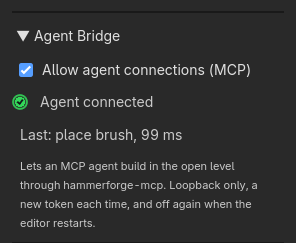

# Agent Bridge (MCP)

The Agent Bridge lets an AI agent that speaks the Model Context Protocol build in
the level you have open in the Godot editor. You ask it for a room, a corridor or
a fix, and it places and changes brushes the way you would, each change one step
in the editor's undo history. Claude Code, Claude Desktop and any other MCP
client that runs a local server over stdio can use it.

It has two parts. The listener is in the HammerForge addon and is off until you
turn it on. The server, `hammerforge-mcp`, is a small Python program your MCP
client starts. It lives in the repository's
[hammerforge_mcp/](https://github.com/saworbit/hammerforge/tree/main/hammerforge_mcp)
folder and is not in the Asset Library download.

The bridge is in the addon from HammerForge 0.4.0. 0.3.2 and earlier do not have
it.

## What it can and cannot do

An agent on the bridge can make a starter level, place, move, turn, resize,
delete and extrude brushes, paint them with palette materials, stand the player
spawn, place, move, retune, wire, unwire and delete lights, sounds, props and
logic entities, make a brush a trigger, a door, a button, a wall, a detail or a
clip brush and wire it, hollow, clip, carve, merge and intersect brushes, snap
them to the grid, build stairs, arches, domes, rings and door frames and change or
detach them, place prefabs from the library and switch and propagate them, mark
out the parts of the level a partial bake takes with cordons, list brushes,
materials, entities and cordons, check the level, take screenshots, bake, and
undo its own steps.

It cannot save your scene, open or delete files, run the game, change project
settings, or reach anything outside the open level. The one file it writes on
its own account is the bake it makes when you ask it to bake. Two more change as
they do for your own edits: a material it applies goes on your Recent row in the
material browser, which is kept in your preferences file, and with region
streaming on, an undo of its paint rewrites the region files that paint is in.

It cannot pick faces or use the selection, so the commands that work on picked
faces or on what is selected stay with you: the UV and texture tools, Apply
Picked Look, Mirror Copy, Offset, Pick Pivot, Grow and Shrink, Apply Rotation
and Scale, and Convert to Brushes. A Trim Run is built along picked wall faces,
so it cannot build or re-pick one; it can change or detach one you built (see
below).

## How it keeps your work safe

- **Off until you say.** You tick a box to turn it on. It is off again every time
  the editor starts.
- **This machine only.** It listens on `127.0.0.1`. A new random token is made
  each time you turn it on, and written to `.godot/hammerforge_mcp/` in your
  project, a folder only your user can read. Git and exports leave `.godot/` out.
- **Every change is one undo step.** Each one is named `MCP: ...` in the editor's
  history, so Ctrl+Z takes it back like any of your own. A change that fails part
  way leaves the level as it was, and one that changes nothing, such as Move to
  Floor on a brush already on the floor, records no step.
- **The agent only undoes its own work.** `hf_undo` takes back the agent's last
  `MCP: ...` step, and refuses once you have touched the level since, even if you
  undid what you did.
- **It stays on the level it was given.** Switch to another scene tab and the
  agent's next change is refused until it looks again with `hf_get_status`.

## Set it up

You need Python 3.10 or newer, and an MCP client.

1. **Install the server.**

    ```bash
    pip install "git+https://github.com/saworbit/hammerforge.git#subdirectory=hammerforge_mcp"
    ```

    That installs the server from `main`, for the addon on `main`. The server
    is versioned with the addon, so with a released HammerForge put its tag
    after `.git`, `@v` and the version in `addons/hammerforge/plugin.cfg`, such
    as `hammerforge.git@v0.4.0#subdirectory=hammerforge_mcp`. Step 3's
    `--check` says when the two are apart, and prints the line to install.
    From a clone of the repository, `pip install ./hammerforge_mcp` does the same.
    With [uv](https://docs.astral.sh/uv/) you can skip installing and let your
    client run `uvx --from "git+https://github.com/saworbit/hammerforge.git#subdirectory=hammerforge_mcp" hammerforge-mcp`.

2. **Turn the bridge on.** Open your project in the Godot editor. In the
   HammerForge dock, open the **Test** tab, then **Agent Bridge**, and tick
   **Allow agent connections (MCP)**. The lamp turns amber and the line beside it
   says which port it listens on.

3. **Check the server can reach it.**

    ```bash
    hammerforge-mcp --check --project /path/to/your/godot/project
    ```

    `--project` is the folder with `project.godot` in it. The check says which
    scene and level the bridge is on, or what is wrong and how to fix it. Then it
    prints the lines to add the server to a client, with the full path of the
    Python it runs under. Use those: a client started from the desktop does not
    read your shell's PATH, so a bare `hammerforge-mcp` may not be found.

4. **Add it to your client.** For Claude Code, run the `claude mcp add` line the
   check printed. It adds the server for you in that folder. If that command will
   not run in your shell, save the JSON block as `.mcp.json` in the project's root
   instead; Claude Code asks you to approve it the first time. It holds your
   machine's paths, so keep it out of git. For
   Claude Desktop, put the JSON block in `claude_desktop_config.json` and restart
   it. Other clients that read an `mcpServers` block take the same one.

The lamp turns green when an agent connects.

## Ask it for something

The server offers three prompts your client can list. In Claude Code they are in
the `/` menu, and arguments follow separated by spaces:
`/mcp__hammerforge__block_out_room 20 12 6` asks for a room 20 m wide, 12 m deep
and 6 m tall.

- **Block out a room** (`block_out_room`, with width, depth and height): floor,
  walls, ceiling, a doorway and the spawn in one undo step. The prompt works out
  every size and centre, so the agent has no arithmetic to get wrong.
- **Review the level** (`review_level`): checks the level, looks at it, and lists
  what to fix, without changing anything.
- **Bake for a playtest** (`bake_for_playtest`): fixes what the check reports,
  bakes, and says how to confirm the game runs that bake.

Plain requests work too. Some that go well:

- "Make a 20 by 12 metre hall, 6 metres tall, with a doorway in each short wall."
- "Put a 2 metre wide ramp from the floor up to the ledge at y 3 on the east side."
- "Paint the floor with the darkest grey in the palette, and the walls with the orange one."
- "Something looks off near the stairs. Take a screenshot there and tell me what."
- "Undo that last change and try it with the walls half a metre thinner."

Say sizes in metres. The agent is told the rest of the conventions.

## Watch what it does



- The **Agent Bridge** lamp is amber while it waits, green with an agent
  connected, and red if it could not start. The line beside it says why, such
  as a token folder it could not close to other users, in which case it writes
  no token at all.
- The line beside the lamp says what is running now, such as "Running: bake".
- The line under it says what the agent last did, such as "Last: place brush,
  14 ms", or why it was refused, such as "Last: undo refused: undo_conflict".
- Each change is in the editor's undo history as `MCP: place brush`,
  `MCP: batch (6 ops)` and so on.
- The server logs one line per call to stderr. `--log-file` writes them to a file
  as well, and `--log-level DEBUG` adds the arguments of each call. The token is
  never logged.

## What the agent can call

| Tool | What it does |
|---|---|
| `hf_get_status` | Which editor, scene and level the bridge is on, the revision, counts, grid and camera |
| `hf_create_starter` | Make a level in the open scene: floor, sun and spawn |
| `hf_place_brush` | Place a brush: shape, size, position, union or subtract, and a name if you want one |
| `hf_transform_brush` | Move a brush to a position, turn it to an angle, or both |
| `hf_resize_brush` | Give a brush a new size about its centre |
| `hf_delete_brush` | Delete a brush |
| `hf_extrude_face` | Add a box on one face of a brush, or a prism of the face when it is not a rectangle, the way the Extrude tool does |
| `hf_assign_material` | Put a palette material on a brush, or on some of its faces |
| `hf_set_spawn` | Stand the player spawn on a floor point, facing a yaw |
| `hf_place_entity` | Place a light, sound, prop or logic entity, with its properties or a preset |
| `hf_transform_entity` | Move an entity, aim it, or both |
| `hf_set_entity_properties` | Change an entity's properties, a brush entity's by its `brush_id`, or apply a preset, checked as placing checks them |
| `hf_delete_entity` | Delete an entity and the wires aimed at it |
| `hf_add_entity_output` | Wire an entity's output to an input on a named target, such as a timer to a light's Toggle, or a trigger to a lamp |
| `hf_remove_entity_output` | Take a wire back by its place in the source's outputs |
| `hf_set_brush_entity` | Make brushes one trigger, door, button, wall, detail or clip brush, with a name to wire to, or untie them |
| `hf_get_cordons` | List the cordons a partial bake is cut to: each one's index, name, corners and switch, and the level's switch for all of them |
| `hf_set_cordon` | Add a cordon round brushes or at a box, or move, rename or switch one by index, or switch every cordon on or off |
| `hf_remove_cordon` | Take a cordon out by index; the level always keeps one |
| `hf_get_brushes` | List brushes with their faces and the structure or prefab copy each is a piece of, filtered by id or by a box |
| `hf_get_materials` | List the level's material palette, by id and name |
| `hf_get_entities` | List the level's point entities, the spawn included, with their properties and wiring; a brush made an entity is listed by `hf_get_brushes` |
| `hf_measure` | Measure brushes, faces, entities and points: sizes and volume, the gap between two (0 when touching, negative when overlapping), the gap along each axis, and the angle between two faces |
| `hf_validate` | List what HammerForge would warn about before a bake, naming the brush each is about |
| `hf_viewport_screenshot` | A picture of the viewport, or a clean one framed on some brushes or a box from a side you choose, or from a camera you place, leaving out brushes or cuts, or showing only the bake |
| `hf_list_commands` | List the palette commands an agent can run, with what each takes and its params, the prefab library's prefabs and the level's paint layers |
| `hf_run_command` | Run a palette command on named brushes: hollow, clip, clip to a face, carve, merge, intersect, snap to grid, build stairs, arches, spiral stairs, domes, rings or door frames, change or detach one, place a prefab from the library, switch or propagate a placed one, move to floor or ceiling, reset rotation; or paint floor by cell: a rectangle painted or erased, its walls raised, a room stamped, a connector between two layers confirmed |
| `hf_batch` | Up to 100 changes as one undo step, all or nothing |
| `hf_bake` | Bake the whole level, or with `cordons: true` only what the cordons take, and write `<scene>_mcp.tscn` with the bake id on its root |
| `hf_undo` | Take back the agent's last step, never anyone else's |
| `hf_redo` | Put back the step `hf_undo` took |

Command replies list a target in `changed` only when its brush data differs after the command. A mixed Move to Floor selection leaves brushes already on the floor out of that list.

Paint replies count filled-bit flips in `cells_changed` separately from material
id changes in `materials_changed`. `heights_changed` counts new or changed
wall-height overrides, including new overrides at the default height. A
material-only paint can record a step with `cells_changed: 0`.

Conventions: Godot's Y-up, metres, world space. `size` is the full extent on each
axis and `position` is the brush's centre. With snapping on, which is the default,
sizes snap to whole grid steps and an unrotated brush's lowest corner lands on the
grid. A face is named by its index, by a world side such as `"+y"`, or by a normal
such as `{"normal": [0, 1, 0]}`.

The tool descriptions carry these too:

- A `wedge`'s tall, vertical face is on -x, and its slope rises toward -x. To face
  a ramp another way, pass `rotation_degrees` to `hf_place_brush`, or turn it after
  with `hf_transform_brush`. `hf_place_brush` also takes a `material` and, for a
  pyramid or a round shape, `sides`: on a sphere, ellipsoid, capsule or torus,
  the segments round it.
- Round shapes stand along Y. A cylinder's `size.y` is its height. A torus lies
  flat, its `size.y` the thickness of its tube.
- A spawn at `yaw_degrees` 0 faces -Z, and a positive yaw turns it toward -X. The
  answer's `spawn.facing` gives the direction.
- `hf_set_spawn` takes where the feet go, and the `suggested_position` and
  `clear_place` in its answer are feet too, so either can be passed straight back.
  Its check finds a floor built from brushes before the first bake as well, and
  judges the whole level, the bake `hf_bake` makes by default, with any cordon
  set aside. With cordons on and the spawn's floor outside them, the spawn is
  valid and `validation.warnings` carries a `partial_bake_floats` warning: a bake
  cut to the cordons would start the player over nothing. `hf_validate` says the
  same.
- With snapping on, a brush whose size is an odd number of half grid steps moves
  off the centre asked for, because its lowest corner snaps. The answer's
  `snapped` is true only when something moved, with `requested` beside what was
  applied. Pass `"snap": false` for a piece that has to sit centred on another,
  such as a ball on a pillar.

### Place, measure, compare

An agent that has placed something should check where it ended up by measuring,
not by reading face lists and doing the sums
([#1649](https://github.com/saworbit/hammerforge/issues/1649)). `hf_measure`
takes brush ids, faces (`{"brush_id": "a", "face": "+y"}`), entities
(`{"entity": "Entities/lamp"}`) and points (`[x, y, z]`), and answers in about a
kilobyte:

- one brush: its bounds, volume and face count; one face: its area, centre and
  normal;
- two items: `gap`, the smallest distance between them, 0 when they touch and
  minus the depth when they overlap; `centre_distance`; and `axis_gaps`, the gap
  along each axis; two faces also give `angle_degrees` and `coplanar`;
- more than two: their bounds and volume together.

So "does the ramp touch the floor?" is `hf_measure` of the ramp and the floor and
a `gap` of 0, and "how wide is the doorway?" is the doorway's own bounds. The gap
between two brushes is exact for any convex shape, turned or not.

## Build for the player

`hf_get_status` gives an agent the playtest player's numbers under `player`, read
from the player's own script. The playtest player Test Level drops in is:

| | |
|---|---|
| Capsule | 0.35 m radius, 1.6 m tall |
| Eye | about 1.8 m above the feet |
| Tallest step it walks up | 0.4 m |
| Jump | about 2.2 m high |
| Steepest slope it walks | 45 degrees |
| Walk, sprint | 6.5 m/s, 10 m/s |

The tool description tells an agent what they mean for stairs, walkways and
doors: risers at most 0.4 m, a parapet below eye height if the player should see
over it, and doorways taller than the player and wider than the capsule.
`hf_validate` checks the first and last against the same numbers: brush stairs
whose risers are over the step, doorways the player does not fit through, and
wedge ramps too steep to walk up, each naming both brushes, at any angle the
pieces are turned together, and a spiral of box steps each turned its own way
([#1095](https://github.com/saworbit/hammerforge/issues/1095)). A stair whose
Collision is Ramp is measured by the ramp the bake lays over it, and a
`func_clip` brush is left out. It does not check
sight lines. A game with its own controller may need other numbers.

## Bake for a playtest

`hf_bake` bakes the whole level, with any cordon set aside as Export Game Scene
sets it aside, and writes `<scene>_mcp.tscn` beside the level's own scene, or
`res://hammerforge_mcp_bake.tscn` for a scene never saved. Each bake
replaces the last. It never touches `<scene>_game.tscn`, the file **Export Game
Scene** writes.

`hf_bake` with `cordons: true` bakes only what the cordons switched on take, as
the dock's **Bake** does, into the same file. Use it to look at or play one part
of a big level. Every point entity still goes in, as **Play Selected Area**
exports them. With cordons off, or every cordon switched off, it is refused
rather than baking the whole level under a partial name. The answer, the file's
`hammerforge_bake` metadata and `hf_get_status`'s `last_bake` say `partial`, and
a partial bake lists the `cordons` it was cut to. Its `warnings` say when the
spawn has no floor among the brushes it took.

The answer gives the bake's `bake_id` and the file's `res://` path. The baked
scene's root carries the same id, so whatever runs it can check it got that bake:

```gdscript
var bake: Dictionary = get_tree().current_scene.get_meta("hammerforge_bake")
print(bake.bake_id, " from revision ", bake.source_revision)
```

To run it and check it at runtime, [gda](https://github.com/aigengame/godot-agent)
starts the game on that scene with `gda daemon start --scene` and the path; the
MCP server's README has the
[steps](https://github.com/saworbit/hammerforge/blob/main/hammerforge_mcp/README.md#hand-a-bake-to-gda).

`hf_get_status` says `bake_current: false` as soon as anything changes the level
after the bake. Bake again before the next run. A whole bake stays current
across `hf_set_cordon` and `hf_remove_cordon`, and their undo and redo, since it
set the cordons aside; a bake cut to the cordons goes stale on any step, and so
does a whole bake on a batch that holds a cordon op among others.

A bake applies the level's pending subtract cuts, and records that first as a
step of the agent's own, `MCP: apply pending cuts`, so `hf_undo` puts the cuts
back to pending and `hf_redo` applies them again. The bake itself is still no
step. The editor's own history holds the same step.

The starter level's floor goes into `<scene>_mcp.tscn` with the level. It is a
large CSG box with collision, top at y = 0, the same one the editor shows and Test
Level runs, so a game loading the file has ground beyond the brushes.

## When something goes wrong

The agent sees each refusal as a code and a message saying what to do. The ones
you are most likely to meet:

| Code | What it means | What to do |
|---|---|---|
| `bridge_off` | The editor is closed, the box is not ticked, or `--project` names another folder | Tick **Allow agent connections (MCP)**. If the editor crashed, open it again and tick the box. Check `--project` is the folder with `project.godot` |
| `bridge_unavailable` | The connection dropped during a call | Check the editor is open and the box still ticked. The agent can retry |
| `auth_failed` | The token in the discovery file is not the open editor's | Two editors open on one project can do this. Close one, then untick and tick the box |
| `unsupported_bridge_version` | The server and the addon are from different versions | Update whichever is older |
| `target_changed` | You switched scene or level since the agent last looked | The agent calls `hf_get_status` and carries on with the open one |
| `no_level` | The open scene has no HammerForge level | Ask for a starter level, or open a scene that has one |
| `undo_conflict`, `redo_conflict` | The step is not the agent's, or you changed the level since | Use the editor's own undo for your work |
| `busy` | Another command is still running | Wait. `hf_get_status` says what and for how long |
| `bake_busy` | A bake is already running | Wait for it to finish |
| `bake_failed`, `export_failed` | The bake did not finish, or its file could not be written | Read the warnings in the answer, and the editor's Output panel |
| `screenshot_unavailable` | The editor has no picture to give | Screenshots need an editor with a window. A headless editor cannot draw |
| `no_bake` | A screenshot asked to show the bake, and the level has none | The agent bakes first with `hf_bake` |
| `timeout` | No answer in time | The editor may still be working. The answer gives an `operation_id`; the same change sent with it returns the first answer instead of running twice |
| `internal_error` | A script error in the editor | See the Output panel, and report it with what you asked for |

`hammerforge-mcp --check` is the quickest way to see whether the server can
reach the editor at all. It connects beside a working agent, not in its place,
and can only read status, so it is safe to run while an agent builds.

## Limits

| What | Limit |
|---|---|
| One request | 1 MiB |
| One answer | 16 MiB |
| Changes in one `hf_batch` | 100 |
| Brushes in one `hf_get_brushes` answer | 2000 (200 unless asked) |
| Screenshot size | 64 to 1920 wide, 64 to 1080 tall (1280 by 720 unless asked) |
| Brushes one screenshot leaves out | 1000 |
| One extrude | 256 m |
| Positions and sizes | 100000 m on each axis |
| An `operation_id` | 128 characters of `A-Z a-z 0-9 . _ : -` |
| Answers kept for retries | the last 256 changes that went through |
| Time before the server gives up | 15 s for status, 60 s for validate and screenshots, 900 s for a bake, 30 s for the rest |

Your client may stop waiting sooner than the server does. A long bake still
finishes in the editor, and `hf_get_status` says when it has.

## Known limits

- A screenshot needs an editor with a window. A headless editor answers
  `screenshot_unavailable` straight away.
- After the agent's `hf_undo`, the editor's Ctrl+Shift+Z may not redo that step.
  Use `hf_redo`, or the editor's History dock
  ([#1028](https://github.com/saworbit/hammerforge/issues/1028)). The dock's own
  Undo button has the same limit.
- One level per scene.
- The agent's cordons decide what the dock's **Bake** takes. `hf_bake` bakes the
  whole level, as Export Game Scene does, unless it is asked for `cordons: true`.
  A cordon given a place by `hf_set_cordon` switches cordons on, as **Add from
  Selection** does, unless the call says `enabled: false`. On a level whose only
  cordon is the untouched default round the origin, it takes that cordon's place,
  as **Set from Selection** does, rather than adding one beside it.
- `place_prefab` places from the project's prefab library, `res://prefabs`, by
  the file's name, exactly where it is told: it does not snap as a drop does.
  Saving a prefab stays with you.
- A palette command run by the agent names its brushes; it never acts on what
  is selected in the editor. Saving a prefab and Push to Source stay with you:
  they write files no undo step takes back.
- Floor paint is painted by cell: `paint_ramp` fills or erases a rectangle of
  cells, `[x, z]` on the layer's grid, `paint_raise` sets the height of the
  walls round painted cells, `paint_room` stamps a room from a corner and a
  size, and `paint_confirm_connector` keeps a ramp or stairs where a painted
  cell meets another layer's. Each names its layer by index or name, or takes
  the layer the Paint tab has active, and `hf_list_commands` lists the layers.
  Brush, Line, Bucket and Blend strokes, the mirror axes and inference cleanup
  stay with you; so does the Paint tab's choice of layer.
  With region streaming enabled, each paint command loads the regions it
  writes before it checks them, so paint streamed out to disk counts and
  `hf_undo` puts it back as it was
  ([#1502](https://github.com/saworbit/hammerforge/issues/1502)).
- `update_structure` rebuilds a structure the way the dock's Update does, but
  asks nothing first. Where the dock warns that painted faces will go, or that
  the pieces no longer agree where the structure is, the agent's answer lists
  what went (`appearance_dropped`, `edits_replaced`, `warnings`), and `hf_undo`
  puts it back. Every piece gets a new `brush_id`; the structure keeps its
  `generator_id`. Settings the structure already has, with no piece edited,
  moved on its own or deleted, rebuild nothing: every piece keeps its
  `brush_id` and the answer has `no_change: true`. An unchanged structure update records no undo step and keeps the revision. The next undo still takes back the preceding change.
  A Trim Run built in the dock can be changed this way too: it rebuilds along the
  walls it was built along. `hf_list_commands` gives no settings for it, since it
  is not a type `create_structure` builds, so read its settings from the
  structure `hf_get_brushes` names.
- A plain screenshot is the editor's own view, with its grid, axis lines and
  selection over the level. A focused or camera shot draws without them. The
  brushes still draw as the editor shows them, see-through, unless the shot asks
  for `show: "baked"`, which draws the last bake instead.
- `hf_get_status` answers as soon as the editor reads it, but a bake holds the
  editor while it builds the level's mesh, so a status sent then waits until the
  bake next lets a frame go by.
- `hf_get_status` gives the counts from the last `hf_validate`, with
  `validation_revision`, the revision it ran at. When that is behind `revision`,
  call `hf_validate` for current ones.
- A change a script makes without the undo history does not move the revision,
  so the agent cannot tell it happened.

