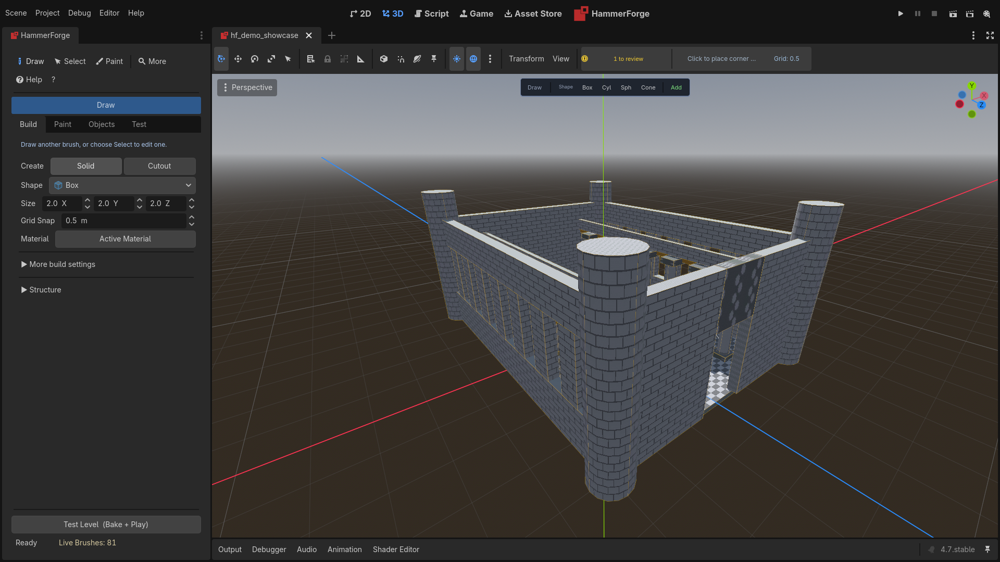

# HammerForge Install + Upgrade

Last updated: October 22, 2026

This guide covers installing, upgrading, and recovering HammerForge for Godot 4.7+.

## Requirements

- Godot Engine 4.7 stable or newer.
- A 3D scene in your project to host `LevelRoot`.

## Get HammerForge

Three ways, and all of them end with `addons/hammerforge` in your project:

- Inside Godot: open **AssetLib**, search for HammerForge, and press **Install**.
- From the [releases page](https://github.com/saworbit/hammerforge/releases): `hammerforge-<version>-addon.zip` is the plugin on its own and extracts straight into a project. `hammerforge-<version>.zip` is the same plugin with `LICENSE`, `README.md` and `.gitignore` beside it.
- From a clone of this repository: copy `addons/hammerforge` out of it.

## Install HammerForge

1. Copy `addons/hammerforge` into your project.
2. Enable **HammerForge** in **Project → Project Settings → Plugins**.
3. Open any 3D scene. In the empty-state banner, choose **Create Starter** for a floor, sunlight, and player spawn, or **Create Empty** for only `LevelRoot`.
4. Verify **HammerForge** appears in the main-screen switcher at the top of the editor, beside **2D**, **3D** and **Script**, wearing the HammerForge mark. Opening it shows the Console.
5. Verify the left dock is titled **HammerForge** and shows **Build**, **Paint**, **Objects**, and **Test**, with **Draw**, **Select**, **Paint**, **More**, and **Help** in the primary toolbar.
6. Draw a brush, then use **Test → Test Level (Bake + Play)** to verify the complete workflow.

In a new 3D scene with nothing in it yet, a left-click with Draw active also creates an empty root. A scene that already has nodes in it is left alone until you create a level from the banner. Camera navigation, right-clicks, and other passive viewport input do not modify the scene.

## Upgrade

1. Close Godot.
2. Back up your project, including `.hflevel` and `.hfprefab` files.
3. Replace the existing `addons/hammerforge` folder with the new version. Your own data lives outside it and is kept: brush presets, structure presets and the project's bake profiles in `res://hammerforge_presets/`, prefabs in `res://prefabs/`, custom tools in `res://hammerforge_tools/` and entity definitions in `res://hammerforge_entities.json`. Upgrading from 0.3.2 or earlier, brush presets are still inside the addon folder: move `addons/hammerforge/presets/` to `res://hammerforge_presets/` before you replace it. An install that copies over the top, as the Asset Library does, leaves that folder in place, and the new version moves the presets across on first load.
4. Reopen the project and re-enable the plugin if prompted.
5. Open a level and run **Test → Check Only**, followed by **Test Level**, to verify validation, bake, and play.

## Cache Reset (Recovery)

If the plugin fails to load, the dock is missing, or tools behave incorrectly:

1. Close Godot.
2. Delete the project cache folder `.godot/editor`.
3. Reopen the project and enable the plugin again.
4. If resources still look stale, delete `.godot/imported` and reopen.

## Compatibility Notes

- HammerForge targets Godot 4.7+.
- New `.hflevel` fields are backward compatible; missing keys fall back to defaults. A brush saved before smoothing groups bakes flat, as it did; set a Smoothing group on its faces to shade it round.
- Since October 2026 a round brush cut on the CSG path bakes with its own faces, the segments it shows, where it used to bake as Godot's primitive at Godot's counts. A level with a cut through a sphere or a cylinder bakes a little differently after an upgrade.
- A custom keymap that binds a key HammerForge takes ahead of the keymap (the command palette's F1, Shift+? and Ctrl+K, Escape, or a nudge key) is warned about when it loads, naming the key, because that binding never ran.
- `.glb` export requires a successful bake first.
- The agent bridge (MCP) is optional and off until you turn it on in the Test tab; see [hammerforge_mcp](https://github.com/saworbit/hammerforge/tree/main/hammerforge_mcp). No third-party editor bridge is vendored, and none is required to use HammerForge.

## Migration Checklist

1. Back up the project and authored level/prefab files.
2. Open a level and run **Test → Check Only**; apply offered fixes deliberately.
3. Save the level to persist newly introduced fields.
4. Run **Bake Only** and **Test Level** to confirm geometry and runtime behavior.
5. Export a `.glb` if your downstream pipeline depends on it.
