# HammerForge User Guide

Last updated: October 18, 2026

This guide covers the current HammerForge workflow in Godot 4.7: brush-based greyboxing, bake, entities, floor paint, and per-face materials/UVs.

## Quick Start
1. Enable the plugin: Project -> Project Settings -> Plugins -> HammerForge.
2. Open any 3D scene. **HammerForge** now appears in the main-screen switcher at the top of the editor, beside 2D, 3D and Script, and the left dock is titled **HammerForge**.
3. In the empty-state banner, click **Create Starter** to add a `LevelRoot`, floor, sunlight, and player spawn. Use **Create Empty** when you want only the root.
4. In **Build**, choose **Draw** and drag in the viewport to set the base; click again to set the height.
5. Open **Test** and click **Test Level (Bake + Play)**. HammerForge checks the spawn, bakes, and launches the playtest.

If anything is not behaving, open the **Console** (the HammerForge entry in the switcher) and read the Status board. It is the fastest way to find out what is wrong and what fixes it.

## World Scale

**One world unit is one metre.** That is the convention Godot's own 3D physics uses,
and it is the one the project's `physics/3d/default_gravity` of 9.8 already assumed.
Every size in this guide and every SpinBox in the dock is in metres.

The numbers that make it concrete:

| | in metres |
|---|---|
| The playtest player, standing | 1.6 |
| The playtest player, crouched | 0.9 |
| Player width | 0.7 |
| Default grid snap | 0.5 |
| Default brush | 2 x 2 x 2 |
| Highest ledge the player can jump onto | about 2.1 |

So a default brush is a little taller than a person, a room is eight to twelve metres
across, and a doorway is about two metres high and one wide. If you are coming from
Hammer, Radiant or TrenchBroom, divide the numbers you know by about 45: a 128-unit
Quake room height is roughly 3 m.

Earlier versions drew on a Quake-family grid: a 16 unit snap and a 32 unit brush,
while the player and the shipped examples were already metres. A default brush was
twenty player heights tall. Levels saved before this change keep the grid and sizes
they were built with, because those are stored on the `LevelRoot`; only the defaults
for a new level moved.

## HammerForge Console

Open it from **HammerForge** in the main-screen switcher. The overall lamp also sits in the 3D viewport toolbar while you build; clicking it opens the Console.

Three tabs.

### Status

Eight checks, each a red / amber / green lamp with what was measured, what it means, and the one button that resolves it.

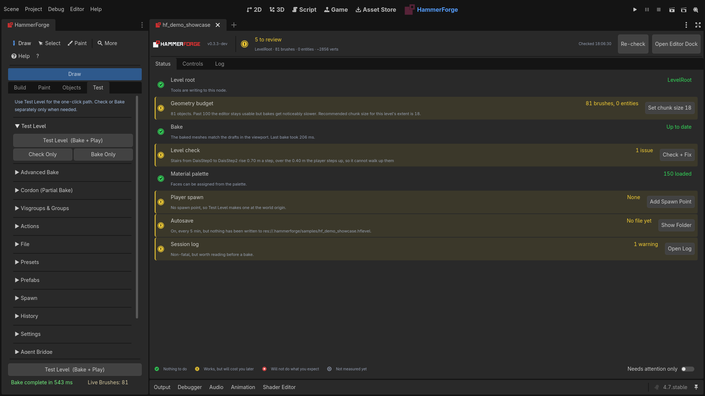

| Check | Green | Amber | Red |
|---|---|---|---|
| **Level root** | A `LevelRoot` is in the open scene | — | No `LevelRoot`, so every tool is inert — *Create Starter Level* |
| **Geometry budget** | 100 brushes + entities or fewer | Above 100; an edit takes longer than a frame to settle | Above 1,000; every edit pauses the editor ([measured](HammerForge_Performance.md#editing)) |
| **Bake** | Baked meshes match the drafts | Never baked, or brushes edited since — *Bake Now* | — |
| **Level check** | Scanned, no faults | 1–5 issues — *Check + Fix* | 6 or more |
| **Material palette** | Every slot loaded | Empty (fine for greyboxing), or some slots did not resolve — *Load Palette* | No slot resolved, or empty **and** face-material bake is on |
| **Player spawn** | At least one spawn point | None, so Test Level makes one at the origin — *Add Spawn Point* | — |
| **Autosave** | On, and a snapshot exists | Off, or nothing written yet — *Turn On* | — |
| **Session log** | No warnings | Warnings this session — *Open Log* | Errors this session |

A grey lamp means **not measured yet** — usually because no level is open. It is not a fault.

After an editor session that did not close cleanly, a **Did not close cleanly** row comes first, with **Open Folder**, **Copy Report** and **Dismiss**. See [When the editor crashes](#when-the-editor-crashes).

When a newer HammerForge is on the Asset Library, a grey line at the top says so, such as "HammerForge 0.4.2 is out", with **What's New**, **Skip This Version** and **Later**. It never downloads anything, and grey never colours the headline. See [Upgrade](HammerForge_Install_Upgrade.md#upgrade) ([#1656](https://github.com/saworbit/hammerforge/issues/1656)).

A level with notes in it gets a grey **Notes** row, counting the open ones by kind, with **Show Notes**. See [Notes](#notes).

Every lamp carries a shape as well as a colour (tick, exclamation, cross, dash), so the board reads the same with a red/green colour deficiency. Hover any row for the thresholds behind it. **Needs attention only** hides the checks that are already fine.

The header carries the overall lamp, the live scope line (`Arena · 74 brushes · 9 entities · ~3120 verts · 256 KiB paint`), and when the board was last checked.

**Report a Problem** in the header asks what happened, what you expected and how to get there, all optional, and opens the bug form in your browser filled in with them and with what the editor knows: the HammerForge and Godot versions, the system, the renderer and graphics adapter, and, if you leave them ticked, the level's counts, the tool in use, the last 10 undo steps, what a level check finds and the last 50 HammerForge log lines. After a crash, the crash report goes in its own field. Paths are cut down to `res://`, `user://` and `~`. A report too long for a link opens the form with the title and versions, and puts the whole report on your clipboard to paste. **Save a viewport screenshot** writes one to `user://hammerforge/reports` and opens that folder, so you can drag it into the form. Nothing is sent until you submit the form yourself ([#1655](https://github.com/saworbit/hammerforge/issues/1655)). Counts refresh once a second while the Console is open; the two measurements that walk the whole level refresh on a slower beat or when you press **Re-check**.

### Controls

Every HammerForge switch on one screen, grouped by what it affects:

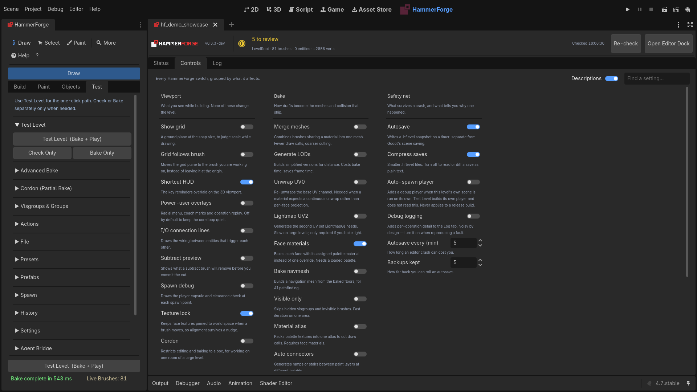

- **Viewport** — show grid, grid follows cursor, shortcut HUD, power-user overlays, size at cursor, draw hover preview, show selection size, I/O connection lines, subtract preview, spawn debug, texture lock, cordon
- **Bake** — merge meshes, LODs, unwrap UV0, lightmap UV2, face materials, navmesh (cell size and height, agent height, radius, climb and slope), visible only, material atlas, auto connectors, wire I/O, occluders, worker threads, freeze on commit, chunk size
- **Safety net** — autosave (with interval and backups kept), compress saves, auto-spawn player (off by default; adds a debug player when this level's own scene is run on its own, never in a release build), check for a newer HammerForge (once a day, from the Asset Library, see [Upgrade](HammerForge_Install_Upgrade.md#upgrade)), debug logging

Each switch is captioned with what it does, and **Find a setting** searches those captions as well as the names, so "pathfinding" finds *Bake navmesh*. Turn **Descriptions** off to fit more on screen; the text stays on the tooltips. A switch with nowhere to write — no level open — is disabled rather than shown at a made-up default.

These are the same settings as **Test → Settings** and **Test → Advanced Bake** in the dock. The Console writes through the dock's own controls, so the two always agree.

### Log

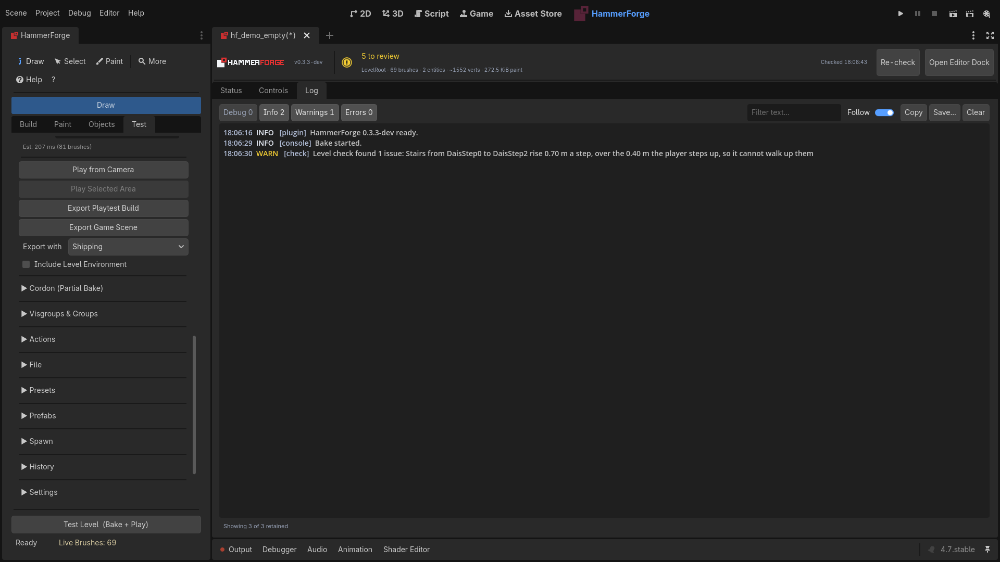


HammerForge's own messages, separate from Godot's Output panel where every addon's output is mixed together. The level buttons show how many of each arrived this session and double as the filter — click **Errors 2** to see just those two. **Follow** keeps the newest line in view, and **Copy** / **Save…** take whatever is currently shown.

A message that repeats collapses to one row with a count (`(x4)`) rather than filling the buffer. The buffer trims down to the most recent 600 entries in batches, so it holds up to 663; the footer says how many it holds and how many older ones were dropped.

### Entities

Every entity class in the level with how many there are, most first: point entities and brush entities both, so a trigger counts as a `trigger_once` ([#1709](https://github.com/saworbit/hammerforge/issues/1709)). **Count in** narrows it to what stands inside the active cordons or to one visgroup. Click a class to select every one of it.

**Export Entities...** writes the entities in that scope to a CSV: one row each, with its kind, class, name, position, rotation, a brush entity's bounds, its visgroups, how many outputs it has and how many aim at it, then one column per property, blank where a class has none. Numbers use a decimal point whatever your system's language, a colour is `#rrggbb` and a vector `x y z`, and a value with a comma or a quote in it is quoted, so the file opens cleanly in any spreadsheet. The same table comes from the command line, for a build script:

```
godot --headless -s res://tools/export_entities.gd --path . -- level.hflevel out.csv
```

### Notes

A **Note** is text left in the level for the people working on it: "the lift goes here", "temporary wall, remove after the art pass", "players get stuck on this ledge" ([#1700](https://github.com/saworbit/hammerforge/issues/1700)). Place one from the **Editor** category of the entity palette, or from **Place Entity Here** in the viewport menu. It has a **Title**, a **Body**, a **Kind** (Note, To Do or Playtest), an **Author** and **Done**. A new note is signed with the author of the last note you signed, so you type your name once.

In the viewport a note is a marker with its title over it: a sphere for a Note, a diamond for a To Do, a cylinder for a Playtest. Its body shows under the title while the cursor is over it, and a done note fades.

The Console's **Notes** tab lists every note under its kind, with how many are open, and clicking one selects it, so **F** frames it. The Status board counts open notes in a grey **Notes** row, which never colours the headline.

Notes save with the level, the scene and a prefab like any entity, and never reach a bake, a playtest, a running game, a `.glb` or a `.map` export; the `.map` export says how many it left out. An agent can place, change and list notes over the bridge with `hf_place_entity`, `hf_set_entity_properties` and `hf_get_entities`.

## Viewport Mouse Controls

Plain **RMB** uses Godot's native 3D camera look whenever HammerForge is idle. It works the same whether nothing, a brush, a face, an entity, a camera, or another scene node is selected, and persistent tool modes do not claim it just by being enabled. While RMB is held, native W/A/S/D camera flight and mixed mouse input stay with Godot and cannot accidentally switch tools, draw, or change selection. **MMB** and the mouse wheel also remain available to Godot for camera navigation.

Outside **Floor Paint** and **Surface Paint**, **Alt+LMB** is reserved for Godot's alternate viewport navigation and transform schemes. HammerForge does not begin a selection or box-select gesture from that press. Both paint modes deliberately own Alt+LMB as their temporary erase while they are active.

In **Select** mode, every ordinary LMB click or drag uses Godot's native Object Select pipeline. HammerForge contributes accurate filled gizmo hit targets for brush faces and visible entity preview meshes; it does not draw a second object rectangle or guess whether the press was on a transform/property widget.

| Press starts on | Result |
|-----------------|--------|
| Empty viewport space | Godot handles the empty click or its native object box selection |
| A visible HammerForge brush/entity surface | Godot selects it through the filled face/preview hit target, then HammerForge normalizes its owner or group |
| A selected brush, resize handle, or transform/property widget | Godot or the custom brush gizmo owns the complete drag; no competing HammerForge selection appears |
| A native Godot object or gizmo, such as a camera or light | Godot owns the click and drag; HammerForge remains available for the level but does not edit through it |

Object selection follows Godot's modifiers, not a second HammerForge rule set. **Shift** keeps Godot's native additive/active-selection behavior for clicks and adds native box-selection results. **Ctrl/Cmd are left to Godot's configured viewport transform and navigation behavior**; HammerForge does not turn them into an Object Select toggle.

Once a transform/property widget or yellow resize handle claims a press, it owns the whole gesture—including Escape and keyboard modifiers—until release or recovery. HammerForge will not start a box selection, nudge with Ctrl+Arrow, paint, or trigger another tool underneath it.

Godot's visible `EditorSelection` is authoritative. HammerForge reads native click and region results after Godot finishes them, maps internal entity-preview children back to their object, and expands brush groups as one selection unit. Clearing the Scene tree or clicking empty space remains a real empty selection; HammerForge does not preserve a hidden stale selection behind it.

**Face Select Mode** is a focused modal state rather than a second object-selection layer. Enabling it switches to the Select tool, turns Paint off, saves the current object selection, and temporarily clears it. That hides Godot's transform widget and HammerForge's resize handles so they cannot overlap a face click or marquee. Face Select has its own deliberate modifiers: **Shift adds faces; Ctrl/Cmd toggles faces**. Each picked face is tinted orange and outlined, drawn through any brush in front of it, until it is deselected. Turning the mode off manually clears the face selection and restores still-valid objects from the snapshot. Leaving the Paint tab, choosing an incompatible built-in or external tool, or entering Vertex Edit closes Face Select through the same restore path. That is why the tools that act on picked faces, the UV Editor, Face Inset and Displacement, sit on the Paint tab under **Face Tools**. Selecting an object in the Scene tree exits immediately and keeps that newly selected object instead of restoring the old snapshot. Escape clears selected faces first; press it again to exit and restore objects, or press it once to exit when no faces are selected.

During an interaction that already owns the pointer, RMB keeps its local meaning: it cancels an active draw, extrusion, Face Select marquee, or vertex drag, and steps back one point while Polygon or Path placement is active. An active paint stroke keeps pointer ownership until LMB is released. Explicitly cancelled releases and buttonless motion restore or settle HammerForge-owned transient edits. On application/window focus loss, HammerForge clears its transient owners while Godot settles any native or custom gizmo it owns, so one gesture is never committed and restored by two systems. In the Measure tool, use **Ctrl+Click** (or **Cmd+Click** on macOS) to set a snap reference. Press **Space** for HammerForge's contextual viewport menu.

### Top, Front and Side Views

HammerForge has no orthographic panes of its own because Godot's 3D editor already has them. **View > 2 Viewports**, **3 Viewports** or **4 Viewports** splits the view, and each pane's menu at its top left turns it into a **Top**, **Front** or **Right** view; with the mouse over a pane, Numpad 7, 1 and 3 do the same, and Numpad 5 switches between perspective and orthogonal. The panes share the selection and the grid. HammerForge reads the camera of the pane under the mouse, and vertex and edge drags follow front, side and top orthographic views (see Vertex Editing). A side view is the quick way to check that a doorway lines up with its corridor.

## LevelRoot
`LevelRoot` is required because it owns the containers and systems HammerForge uses:
- DraftBrushes, PendingCuts, CommittedCuts
- PaintLayers and Generated (floors/walls)
- Entities
- Baker and paint systems

The empty-state banner is the clearest way to create it. In a new 3D scene with nothing in it yet, a left-click while the Draw tool is active also creates an empty root. A scene that already has nodes in it, such as a player or a prop, is not turned into a level by a click: the click selects as usual, and the dock says once where to create a level. Camera navigation, right-clicks, and other passive viewport input never mutate the scene. LevelRoot stays active even when you select other scene nodes (sticky root discovery) -- you do not need to re-select it after clicking a camera, light, or other node.

## First-Run Tutorial
On first launch, a short tutorial guides you through the essential two-step loop:

| Step | Goal | Trigger |
|------|------|---------|
| 1 | Draw something | Place any brush |
| 2 | Test your level | Complete a successful bake with **Test Level Now** |

Each step auto-advances when you complete the required action. You can go back, skip, or hide the guide. Progress persists across sessions if you close and reopen the editor.

Use **Don't show at startup** to hide it on future launches. Reopen or restart the guide from **Help**; you do not need to edit preference files.

## Coach Marks (First-Use Tool Guides)

**Opt-in.** This is one of the power-user overlays, off by default so the core loop stays quiet. Turn on **Power-user overlays** in the Console's **Controls** tab, or in the dock under **Test -> Settings**.

When you activate an advanced tool for the first time, a floating overlay appears with step-by-step instructions. Coach marks are available for 10 tools:

| Tool | Trigger | Steps shown |
|------|---------|-------------|
| Polygon | P key | Click vertices → close loop → set height → confirm |
| Path | ; key | Place waypoints → Enter → set height → confirm |
| Vertex Edit | V key | Select → multi-select → edge mode → merge/split |
| Extrude | E/U/J keys | Select brush → click face → drag → confirm |
| Carve | Ctrl+Shift+R | Select brushes → preview (green wireframe) → confirm → delete fragments. A carver that overlaps nothing says so without asking |
| Clip | Shift+X | Select → preview (cyan wireframe + orange plane) → confirm → split |
| Hollow | Ctrl+H | Select solid → preview (yellow wireframe walls) → confirm → hollow. Select a wall afterwards and press Ctrl+H or **Re-hollow** to shell it again at a new thickness |
| Measure | M key | Click start → click end → Shift+Click to chain → Ctrl+Click for snap ref |
| Decal | N key | Click surface → resize/rotate → assign material |
| Floor Paint | Shift+P toggle | R Rect; X/Z mirror; Y raise; H room; Enter connector |

Each guide has a "Don't show again" checkbox. Dismissed guides are persisted in user prefs. Guides trigger from keyboard shortcuts, the command palette, and context toolbar actions.

## Operation Replay Timeline

**Opt-in.** This is one of the power-user overlays, off by default so the core loop stays quiet. Turn on **Power-user overlays** in the Console's **Controls** tab, or in the dock under **Test -> Settings**.

Press **Ctrl+Shift+T** to toggle a compact timeline showing your recent operations (up to 20). Each operation appears as a color-coded icon:

| Color | Action Type |
|-------|-------------|
| Blue | Draw / Create brush |
| Red | Delete / Remove |
| Orange | Subtract |
| Green | Extrude |
| Yellow | Carve / Clip |
| Purple | Vertex / Merge / Split |

Hover an entry to see its name and elapsed time. Click an entry, then click **Replay** to undo or redo the history to that point. The timeline records every action that passes through the undo/redo system.

## Undo History Browser

The **Test** tab → **History** section contains a visual undo history browser with viewport thumbnails. It replaces the plain text history list:

- Up to **30 entries** are recorded, each with a color-coded action icon and an 80x48 viewport thumbnail captured at the time of the action.
- **Hover** an entry to see an enlarged thumbnail preview.
- **Double-click** an entry to navigate the undo/redo system to that point in history.
- **Undo/Redo buttons** are integrated into the browser header, with disabled state automatically tracking the undo/redo manager.
- Action icons reuse the same color scheme as the Operation Replay Timeline (blue=draw, red=delete, etc.).

## Error Prevention & Forgiveness

HammerForge prioritizes non-destructive workflows so you can experiment freely:

### Geometry Previews (Preview Before Commit)

Destructive geometry operations show a wireframe preview overlay before permanently modifying brushes:

| Operation | Preview Color | What It Shows |
|-----------|--------------|---------------|
| Carve (Ctrl+Shift+R) | Green wireframe | All resulting slice pieces |
| Intersect (Ctrl+Shift+I) | Green wireframe | The one brush that is kept |
| Clip (Shift+X) | Cyan wireframe + orange plane | Two resulting halves + the cut surface |
| Hollow (Ctrl+H) | Yellow wireframe | 6 wall pieces at the chosen thickness |
| Extrude (U/J) | Semi-transparent brush | New brush being extruded from the face |
| Subtract (toggle) | Red CSG cut | Live intersection of overlapping subtract/additive brushes |

Each preview appears immediately, then a confirmation dialog gives you the option to **Cancel** and abort without changing anything.

### Bulk Delete Safeguard

Deleting 3 or more brushes at once prompts a confirmation dialog. The dialog reminds you that Ctrl+Z can undo the deletion. Deleting 1-2 brushes remains instant (no friction for common operations).

### Undo Everything

During an unfinished Draw or Extrude, Ctrl+Z cancels the preview and leaves earlier brushes and undo history unchanged. Press it again when idle to undo the last committed action.

All brush operations (draw, delete, carve, clip, hollow, extrude, move, resize, merge, intersect, material assignment, UV changes) are fully undoable via Ctrl+Z. The Undo History Browser (**Test** tab) provides visual navigation with thumbnails.

## Measure Tool (Multi-Ruler)

Press **M** to activate the Measure tool. It supports persistent multi-ruler measurements with angle display and snap references:

- **Click** to set point A, click again to set point B — a ruler line appears with distance, dX/dY/dZ decomposition.
- **Shift+Click** chains a new ruler from the last ruler's endpoint. Consecutive chained rulers that share a vertex display the **angle** between them in degrees.
- Up to **20 rulers** can be active simultaneously, each drawn in a cycling color palette.
- **Ctrl+Click** near a ruler to set it as a **snap reference line**. The snap system will project nearby points onto that line.
- Press **A** to toggle align mode on/off. Turning it off keeps the ruler you chose, so turning it back on snaps to the same line. With no reference chosen, **A** uses the newest ruler. A ruler with both ends on the same point has no direction and sets no snap line.
- Press **Delete/Backspace** to remove the last ruler.
- Press **Escape** to clear all rulers.
- The HUD shows ruler count, distance of the last ruler, and alignment status.

## Generators: Structures From Numbers

### Hollow

`Ctrl+H` turns a solid brush into walls of the thickness you set. It works on any
convex brush (a torus is not one), at any rotation, and it gives you one wall per face — so hollowing a
**cylinder gives you a pipe**, and hollowing a rotated box gives you six rotated
walls.

Each wall keeps what was on the outside of the solid: its textures, its surface
paint and its sculpts, the way a Clip does (see Cutting below). The inside faces of
the walls start unpainted.

The confirmation tells you how many walls you are about to get, because that
number depends on the shape: a box makes six, a cylinder makes one per facet plus
a top and a bottom. The yellow preview outlines the real walls.

If the thickness leaves no room inside, hollow says so and suggests one that fits.
A sphere, capsule or ellipsoid is built from 128 faces unless you give it more
Sides, so hollowing one makes up to 128 walls; a smoother one has more faces than
hollow takes, and hollow says so. A torus is refused: it is not convex, and
hollow works on a brush's outside planes, so its walls would follow the torus's
hull rather than its ring.

**The walls come out too thin? Shell it again.** Select any wall of a hollowed
brush and the row becomes an editor for it: the thickness you used comes back,
**Hollow** becomes **Re-hollow**, and **Detach** appears beside it. Change the
number, press Re-hollow, and the same solid is shelled again at the new
thickness. Detach keeps the walls and forgets the hollow, which is what you want
once the room is the shape you meant and you would rather edit the walls
themselves.

A room you have dragged or turned since hollowing it re-shells **where it now
stands**. Move the walls one at a time, though, and they stop agreeing about
where the room is — that reads as editing rather than moving, and the re-shell
goes back to the placement it had.

**Walls you have reworked are counted first.** Move a wall on its own, resize it,
retexture it or paint on it, and the row says how many walls are in that state and
names Detach. Press Re-hollow and the first press only warns; press it again and
the rebuild goes ahead. Change the thickness and the second press has to be earned
again, because you agreed to one particular re-shell rather than to all of them.

> Walls shelled from a painted solid start with its paint layers. A stroke inside
> one of those layers counts the wall too, because Re-hollow would put the solid's
> paint back over it.

> Saving the scene and opening it again counts nothing on its own. That holds for
> a box hollowed with an earlier version too, whose walls a reopen stores in
> another order: each wall is checked against the order it was saved in, so an
> untouched one counts nothing and one reworked before the save still counts
> (#873, #878).

> Moving the room as a whole is not reworking it. Every wall shares the same move,
> the re-shell follows the room, and nothing is counted.

> A thickness the brush cannot take is refused before anything is deleted, so a
> Re-hollow that will not work costs you nothing.

### The Structure section

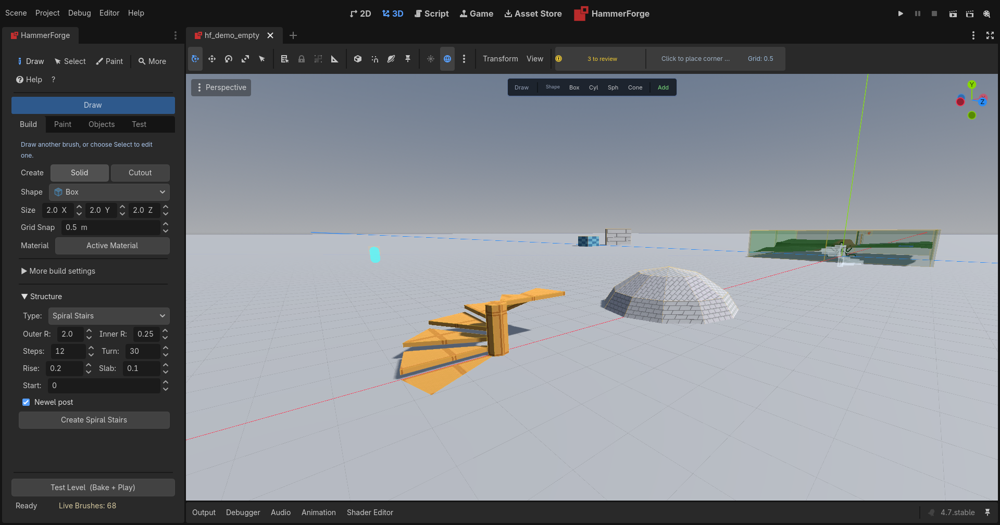


The **Structure** section in the Build tab builds a whole shape out of a handful
of numbers. Pick what you want from the **Type** dropdown and the settings below
it change to that shape's own — a dome has rings and a sweep, a staircase has a
tread and a rise, and neither of them has a wall thickness.

There are seven: **Arch**, **Stairs**, **Spiral Stairs**, **Dome**, **Ring**,
**Door Frame**, and **Trim Run**, which is built along wall faces you pick rather
than at the selection. Each type keeps the settings you last gave it, so a look at the
stairs does not cost the arch you tuned, and the type and its settings come
back next session.

Scripts that create or update a structure must pass settings in their declared types: booleans as `true` or `false`, numeric settings as numbers, and integer settings as whole numbers. Numeric strings and fractional integers are refused before building.

Press the button (or `Ctrl+Shift+A`) and it lands centred on whatever you have
selected, **facing the way that selection faces** — select a wall standing at
forty-five degrees and the arch you build on it stands at forty-five degrees too.
With nothing selected it stands on the world origin, square, with its lowest
point at y = 0 rather than its middle, so it stands on a floor there. Then treat it like
any other geometry: rotate it, carve a doorway through it, clip a piece off.

A selection has to agree with itself to hand its facing over: pick two brushes
turned different ways and you get the world axes, because there is no single
direction to inherit. So does a brush that has been scaled or mirrored in the
inspector, whose axes are not a facing at all. Either way the ghost shows the
angle before you press anything.

**Open the section and the shape draws itself first.** A pale wireframe stands
where the button would build, and it follows every number as you turn it: a dome
gains a ring, a spiral gains a step, an arch widens. Nothing is built until you
press the button — the ghost is what you would get if you did.

If a combination cannot be built the ghost disappears and the section says why,
so you find out while you are still choosing rather than after you have pressed
the button. Every piece has to be a brush the level can keep. A piece that is a
box is at least 0.1 on every side, the least a box can be, so Door Frame's Wall
and Frame start at 0.1. Any other piece, an arch's, a dome's or a ring's, is
refused only when it would be a sliver that Validate reports, and the message
says what is thin and what to change: fewer segments, a larger Radius, a thicker
Wall ([#1605](https://github.com/saworbit/hammerforge/issues/1605)). The ghost belongs to the section: collapse it, or move to another
tab, and it goes.

**Presets keep a house style.** The **Preset** row under Type lists the presets
saved for that type, with **Defaults** first. Set the numbers, press **Save** and
give them a name; a name already saved for the type asks before it is replaced.
Picking a preset only fills the settings, and the ghost follows: nothing is built
and nothing moves until you press the button. With a piece of a structure
selected, the preset loads into its settings and **Update** is still a press of
its own. **Delete** removes the preset the row is on, on a second press. The row
reads **Custom** once you change a number by hand.

Presets live in `res://hammerforge_presets/structure_presets.json`, beside the bake
profiles, so commit it and everyone on the project has them. A preset with a
value out of range, from an old or hand edited file, is refused by name and the
settings keep their values; a setting the structure no longer has is dropped.

### Arch

A curved run of brushes from six numbers:

| Setting | What it does |
|---------|--------------|
| Radius | The outside of the arch |
| Wall | How thick the ring is — the opening is what is left inside |
| Depth | How far the arch extends along its own axis |
| Arc | Degrees swept. 180 is a half arch, 360 a full ring, 90 a quarter |
| Segments | One brush per segment. More segments, smoother curve |
| Start | The angle the arch begins at |

A segment cannot span half a turn or more — a wedge that wide is not a convex
shape, and every brush here is convex — so a full ring needs at least three
segments. The arch will tell you the minimum if you ask for too few.

### Stairs

A flight of stairs, one brush per step, straight or turning at a landing.

| Setting | What it does |
|---------|--------------|
| Width | How wide the flight is, across the direction of travel |
| Tread | How far one step carries you forward |
| Height from | **Rise**: each step climbs Rise. **Total**: Steps share the Total. **Fit**: the fewest steps no higher than Rise that climb the Total |
| Total | The height the stair climbs, floor to floor. Used by Total and Fit |
| Rise | How far one step carries you up, or with Fit the most it may. Not used by Total |
| Steps | How many risers it climbs, one brush each. Not used by Fit |
| Fill | **Solid** fills under each step down to the base; **Open** leaves floating treads |
| Slab | How thick a floating tread or a nosing is |
| Nosing | How far a tread overhangs the riser below. 0 is none |
| Collision | **Steps** collide as they look; **Ramp** bakes a smooth slope over them instead (see below) |
| Turn | **Straight**, or **L left**, **L right**, **U left** or **U right** at a landing, seen walking up |
| Before landing | Risers in the first flight, the last of them onto the landing |
| Landing | How deep the landing is along the first flight |
| Gap | The space between the two flights of a U |

**Total and Fit start from the floor height**, which is the number you know. A
3 m climb in 16 steps is risers of 0.1875, which the Rise field cannot hold;
Height from Total gives it exactly. Fit with a Rise of 0.2 and a Total of 3 takes
15 steps. The line under the settings says what they came to: the steps, the rise
of each, the climb, where the landing is and, with Ramp collision, how steep the
ramp is. Every piece of a stair is a box, and no box is thinner than 0.1, so every
size starts there, and a solid flight whose Total or Fit comes to risers under 0.1
is refused, since its first
step is one riser tall ([#1582](https://github.com/saworbit/hammerforge/issues/1582)).

**A turn** puts a landing at the top of the Before landing riser and sends the
rest of the steps off it. An L leaves the landing's side at its far end, a
quarter turn, so an L landing is at least as deep as the stair is wide. A U comes
back beside the first flight with the Gap between them, and its landing spans
both. Every piece is still a box, and the first flight stands where a straight
flight of the same steps would, so changing the turn on Update rebuilds only the
landing and the flight after it ([#1410](https://github.com/saworbit/hammerforge/issues/1410)).

**Nosing** on a solid step is a slab of its own hung off the top of its riser,
because a step with a lip is not convex. A nosing is a box, and no box is thinner
than 0.1, so a solid nosing is at least 0.1 deep and its Slab at least 0.1 thick. An open tread
just grows forward, so its nosing can be any depth. A stair is at most 128
brushes, nosings included.

Solid is what most stairs in a level are — you cannot see under them, so there is
nothing to build there. Open is for a flight you can see through.

Keep the rise under what the player can actually climb. In a Godot
`CharacterBody3D` that is the step height on the floor snapping, and a flight one
unit over it is a flight the player walks into rather than up.

### Spiral stairs

A flight that turns as it climbs. Every tread is computed as the wedge a tread at
that radius actually is, which is what a radial array of a box cannot give you.

| Setting | What it does |
|---------|--------------|
| Outer R | How far the treads reach from the axis |
| Inner R | The hole down the middle. Zero makes treads that meet at the axis |
| Steps | One brush per tread |
| Turn | Degrees one tread turns through. Negative turns the other way |
| Rise | How far one tread carries you up. Zero makes a flat fan |
| Slab | How thick one tread is |
| Start | The angle the first tread begins at |
| Newel post | Fills the middle with a post the full height of the flight |

Twelve treads at thirty degrees is one full turn. A tread cannot turn through half
a circle or more, for the same reason an arch segment cannot. Nor can a tread or
the post be under 0.1 across: a tread turning a degree or two, or nearly half a
circle, is a sliver, and the section says so ([#1582](https://github.com/saworbit/hammerforge/issues/1582)).

The newel post needs an inner radius to occupy — with the hole set to zero the
treads already meet in the middle, and the section says so rather than quietly
skipping the post.

Spiral Stairs has a **Collision** setting too, Steps or Ramp.

### Ramp collision

A game's own `CharacterBody3D` usually has no step up, so it walks into the
first riser of a baked stair and stops. Set **Collision** to **Ramp** on Stairs
or Spiral Stairs and the steps still bake as they look, but their faces leave the
baked collision and a smooth slope goes in their place
([#1416](https://github.com/saworbit/hammerforge/issues/1416)):

- **Stairs**: one convex piece per flight, its top through the front edge of
  every tread, from the floor a tread in front of the first and flat over the top
  tread, and one box per landing.
- **Spiral Stairs**: a sloped piece up to each tread along the walking line, half
  way across the treads, each starting where the last one ends, and the top tread
  flat. The newel post keeps its own collision.

The bake lays the ramp where the structure stands when you bake, so moving it
moves the ramp. It goes on a body of its own, `RampCollision`, on the level's
Physics Layer, with no mesh; Collision Mode 2 puts it in its stair's visgroup
body instead, and Mode 0 names each shape after the material of the tread under
it, as it names every surface.

A stair keeps the collision of its steps, and the Console says why, when the
ramp would not fit it: a piece edited by hand or deleted, a cut reaching it, a
piece tied to a brush entity class, a Bake Selected that takes only part of it,
or a slope steeper than the 45 degrees the player walks up, which a body would
slide down.

Validate reads a Ramp stair the way the bake will build it: where the bake lays
the ramp, steps over the player's step height say nothing, and wherever it keeps
the steps' collision they are reported as before. A Bake Selected, cordon or Bake
Visible Only that takes only part of a stair is about that bake, not the level,
so Validate does not count it; the bake says so in the Console
([#1588](https://github.com/saworbit/hammerforge/issues/1588)).

### Dome

A hemisphere built in rings, one brush per panel.

| Setting | What it does |
|---------|--------------|
| Radius | The outside of the dome |
| Wall | How thick the shell is. A wall equal to the radius makes it solid |
| Rings | Bands of panels stacked from the base to the crown |
| Segments | Panels around the dome. More segments, rounder dome |
| Arc | Degrees swept around. Less than 360 makes a slice |
| Sweep | Degrees climbed. 90 reaches the crown, less leaves it open |
| Start | The angle the dome begins at |

A brush dome is faceted, because a patch of a sphere is not a convex solid with
flat faces and a brush has to be. Its outer and inner faces are in smoothing group
1, so it bakes shaded round (see [Smoothing Groups](#smoothing-groups)). Four rings
of twelve panels reads as round from inside a room. It is `rings × segments` brushes, so it will refuse a dome past a
few hundred and tell you the number you asked for.

A **Sweep** below 90 stops short of the crown and leaves it open — an oculus, or
the base for a lantern. A **Wall** equal to the **Radius** makes a solid dome
rather than a shell, which is the shape of a hill.

### Ring

A ring with a round tube, one brush per segment, lying flat around its centre: a
pipe bend, a ring moulding, a curved handrail.

| Setting | What it does |
|---------|--------------|
| Radius | From the centre of the ring to the middle of the tube |
| Tube Radius | How thick the tube is. Less than the Radius |
| Ring Segments | One brush per segment. More segments, smoother curve |
| Tube Segments | Sides around the tube, 3 to 32. More sides, rounder tube |
| Start | The angle the ring begins at |
| Sweep | Degrees it goes round. 360 closes it, 90 makes a quarter bend |

Unlike the **Torus** brush shape, each piece is an ordinary convex brush, so it can
be hollowed, carved and vertex edited like any other, and the tube is as thick as
you set it rather than following the ring's size. A piece cannot span half a turn
or more, for the same reason an arch segment cannot, and a **Tube Radius** at or
past the **Radius** is refused, because the tube would fold over itself at the
centre.

### Door Frame

A framed doorway: two posts and a head round a clear opening, and the cut that
makes the opening, all one structure.

| Setting | What it does |
|---------|--------------|
| Width | How wide the clear opening is, between the posts |
| Height | How high the clear opening is: to the head, or to the crown of an arched one |
| Wall | How thick the wall is that the frame wraps |
| Frame | How wide each post and the head are on the wall's face |
| Proud | How far the frame stands out from each face of the wall |
| Head | **Flat**, a lintel over the opening, or **Arched**, a half round arch on the posts |
| Segments | Pieces in an arched head, 2 to 64. More segments, smoother curve |
| Cut opening | Also make the cut for the opening |

The posts' inner faces and the head's underside bound exactly the opening you set.
An arched head is the Arch structure's half circle, its inside the opening's width,
resting on the posts, so its Height must be at least half its Width and 0.1 more,
for posts a brush tall.

With **Cut opening** on, the opening is a Cutout like one you draw: it waits in
Pending Cuts until you apply it. Change the width and Update, and the cut is
resized with the frame, whether you have applied it yet or not; one already
applied stays applied. An arched opening's cut is one convex piece, so Validate
measures the doorway to its crown and reports one lower than the player.

Like every structure, it lands centred on what you have selected and facing its
way, with its width along that selection's X and the wall's thickness along its Z.

### Trim Run

A skirting along the foot of a room's walls, or a cornice along their tops, as
one structure: a trim profile swept along the wall faces you pick, mitred at every
corner and stopped square at every doorway.

Pick the wall faces in **Face Select**, then run **Run Trim Along Faces**
(`Shift+Alt+T`, the command palette, or the Space menu while faces are picked). Or
set the Structure section's Type to **Trim Run** and press **Create Trim Run**,
which does the same. Either way it builds with the settings the section holds for
a Trim Run.

| Setting | What it does |
|---------|--------------|
| Edge | **Bottom**, a skirting on the faces' bottom edges, or **Top**, a cornice hung from their top edges |
| Offset | How far in from that edge the trim stands: up from the bottom, down from the top. A dado rail is a Bottom run with an Offset |
| Profile | Flat, Chamfer, Round, Cove, Ogee or Stepped, the profiles the Path tool's trim has |
| Width | How far the trim stands out from the wall |
| Height | How tall the trim is up the wall |
| Segments | How many pieces a curve of the profile is cut into |

How the faces are read:

- Only upright faces are taken. Pick a sloped one and nothing is built, and the
  message names the face.
- An edge is where a face is open to the room. Another brush in front of a face
  hides what it covers, so a wall that runs on under the floor or past the room's
  corner gives the edge you see, on the floor and in the corner. A face another
  brush hides completely is left out, and the message names it.
- Edges that meet end to start chain into runs, closed round a room or open along
  a few walls. A run breaks where the picked faces do not meet.
- Every corner, inside or outside, is cut on the plane that bisects its two walls,
  so the pieces meet with no gap and no overlap.
- A Cutout brush through a wall, pending or applied, is a doorway: the trim stops
  square either side of it, leaving a gap exactly the cut's width. A cut the trim
  does not reach, a window above a skirting, leaves it whole; raise the Offset to
  the window's height and the same window breaks a rail.
- A profile that is not convex is cut into bands as the Path tool's trim is, each
  band a brush of its own.

The run is kept on the structure beside its settings. Select any piece and the
section reads **Update Trim Run**: change the profile, the size, the edge or the
offset and Update rebuilds along the same run, in a level saved and reopened too.
The run is read when you build, so a wall moved afterwards keeps its old trim
until you **Re-pick**: select a piece of the trim, open Face Select, pick the faces
it should follow now and press **Re-pick** beside the section's button, or pick
**Re-pick Trim Run** in the Space menu. Re-pick keeps the settings and replaces the
run; the faces it already follows change nothing. A face too short for the trim
to turn both its corners is refused by name, and the trim already there stays.

A Trim Run's own pieces hide no wall, so a cornice or a rail can be run along
walls that already have a skirting.

### Changing a structure after you have built one

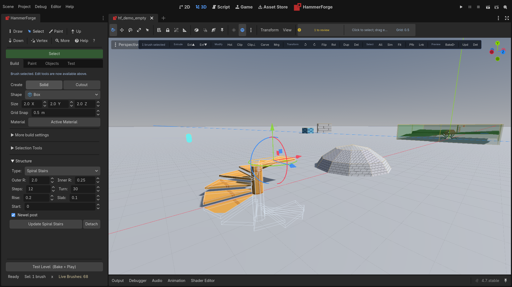


Every structure remembers the numbers that made it. **Select any one of its
pieces** and the Structure section changes: the type switches to whatever that
structure is, the settings that built it load into the controls, the button reads
**Update**, and a **Detach** button appears beside it. The context toolbar
shows **Upd** and **Det** for a selected piece too, doing the same.

Change anything and the ghost shows the new shape standing over the real one, so
you can see the arch getting wider before you agree to rebuild it. Press
**Update** and the structure rebuilds in place. Everything
you painted on it comes back on the same faces: per-face materials, UV projection,
scale, offset and rotation, and paint layers. If you increase the piece count, the
new pieces take the whole-brush material most of the pieces have (the earliest
piece's on a tie), and their faces start plain, because there is no face of theirs
to inherit from.
A brush entity you tied the pieces to comes back too, with its name, wires and
properties, and when the whole structure was one entity the new pieces join it.
Each piece keeps its node name, so a wire aimed at one still finds it.
Press **Update** with nothing changed and the section says *Nothing to update*:
the pieces stay exactly as they are, and so does anything aimed at them.

**If a change would drop painted faces, Update says so and waits.** Cutting the
piece count means the pieces past the new end have nowhere to come back to. The
section tells you how many carry paint, and a second press of **Update** goes
ahead. **Detach** is the other way out.

This is the point of it: a radius, a segment count and a step rise are numbers you
get right by looking at the result, not in advance.

**A structure you have moved or turned rebuilds where it now stands.** Build an
arch, drag it into the doorway it belongs in, rotate it to face the way the
doorway does, then widen it — it stays in the doorway, still facing that way.
It takes **more than half the pieces agreeing** to say where a structure went, so
nudging one brush of a twelve-piece arch does not lose the other eleven. That one
brush is a hand edit; the arch is still where you dragged it.

If the pieces genuinely no longer agree — half of them one way, half another —
the section says so: *"These pieces no longer agree on where the structure is.
Update will rebuild it where it was created — Detach to keep them where they
are."* That is the warning worth reading, because where the structure lands is a
bigger surprise than what shape its pieces are in.

A **flip** is the exception. Mirroring a structure turns every face inside out,
and rebuilding through that would give you geometry that looks right in the
viewport and wrong in the bake — so a mirrored structure is not treated as
relocated. Its pieces read as edited, and **Detach** is the way to keep them.

**If you have edited pieces by hand, the section says so** — *"3 pieces have been
edited by hand. Update will rebuild over them — Detach to keep them."* Vertex
drags, clips, bevels, resizes and turns all count, and so does a deleted piece,
which Update puts back. Update still does what you asked; the warning is so that
Detach is a choice you make rather than a lesson you learn.

> A flight of stairs built with an earlier version reads correctly after its
> scene is reopened too. Each step is checked against the order it was saved in,
> so an untouched one counts nothing and one edited before the save still counts
> (#873, #878).

**Detach** stops a structure being a structure. It keeps every brush exactly where
it is and forgets that a generator made them. Use it once you have started editing
pieces by hand. Ctrl+Z will bring an overwritten edit back, but detaching is the
deliberate answer.

Turning a whole structure is not recovered the way moving it is — a rebuild
squares it back up. The warning fires, because every piece reads as edited.

A structure that has been clipped or carved still updates; the pieces the
generator does not recognise any more are simply left alone.

## Cutting: Clip and Carve

**Clip** splits one brush into two. **Carve** cuts one brush out of every brush it
overlaps. Both work on the real geometry, so a cylinder, a polygon-tool brush, a
merged brush and a rotated anything are all fair game. Carve asks to confirm only
when a selected carver cuts something; when none does it says why and leaves
nothing in the undo history (#1267).

| Key | Action |
|-----|--------|
| `Shift+X` | Clip the selected brush across its middle, level with the floor |
| `Shift+Alt+X` | Clip along the selected face's plane |
| `C` | The Clip tool: cut along a plane you place with points |
| `Ctrl+Shift+R` | Carve |
| `Ctrl+Shift+I` | Intersect |

### Clipping along an angle

The quickest way to an angled cut is **Clip to Face Plane**. Select the brush or
brushes you want to cut **first**, then enter Face Select, click the face whose
angle you want, and press `Shift+Alt+X`. Everything you had selected is cut along
that face's plane, as a single undo step.

The order matters because Face Select hides the object selection while it is open
— that is what makes clicking a face unambiguous. The command remembers what you
had selected on the way in. Once the cut is done it releases both the face and the
objects and closes Face Select, because the brushes it was holding have just been
replaced.

That face can belong to any brush, including one you drew purely as a guide and
delete afterwards — draw a box, rotate it to the angle you want, and use one of its
faces as a straightedge.

### The Clip tool

For a cut that no face lines up with, press `C` with the brushes to cut
selected, and place the plane with points. Points land on a face or on the grid,
and snap as a drawn point does.

- **Two points** make a plane through them that runs along the axis the view
  looks down most. Two clicks in a top view make an upright cut; two in a front
  view make one that runs front to back.
- **A third point** makes the plane through all three, for a sloped roof or a
  corner taken off.
- **A drag** places the first two points at the press and the release.
- **Drag a placed point** to move it. The preview follows.
- **Keep** in the tool's settings, or `Tab`, chooses what stays: both pieces, the
  piece in front of the plane or the piece behind. The piece that would go draws
  faded red and a kept one cyan.
- **Enter** cuts every selected brush the plane passes through, as one undo step
  named Clip. A brush it misses, or one in a locked visgroup, is left alone.
- `Backspace` takes off the last point. `Escape` clears the points, and leaves the
  tool when there are none.

The new faces take the material of the face the first point was placed on. When
the first point is on the grid they take the Active Material if it is in the
palette, and otherwise the material of the face beside them, as Clip does.

### What you get back

Half a box is still a box: it keeps its resize handles and behaves exactly as it
did before. A box piece thinner than 0.1, the least a box can be, comes back
**Custom** instead, so it keeps the thickness it was cut to, and so do Carve's and
Hollow's (#1598). An angled piece cannot be described by a box, so it comes back as a
**Custom** brush — still fully editable, but sized by its vertices rather than by
width, height and depth.

Both pieces keep the original's material, its per-face textures, its operation, its
visgroups, its group and its entity class. A face imported from a `.map` keeps the
texture name it came in with, so a cut trigger is still `AAATRIGGER` on export. If the
brush was part of a brush entity, every piece is that entity, with its name or tie,
its properties and its wiring, so a door clipped to fit a frame is still one door.
Carve and Hollow do the same, and Merge and Intersect make the brushes of one entity
one brush of it. Both refuse brushes that are not all one entity, or not all plain
geometry.

Surface paint comes through too. Each piece of a painted face keeps the paint that
was on that part of it, and the new cut surface starts unpainted. The pieces' paint
is their own, so painting one afterwards leaves the other alone. Carve and Hollow
keep paint the same way.

A sculpted face keeps its sculpt where the piece of it is still a four-cornered
face: a straight cut across a sculpted floor leaves both halves sculpted, each on
the same surface. A cut that takes a corner off leaves a three or five-cornered
piece, which a sculpt cannot be laid on, so that piece comes out flat and the
Output panel says which brush lost it. The Clip, Carve and Hollow confirmations
say how many sculpts the cut will drop before you commit (#871). Undo puts the
brush back whole (#863).

The cyan preview shows the two real pieces before you commit, so an angled cut looks
like what you are about to get.

### Carving

Carve removes the carver's volume from everything it overlaps and then consumes the
carver. The pieces left behind are whatever survives outside the carver, so a corner
cut leaves a few pieces and a slot driven right through leaves two.

A carver that would swallow a brush entirely leaves that brush alone rather than
deleting it — nothing vanishes without a preview showing it first.

A hidden brush is left alone too. A mapper who hides the outer walls to work inside
a room can carve a doorway through an inner wall without cutting the wall they cannot
see, and the confirmation counts the hidden brushes the carve skips ([#1710](https://github.com/saworbit/hammerforge/issues/1710)).

### Intersecting

Intersect (`Ctrl+Shift+I`) keeps only the volume the selected brushes share, as one
convex brush: a box and a cylinder overlapping at a corner give a quarter round
column, and a wedge intersected with its room is trimmed to fit it. Select the
brush to keep first. It is cut down by the planes of each of the others in turn,
and what is left replaces them all in one undo step, so one `Ctrl+Z` brings every
brush back. The green wireframe shows the brush that is kept before you confirm.

What is left is a piece of the first brush: it keeps that brush's operation,
visgroups, group and brush entity, and its faces keep their textures, paint and
sculpts as a piece of a carve does. A face cut by another brush takes the look of
that brush's face, its texture and how it is laid on. Brushes that share no volume,
that mix solid brushes and cuts, or that are not all one entity are refused, and
nothing changes.

> Hollow (`Ctrl+H`) handles rotation too. It shells a brush against its own face
> planes, so a turned box gives you six turned walls. See [Hollow](#hollow).

## Moving by an Exact Offset

**Offset** (`Alt+G`, the command palette, or **Offset...** in the Space menu)
opens a small popup at the cursor with **X**, **Y** and **Z** and a **World** /
**Local** choice. Type the distance and press **Enter**: placing a brush 3.25 up,
or a vertex 0.5 along a wall, no longer means changing the grid, nudging and
changing it back. The move is exact, never rounded to the grid, and it is one undo
step.

What it moves is what you have picked:

- **Brushes and entities** move as a nudge moves them.
- In **vertex mode**, the selected vertices move, and the faces round them follow.
- In **Face Select**, each picked face moves by its corners together, so the
  faces round it stretch to meet it.

A vertex or face move that would leave a brush other than a convex solid changes
nothing and says why, as a vertex drag does.

**Local** goes along the selection's own axes, so a turned wall can be pushed
along its own length. When the selection does not all face one way, or a part of
it is mirrored or scaled, there are no axes to share: the popup says so under
**Local**, and the move goes along the world's.

The fields keep the last offset and choice, so doing it again is `Alt+G`,
`Enter`. During a draw or an extrude, `Alt+G` does nothing; typed numbers there
are the draw's.

## Rotating and Mirroring

Select anything — brushes, entities, or both — and turn it.

| Key | Action |
|-----|--------|
| `R` | Rotate counter-clockwise by the step |
| `Shift+R` | Rotate clockwise by the step |
| `Shift+M` | Flip (mirror) the selection |
| `Alt+M` | Mirror Copy: keep the selection and add mirrored copies |
| `Alt+R` | Reset rotation |
| `Alt+P` | Pick Pivot: click the point to turn about |
| `Shift+Alt+P` | Clear Pivot: back to the selection's centre |

**Which axis.** If you have an axis lock set (`X` / `Y` / `Z`), that is the axis.
Otherwise rotate uses **Y** — a yaw, which is what you want almost every time —
and flip uses **X**, a left-right mirror.

**What it turns around.** The **Pivot** picker in Selection Tools chooses between
the centre of your selection, the world origin, the first object you selected,
and **Pick**, a point you click. The selection centre is the median of the
objects' own positions, which means pressing `R` four times with a 90° step puts
everything back exactly where it started, however lopsided the selection is.

**Picking a pivot.** Choose **Pick**, or run **Pick Pivot** (`Alt+P`), and click
in the viewport: the pivot snaps to the brush vertex, edge midpoint or face centre
nearest the cursor, within a few pixels. A door then hinges on its edge, and a
wall swings round its corner post. A small cyan cross marks the pivot for as long
as Pick is the Pivot. Rotate, Flip, a radial Duplicate Array and Mirror Copy
through the Pivot all use it until you choose another, or **Clear Pivot**
(`Shift+Alt+P`) goes back to the selection's centre. The point is saved with the
level.

The pick waits for one click and the mode banner says so. A click with nothing in
reach says that and waits for another. `Escape`, a right click, changing tool or
mode, the editor losing focus or switching scenes put it away.

**The step.** Set it in Selection Tools. 15° by default; 45° and 90° are the
other two you will reach for.

**Texture Lock applies.** With it on, the texture goes round with the brush, the
same way it travels with a brush you move. Every face of a box under a yaw keeps
its texture where it sits on the brush, upright as it was. Turn Texture Lock off
and the texture keeps its place in the level instead, so the brush turns under it.

This is the opposite of what it did before planar UVs moved into world space. A
projection taken from a brush's own vertices did not move when the brush did, so
back then the compensation was the thing that let go of the texture. Now the
projection follows the level and the compensation is what holds the texture on
the brush.

A face that swings out from under its own projection, like a wall under a yaw,
lands on a different projection axis. The texture goes round with it, but the
placement is re-derived rather than carried exactly, because a planar projection
cannot say more than which plane it reads.

### After you rotate

Clip and Carve both handle rotation — they cut the real geometry wherever it is.

Hollow handles it as well. It shells a brush against its own face planes, so a
turned box gives you six turned walls rather than a refusal.

So **Reset Rotation** (`Alt+R`) is there for when you want a brush square again,
not because anything has stopped working on it. It does not move your geometry: if
you turned a brush by exactly 90°, it folds that quarter turn into the brush's
dimensions instead of snapping the brush back to its old footprint, so the brush
stays exactly where it looks like it is.

### Apply Rotation and Scale

A brush stretched with Godot's scale gizmo keeps its old `size`, so typed sizes,
the resize handles and Hollow's wall thickness all work in units that are not
metres along the stretched axis. **Apply Rotation and Scale** (Build > Selection
Tools > Transform, and the command palette; no default key) folds each selected
brush's rotation and scale into its shape and leaves it with no rotation or scale
of its own. Nothing moves in the world, and every face keeps its look.

A box under a scale or a quarter turn stays a box, with the change in its size,
and a sphere stretched unevenly becomes an ellipsoid. A mirrored brush comes out
the right way out. Anything else keeps its exact shape as a Custom brush. The
toast names each brush that could not keep everything:

- a turned round shape, or a cylinder stretched unevenly across its round side,
  becomes Custom and loses its resize handles and Sides
- a Cylindrical face is projected in the brush's own space, so the UVs it shows
  are written into its custom UVs
- a sculpted face cannot keep its heights under an uneven scale, so that brush is
  left alone; a turn and an even scale keep the sculpt
- a structure piece now reads as edited, and Update warns before rebuilding over it

One press is one undo step, and undo gives back the shape, size and transform each
brush had.

### Flip

Mirroring is exact. A mirrored box is still a box and keeps its resize handles; a
shape that a mirror genuinely changes, like a wedge, has the mirror written into
its faces and becomes a Custom brush. Either way the faces stay wound the right
way out, so a mirrored brush never bakes inside out.

A **sculpted displacement** is mirrored with its face. The sculpt moves to the
mirrored side, and every height, blend value and custom offset lands where the
mirror puts it, down to which way each grid cell folds. Flip it back and you get
the original sculpt exactly. A box keeps its resize handles here too, and
resizing it afterwards keeps the mirrored sculpt the way round the flip left it.
The same goes for a sculpted brush mirrored through a negative scale in the
Inspector: the mirror is taken off and the sculpt stays where it was.

### Mirror Copy

Symmetric rooms and paired stairs are one half and its mirror. **Mirror Copy**
(`Alt+M`, or the button on the **Mirror** row under Transform) leaves the
selection where it is and adds a mirrored copy of it across each axis ticked on
that row, **X**, **Y** and **Z**, and across each combination of them: X alone
makes one copy, X and Z make three, all three make seven. `Alt+M` runs with the
boxes as they stand, and the whole of it is one undo step.

**Where the mirror stands.** With **Selection Edge** ticked, which it is to begin
with, each plane goes through the far (+X, +Y, +Z) side of the selection's bounds,
so the copy lands flush beside the original, touching it and overlapping nothing.
Untick it and the planes go through the **Pivot** the rest of Transform uses.

Each copy is a duplicate put through Flip, so everything under **Flip** above holds
for it: it is the right way out, a box stays a box, and each face's material, UV
settings, paint and sculpt land on the face the mirror sends them to. Entities are
copied with their angles mirrored. A copy gets its own brush id and, like a
duplicate, is a brush entity of its own, with a fresh name. The copies join the
selection, so the mirrored whole moves as one and a second Mirror Copy mirrors all
of it.

**Texture Lock decides the texture**, as it does for a move. On, the texture is
mirrored with the copy, so the copy shows the mirror image of the original. Off,
the copy reads the level's texture where it lands, as Flip leaves a brush.

### Arrays

**Duplicate Array** in Selection Tools has three layouts:

- **Linear** — copies along the X/Y/Z offset, one step further each time.
- **Radial** — copies around an axis. Set the step in degrees, or tick
  **Fill 360°** and let it space the copies and the original evenly around a
  closed ring. Each copy is turned as well as moved, so a ring of arches faces
  outward rather than all facing the same way.
- **Grid** — a 3D lattice. Set the cell count per axis (counting the original)
  and the X/Y/Z offset becomes the spacing. Every axis needs at least one cell;
  a count below that is refused rather than treated as one, the same way the
  linear and radial counts are.

**Turn any of those controls and the copies draw themselves.** A pale wireframe
shows the copies **Create Array** would make, standing where they would stand,
and it follows every number as you change it. The line under the controls says
what you are about to get — *"12 copies of 1 brush"*. Nothing is created until
you press the button.

The ghost waits to be asked for: selecting a brush is not asking about arrays, so
it appears once you touch an array control and goes again when you create the
array, clear the selection, or leave the Build tab. One more tick of a control
brings it back.

**An array has a ceiling of 256 brushes.** The cell counts go to 32 a side, which
is a lattice of over thirty-two thousand brushes — not an edit but a hang. Ask
for more than the ceiling and the ghost disappears and the line tells you the
number you asked for, so you know which control to turn back. **Create Array**
refuses the same arrays for the same reason, and so does **Update Array**: the
ceiling is not a property of one button, so raising an existing array past it is
refused too.

**A refused array costs you nothing.** Whether you are creating or updating, the
refusal lands before anything is built or taken away. Type a count the layout
cannot use into an array you already have, press Update, and the copies stay
where they are with the array still selected, ready for a number that works.

**Ctrl+Z takes an array back out.** All three layouts are one undo step, so an
array you did not want goes away in a single press rather than one copy at a
time.

**An array can be changed after you have made it.** Select any piece of one —
the original, or any copy, whichever you can see — and the section becomes an
editor for that array: its layout, its numbers, and **Create Array** becomes
**Update Array**. Turn the count up, switch the layout from Linear to Radial,
move the offset, and press Update. The copies are rebuilt where they now belong.
Pressing Create with the original still selected does the same thing, so the
button says Update one press after it said Create.

Three buttons, three different answers:

- **Update Array** rebuilds the copies from the numbers on screen. The array
  itself is kept, so you can keep tuning it.
- **Detach** keeps every copy exactly where it is and forgets the array. This is
  what you want when the layout has given you what you needed and you now want
  to edit one copy on its own.
- **Remove Array** deletes the copies and keeps the original.

A ring keeps turning about the point it already turns about, so raising the
count of a radial array does not send the ring over to whichever copy you had
selected. And **Fill 360°** is a way of arriving at a step rather than something
the array remembers, so an array loads with the step it actually has and the box
unticked.

**Update says what it would undo.** Rework one copy of an array on purpose —
drag it, resize it, retexture it, add a paint layer to it — and the section says
so: *"1 copy has been edited by hand. Update will rebuild over it — Detach to
keep it."* Press Update and nothing happens the first time; the status line asks
you to press it again. Detach is the other answer, and it is the one that keeps
what you did.

Moving the **original** is different, and reads differently: *"The original has
moved. Update will bring the copies over to follow it."* Nothing of yours is
lost there — an array following its source is what an array is for — so Update
goes ahead on the first press.

> **Painting inside a layer a copy already had** is noticed when you press
> Update rather than when you select. Reading every copy's paint on each
> selection change would cost more than the check is worth, so the line may say
> nothing until that first press, and the press asks (#875).

> `R` is also the Rect tool in paint mode. Paint mode gets first claim on it, and
> the whole rotate/flip group is skipped while paint mode is on, so the two never
> fight over the key.

## Convert to Brushes

A blockout made with Godot's CSG nodes, or a crate modelled as a mesh, can join a
level as brushes. Select the nodes and pick **Convert to Brushes** from the
command palette or the Space menu:

- a `MeshInstance3D` whose mesh is a closed convex solid becomes one Custom brush,
  a face per flat side, each wearing its surface's material with the mesh's own UVs
- a `CSGBox3D` becomes a box, a `CSGCylinder3D` a cylinder, or a cone when its
  Cone is on, with its sides, and a `CSGSphere3D` a sphere; a cylinder of three or
  four sides becomes a Custom prism or pyramid
- a `CSGPolygon3D` in Depth mode with a convex outline becomes a Custom prism
- a CSG node's material goes on every face, and a shape inside another CSG node
  that subtracts becomes a cutting brush, placed after the shapes it cuts

Each brush stands where its node stood, keeping the node's turn. A scale or a
mirror on the node is folded into the brush as Apply Rotation and Scale folds it,
so its size reads in metres. A material joins the palette when it is not in it.

A concave mesh or polygon, a mesh that is not closed, a CSG node with CSG
children, and one that intersects its parent are refused, each named in the
toast with why, and left as they were. The nodes that convert are hidden, not
deleted, and the brushes are selected. The whole conversion is one undo step:
Ctrl+Z takes the brushes away and shows the nodes again.

## Command Palette (Ctrl+K)

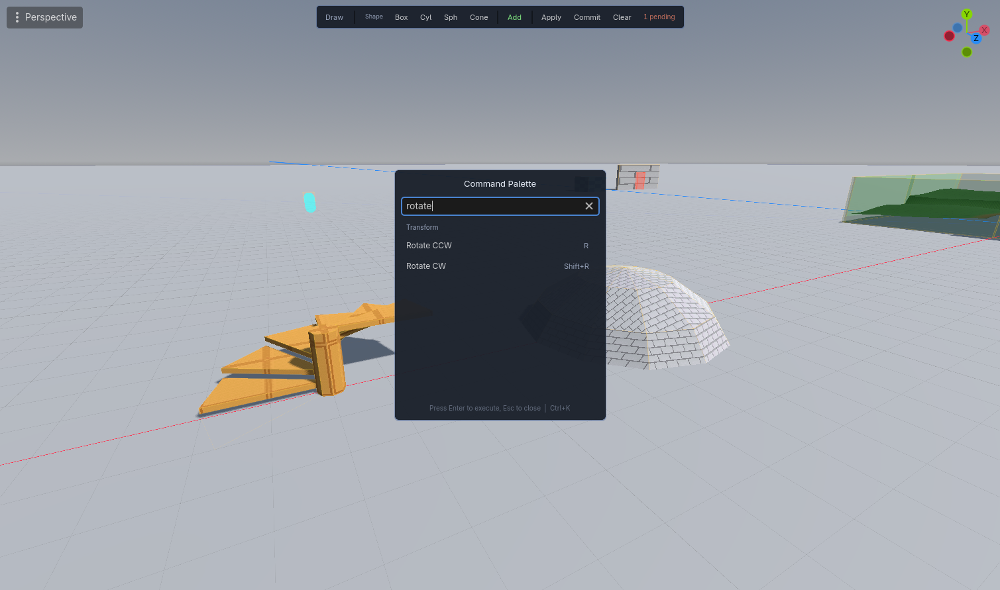


The command palette is a searchable action list. Open it with **Shift+?**, **F1**, or **Ctrl+K**.

- Type to filter actions by name, by keybinding, or by another word for the command. The best match is the top row: an exact name, then an exact other word, then a name that starts with what you typed.
- **Other words**: "shell" finds Hollow, "slice" and "split" find Clip, "subtract" finds Toggle Add / Cut, "texture" finds Apply to Brush, "ho" finds Hollow. The row shows the word it matched, as "Hollow (shell)".
- **Your own words**: put them in `hammerforge_presets/aliases.txt`, one `alias = command_id` a line, `#` for a comment. Yours win over the built in ones. A line the palette cannot read, or one that names no command, is left out with one warning in the Output panel. The file is read when the editor starts.
- **Fuzzy search**: if nothing holds what you typed, the palette finds approximate matches using subsequence matching with word-boundary bonuses
- **"Did you mean: ..."** suggestion appears when fuzzy matching kicks in
- Actions gray out when unavailable (e.g., Hollow requires a brush selection)
- Press **Enter** to execute the top enabled row
- Press **Esc** to close without executing

### Repeat Last Command

**Repeat Last Command** runs the last command that changed the level or the selection again, on what is selected now: hollow one room, select the next, Repeat. It uses the settings the dock holds, so Hollow keeps its wall thickness. Toggles, views, panels, Select All and Deselect All never become the command it repeats. A selection the command refuses gets the command's own message. It has no key by default; give it one in the shortcut dialog.

With nothing typed, the palette shows **Repeat: Hollow** as its top row when there is something to repeat, then the last eight commands you ran under **Recent**, newest first.

## Example Library

The **Test** tab contains an **Examples** section (collapsed by default) with 5 built-in demo levels:

| Example | Difficulty | Key Concepts |
|---------|------------|--------------|
| Simple Room | Beginner | Additive brushes, floor |
| Corridor with Doorway | Beginner | Subtract operations, spatial planning |
| Jump Puzzle Platforms | Intermediate | Multiple brushes, player spawn entity |
| Hollowed Building | Intermediate | Hollow + subtract for windows |
| Simple Arena | Advanced | Multi-level, ramps, cover, multiple spawns |

- **Load** replaces the current level with the example's brushes and entities. It asks first when the level is not empty, naming what will go, and the whole load is one undo step
- **Study This** shows numbered annotations explaining the design decisions
- Search/filter by title, description, tags, or difficulty level

### The reference map

Each example above is about one feature, and the format they are stored in
carries brushes and point entities only. None of them can show you a material, a
UV, a tie, a wire, a visgroup or a navmesh, because the file they live in has
nowhere to put one.

`addons/hammerforge/data/reference_map.hflevel` is a level with all of it in at
once. Open it with **Load .hflevel** on the Test tab. It has two halls with the
corridor's mouth cut through the inner wall of each, 119 brushes, 15 materials,
UVs anchored to world space so the texture runs through the floor to wall join
rather than stepping at it, a visgroup per wing, a button wired through a relay
to a door, a spawn, and the bake options a shipped level uses. Bake it and you
get a navmesh and occluders.

It is a reference rather than a lesson: nothing in it is annotated, and it is not
a good level. It is there to answer "what is a finished one supposed to look
like" and to give the numbers in
[Shipping a Level](HammerForge_Shipping_A_Level.md) something real to describe.

## Dock Layout (4 tabs)
The dock has 4 tabs with collapsible sections for organized access to all controls. Each collapsible section has a visual separator and indented content; collapsed state persists across sessions. A "No LevelRoot" banner appears at the top when no root node is found.

### Mode Indicator
A colored banner between the toolbar and tabs always shows your current tool and gesture stage:
- **Draw** (blue) -- "Step 1/2: Draw base — 64 x 32 x 48" / "Step 2/2: Set height — 64 x 96 x 48" (live dimensions update as you drag)
- **Select** (green)
- **Extrude ▲** (green) / **Extrude ▼** (red) -- "Extruding..."
- **Paint** (orange)

When typing numeric input during a gesture, the value appears in brackets (e.g. "[64]").

Sizes print as many decimal places as the grid step needs, so a 0.25 step reads "0.25 x 2 x 1", with at least two places for a size off the grid. The same size follows the cursor through both stages of a Draw drag, just below and to the right of the pointer, with a typed number in brackets; an Extrude shows its depth there ("Depth 1.5"). It goes when the brush is placed or the drag is cancelled, and is drawn over the viewport, never put in the scene. Turn it off with **Size at cursor** in **Test → Settings** or the Console's Viewport group.

### Toolbar
The primary toolbar keeps the everyday path visible: **Draw**, **Select**, **Paint**, **More**, and **Help**. Operation and advanced geometry commands live in Build sections, the context toolbar, or **More**. **Help** opens the guide and shortcut discovery; **Shift+?**, **F1**, or **Ctrl+K** opens the command palette.

### Build tab

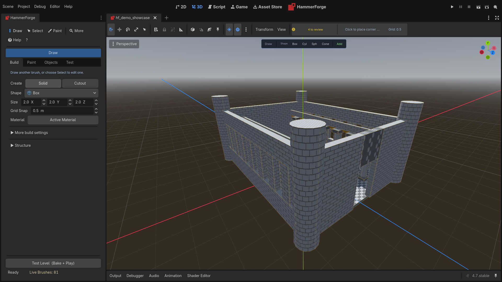

- **Tools**: Draw and Select are always available in the primary toolbar. Use **More**, contextual actions, or the sections below for advanced operations.
- **Shape**: choose from 15 built-in shapes with recognizable icons (plus Custom). Sides appears for a pyramid, and for a cylinder, cone, sphere, ellipsoid, capsule or torus, where it is how many segments go round: 16 to start with, 5 at least, up to 64. More is smoother and costs faces, a sphere being 128 faces at 16 and 2,048 at 64. A pyramid and the round shapes each keep their own number. The Inspector's Sides on a placed round brush stops at 5 too, and a cylinder from an older level that stored 4 shows the 16 it has (#1103).
  A drawn brush is inscribed in the box you dragged. For a box that is the box itself; for a cylinder, cone, capsule or sphere the smaller side of the base rectangle is the diameter and the footprint is centred on the rectangle, so the brush always ends up inside the ground you dragged over. A sphere is uniform in all three axes, so its height stage takes part in the diameter rather than setting a separate height. Use **Ellipsoid** when you want three independent axes.
- **Size** X/Y/Z: defaults for new brushes, in metres. A new level starts at 2 x 2 x 2.
- **Repeat Last Brush** (`Shift+D`, or **Repeat** in the context toolbar's Draw section, which names the brush, such as "Cyl 2 x 3 x 2"): a stamp of the brush the last Draw made, with its shape, size, Sides, Solid or Cutout and material. A ghost follows the cursor, standing on the face or the grid under it where a Draw would start, and each left click places a copy as one undo step and stays armed, so a row of pillars is a row of clicks. Esc, a right click or another tool lets go. Before the first Draw the button is disabled.
- **Kept between sessions**: Shape and each kind's Sides, Solid or Cutout, the snap toggles, Hollow's wall and the Bevel and Face Inset boxes come back as you last left them, and so do the Structure section's type and each type's own settings and every tool's Tool Settings. They are kept with your preferences, not in the level. **Reset Tool Settings** in the Test tab's Settings puts them all back to their defaults. A value edited out of range in `user://hammerforge_prefs.json` comes back at the nearer end, with a warning naming the file and the key.
- **Grid Snap**: snap increment in metres, with quick preset buttons (0.1, 0.25, 0.5, 1, 2, 4, 8). A new level starts at 0.5.
- **Grid Up / Grid Down**: move the drawing plane one snap step along its current axis (`Alt+PageUp` / `Alt+PageDown`). A manual position stays put while drawing. **Reset Grid** (`Alt+Home`) returns it to the LevelRoot origin, flat. Without a manual position, a completed draw keeps the grid on that brush's base plane; loading or undoing brushes does not move it.
- **Align Grid to Selection** (`Alt+End`): selected vertices use their average on the current axis. Otherwise a selected face chooses the dominant axis of its world normal and a plane through its center; an angled face does not tilt the grid. A brush selection uses the top of its world bounds. Nothing selected resets the grid. Face and vertex context toolbars offer the same command. These are view controls and add no undo step; the held plane is not saved with the level.
  A held plane answers only where the cursor meets no surface: a draw that starts on a brush face or a collision surface starts on that surface.

- **Snap Modes**: G (Grid), V (Vertex), C (Center), E (Edge midpoint), and P (Perpendicular projection). Toggle independently; the closest eligible geometry candidate within the threshold beats grid snap.
- **Draw on Face** (the **On Face** button beside the Snap row, **L**, or the command palette): a draw that starts on a brush face builds on that face's plane instead of a flat one. See [Brush Creation](#brush-creation-cad-style).
- **Material**: the Active Material, the whole-brush material every new brush is made with: a drawn brush, a Polygon brush, each piece of a Path and of a new structure, and a dropped preset. Paint mode puts it on a brush you click. An Extrude takes its source brush's material and a Cutout keeps the cut look. **Clear** sends new brushes back to the translucent default and leaves brushes already made as they are. It is saved with the scene, not in the `.hflevel` file, and a structure's Update keeps each piece's own material.
- **Physics Layer**: which collision layer the baked world goes on. Godot's own `CharacterBody3D`, `RigidBody3D` and every raycast default to mask 1, so **Static World (Layer 1)** is the one the player walks on and the other two entries produce a level the player falls through unless your game looks at that layer deliberately. The baked body's own mask is always 0: it never moves, so a mask buys it nothing and only widens the broadphase.
- **Texture Lock**: UV alignment preserved on move, resize, and rotate (enabled by default).
- **Selection Info** (above Selection Tools, whenever brushes, faces, vertices or edges are selected, in Vertex mode and Face Select too): one brush shows its centre and size, one face its centre, normal and area, one edge its length and midpoint, and several of anything their count and the centre and size of their bounds. One vertex shows X, Y and Z as fields: type a number and press Enter, or leave the field, and the vertex moves there as one undo step. The move is judged as a drag is when you let go, so a place that would leave the brush non-convex is refused, the field goes back and the reason shows. **World / Local** picks the space: Local is the brush's own space for a vertex, edge or face, and the parent's space for a brush, as the Inspector shows it. Several things in different spaces are shown in world space, and the section says so.
- **Selection Tools** (visible when brushes are selected, grouped by domain):
  - **Brush Modification**: Hollow (wall thickness spinner + button, Ctrl+H) with yellow wireframe preview; Clip Selected (Shift+X) with cyan wireframe preview + orange split plane. Carve (Ctrl+Shift+R) with green wireframe preview. Merge (Ctrl+Shift+M) combining 2+ brushes.
  - **Positioning**: Move to Floor (Ctrl+Shift+F) / Ceiling (Ctrl+Shift+C). **Snap to Grid** (Ctrl+B) moves each selected brush the least distance that puts the lowest corner of its world bounds on a grid point, and a selected entity's origin onto the nearest one. Size and rotation stay, so a brush sized in whole grid steps ends with every corner on the grid. A grid point is a whole number of grid snap steps from the world origin; a held drawing plane does not move them. One press is one undo step, a selection already on the grid adds none, and Texture Lock treats the move as it does a nudge. The context toolbar and the command palette offer it too.
  - **Transform**: Step (degrees per press) and Pivot (Selection / World Origin / Active / Pick, a clicked vertex, edge midpoint or face centre). Rotate CCW (R) and CW (Shift+R) turn the selection about the locked axis, or Y when no axis lock is set. Flip (Shift+M) mirrors it across the locked axis, or X. The Mirror row ticks X, Y and Z, and Selection Edge, for Mirror Copy (Alt+M), which keeps the selection and adds mirrored copies beside it. Reset Rotation (Alt+R) clears a rotation without moving the geometry. Apply Rotation and Scale folds a rotation and scale into the brush's shape, so its size reads in metres and nothing moves.
  - **Bake**: **Cast Shadows** (Level Default, On, Off, Double Sided, Shadows Only) and **Lightmap Scale** (0.125 to 8, default 1) for the selected brushes, set on all of them at once as one undo step. The dropdown shows nothing, and the scale says *(mixed)*, when the selected brushes differ. Level Default leaves Cast Shadows to the brush's visgroups and then to **Cast Shadows** in Advanced Bake. Shadows Only casts shadows without being seen, for a blocker that shapes the light through a window; Off suits a sky shell or a far backdrop. Lightmap Scale multiplies the lightmap detail Lightmap UV2's **Texel Size** gives the brush: 4 is four times as fine, for a lit floor or a wall a window shadow falls on, 0.5 half, for a ceiling. A mesh casts shadows one way and has one lightmap density, so brushes that differ in either bake into meshes of their own and the rest still merge ([#1444](https://github.com/saworbit/hammerforge/issues/1444), [#1438](https://github.com/saworbit/hammerforge/issues/1438)). Both are saved with the brush in the `.hflevel` and kept by undo, duplicate and the pieces of a Clip, Hollow, Carve, Intersect or Merge ([#1660](https://github.com/saworbit/hammerforge/issues/1660)); `.map` export leaves them out.
  - **Entity Binding**: Tie/Untie brush entity class (populated from entity definitions), with an optional name. The name is the address an I/O connection targets, so a door has to have one before anything can open it. Brushes tied in one go are one entity whether or not they are named, so a two-leaf door exports as one `func_door` rather than two that move independently; tying two doors separately keeps them separate. A field set in the Entity panel goes on every brush of the entity, and so does a wire, so a trigger of several brushes fires from whichever brush a body enters. Its wires go out once per event, not once per brush, and a `trigger_once` of several brushes fires once in all ([#1129](https://github.com/saworbit/hammerforge/issues/1129)). That holds for a tie with no name as well ([#1133](https://github.com/saworbit/hammerforge/issues/1133)), and a `.map` import gives such an entity back tied as one ([#1134](https://github.com/saworbit/hammerforge/issues/1134)). Untie takes the brush's wires and properties with it, and tying a brush as another class keeps only what that class has.
  - **Clip brushes**: tie a brush as `func_clip` for collision the player cannot see: a smooth slope over stairs or rubble, a barrier along a ledge, a fill over a jagged cliff. The bake makes the brush's convex hull into collision and draws nothing, and every clip on one physics layer shares one body, so twenty cost one node; a named clip keeps a body of its own. Its **Physics Layer** in the Entity panel is the layer it goes on, 1 to 32. 0, the default, is the level's Physics Layer, so a player meets it wherever it meets the world; a game that wants bullets to pass through puts it on a layer only its player collides with. The editor draws it violet whatever material its faces carry. It takes no part in the world's CSG, so a cut never carves it. It does cut the baked navmesh, since an agent's body meets it as the player's does, and Validate's stairs, ramp and doorway checks leave it out ([#1409](https://github.com/saworbit/hammerforge/issues/1409)).
  - **Duplicate Array**: Layout (Linear / Radial / Grid), count, X/Y/Z offset, and the controls for the chosen layout — axis, step degrees and a Fill 360 helper for Radial; per-axis cell counts for Grid, which uses the X/Y/Z offset as its spacing. A live wireframe of the copies and a line saying how many. Create/Remove Array buttons; selecting any piece of an existing array turns Create into **Update Array** and shows **Detach** beside it.
  - **Bulk delete**: deleting 3+ brushes shows a confirmation dialog (undo reminder). Single/dual deletes remain instant.

### Paint tab (collapsible sections)

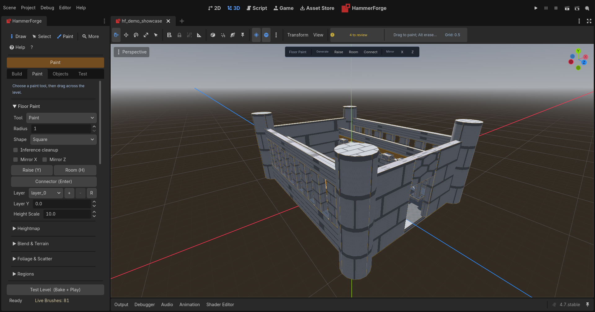

- **Floor Paint**: Brush, Erase, Rect, Line, Bucket, Blend tools; shape, radius, and layer picker; default-off inference and X/Z mirror toggles; Raise, Room, and Connector actions. The dock is optional for the first room: Shift+P, R, then LMB-drag in the viewport.
- **Heightmap**: Import PNG/EXR or Generate procedural noise. Height Scale and Layer Y spinboxes. **Sculpt tools**: Raise, Lower, Smooth, Flatten buttons with strength/radius/falloff spinboxes for interactive terrain editing. **Convert Selection → Heightmap** button rasterizes selected brush top faces into a new heightmap layer (inherits grid origin/basis and chunk_size from the paint layer manager).
- **Blend & Terrain**: Blend Strength, Blend Slot (B/C/D), and Terrain Slot A-D texture pickers with UV scales.
- **Foliage & Scatter**: Interactive scatter brush for foliage and object placement. Pick a mesh resource or a scene — a `.glb` or `.gltf` from an artist imports as a scene, and the first mesh inside it is what gets scattered — then set density/radius/height constraints/slope filter/scale variation. Choose Circle or Spline brush shape. Preview generates a MultiMesh preview (Dots/Wireframe/Full). Scatter commits as a permanent `MultiMeshInstance3D`, in one undo step, owned by the scene so a save keeps it. Clear removes the preview. A stroke asking for more than 50,000 instances is refused with the count, so wind the radius or the density down rather than waiting for it. Spline mode uses selected nodes as path control points with a configurable width band.
- **Regions**: Region Streaming enable, Region Size, Stream Radius, Show Region Grid, memory stats.
- **Materials**: Visual thumbnail browser (`HFMaterialBrowser`) with search, pattern/color filters, a Prototypes/Palette/Favorites view toggle, and the count the grid shows in the section header. Add/Remove/Refresh Prototypes/Remove Unused/Replace.../Clear buttons under **Material Library**, closed by default. Face Select Mode toggle, with **X-ray** beside it for a face marquee that takes covered and back faces. Assign to Selected Faces. Right-click thumbnails for context menu (Apply to Faces, Apply to Whole Brush, Set as Active Material, Replace Material, Toggle Favorite, Copy Name). Set as Active Material makes that material the Build tab's Active Material, the one Paint Mode puts on a clicked brush. Favorites are kept in `user://hammerforge_prefs.json` by resource path, so they survive a dock rebuild and an editor restart; a material built in the session and not saved to disk has no path and cannot be starred, and the status line says so. The first nine favorites carry their number in the Favorites view, the number Alt applies them with. A favorite whose file is gone shows there as "!" with its old path in the tooltip, and right-clicking it offers Remove Favorite. In the Palette view an empty slot shows as "!" where it stands, since faces keep using its index. A **Recent** row above the grid holds the last eight materials applied to faces or brushes by any route (the Apply button, a double-click, a drop, a Paint Mode click, a favorite, Apply Last Texture, Apply Picked Look, the agent bridge), newest first and each once, kept beside the favorites so it survives a restart. A material with no path is left out. Clicking one selects it; one this level's palette does not hold is added to it first, as one undo step. Hover a thumbnail to preview on selected faces. Drag a thumbnail, or a material file (`.tres`, `.material`) from Godot's FileSystem dock, onto a brush face in the viewport to paint that face; dropped on a face that is in the face selection, it paints every selected face. A file the palette already holds reuses its slot, and one it does not is added, in the same undo step as the paint. An image is not a material and is refused with a toast; a scene, a mesh or a sound is left to Godot's own drop. Press **T** for Texture Picker (eyedropper). The **Refresh Prototypes** button batch-loads 150 built-in SVG textures (15 patterns x 10 colors) for quick greyboxing.
- **Face Tools**: the tools that act on the faces Face Select picked, each in a section of its own.
  - **UV Editor**: Per-face UV editing with drag handles over the face's texture, UV Snap, Reset Projected UVs, Scale with x2, /2 and a U/V link, Flip U, Flip V and Rotate 90, a Smoothing group, and a Justify grid (Fit, Fit U, Fit V, Center, Left, Right, Top, Bottom), Align to Face and Align to World, Link, Unlink and Select Group, and Wrap. Justify moves a layout dragged out by hand rather than resetting it, so the UV editor and the Justify buttons compose. **Texture Gizmo** (also **Giz** in the context toolbar's UV group) puts a gizmo at the middle of the faces Face Select picked, its axes along the texture's U and V: drag the middle square to slide the texture a grid step at a time along the face, an axis end to stretch it along that axis in eighths (Shift stretches both), and the ring to turn it by Selection Tools > Step. The slide and the stretch snap as any drag does: Grid (G) decides, and holding Ctrl turns it the other way. Holding Ctrl lets the ring turn freely. Every picked face takes the same change on its own U and V, and a layout dragged by hand moves with it. One drag is one undo step, and right click or Escape puts the texture back.
  - **Displacement**: Create, Destroy, Power, Elevation, Sew, and the sculpt brush. See [Displacement Surfaces](#displacement-surfaces).
  - **Face Inset**: Inset and Height for **Inset Face**. See [Face Inset](#face-inset).
- **Surface Paint**: Paint Target (Floor/Surface), layers, texture picker, radius/strength.

### Objects tab

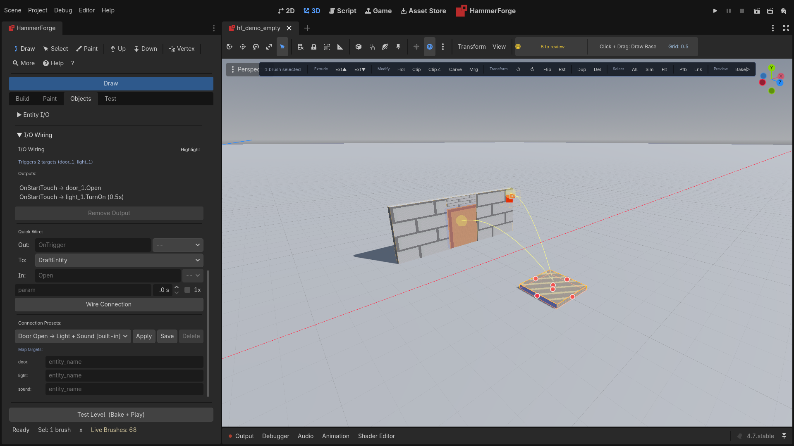

- Create DraftEntity button.
- Entity palette with drag-and-drop placement. A class with presets gets a button for each one beside its own, such as **Point Light: Warm Ceiling**, which places the light with that preset's values.
- Selected `DraftEntity` nodes use the same managed **Delete**, **Ctrl+D Duplicate**, arrow-key X/Z nudge, and PageUp/PageDown Y nudge workflow as brushes, including HammerForge undo/state cleanup.
- **Entity Properties** (collapsible, context-hidden): auto-generated typed controls based on entity definition. Visible when a point entity is selected, and when a brush tied to an entity class is — a `func_door`'s Speed, Wait and Angle are set here, and so are a `func_button`'s Wait and Locked. A brush entity's values are stored with the brush and survive a `.hflevel` save and a `.map` round trip. Select several entities, point entities and tied brushes alike, and the panel edits them together: it lists every property any of them has, one only some have says how many, as **Angle (3 of 12)**, and one whose values differ shows a dash. A value typed goes on each selected entity that has the property, as one undo step, so twelve lights take one Energy at once. The Entity I/O and wiring sections stay one entity's, the first selected, and the panel says which ([#1729](https://github.com/saworbit/hammerforge/issues/1729)). A value still at its class default reads lighter than one set on purpose, which has a **Reset** beside it that puts the default back. **Reset to Default** under the properties puts every one back, and **Write Defaults** gives each selected entity the default of any property its class has and it does not hold yet, such as one a definition file gained since, leaving set values alone. Each edit is an undo step, and typing in one field makes one step rather than one per key. A class with presets starts the panel with a **Preset** list: picking one sets every value it names as one undo step. Lights come with Warm Ceiling, Cool Fluorescent and Practical, and the directional light with Sun. A property that names a file, such as an `ambient_sound`'s **Stream** or a light's **Projector**, has a **...** button beside it that picks one, and a sound has a **Play** button that plays it in the editor. Press Play again to stop it; it also stops when the selection changes.
- **Entity I/O** (collapsible, context-hidden): Output, Target, Input, Parameter fields. Delay (seconds) and Fire Once checkbox. Add Output button. The list of an entity’s connections, and the Remove that acts on it, live once, on the **I/O Wiring** panel below. An output needs a name, a target and an input — blank is refused rather than added as a connection that does nothing — and the delay has to be zero seconds or more. Only visible when an entity is selected; connections auto-refresh on selection change. **Show I/O Lines** checkbox to visualize connections in the viewport. **Wires** beside it chooses which ([#1730](https://github.com/saworbit/hammerforge/issues/1730)): **All wires**; **Chain from selection**, every wire reachable from the selected entities, following outputs to their targets and inputs back to their sources as far as they go, drawn from bright yellow at the selection's own wires to faded blue five hops out, so the order of a sequence reads; or **Selection only**, the wires that start or end at a selected entity. A loop of wires is walked once. **Cycle I/O Wires** in the command palette steps through none, all, chain and selection only, and can be given a key. The choice is kept in your preferences, not in the level.
- **I/O Wiring** (collapsible, context-hidden, collapsed by default): the entity’s current outputs with a **Remove Output** button beside them, and a quick-wire form (output name, target dropdown, input name, parameter, delay, fire-once). The target dropdown lists a named brush entity once by its name, and a brush entity with no name by each of its brushes' node names, any of which reaches the whole entity. Only visible when an entity is selected. Connection summary shows triggers and triggered-by counts. **Highlight** toggle button pulses all linked entities in the viewport. **Connection Presets** picker with 4 built-in patterns (Door+Light+Sound, Button→Toggle, Alarm Sequence, Timer Lights), written in the names the shipped classes raise and answer, plus user-saved presets, with **Save** and **Delete** beside it. Target tag mapping lets you assign preset target placeholders to actual entity names; a tag you leave empty is skipped and named in the status line rather than wired at an entity called after the tag. A saved preset whose name is already in the list gets a number, so two rows never read the same.

> **Progressive disclosure:** During greyboxing, the Objects tab shows only the entity palette and create button. Entity Properties, Entity I/O, and I/O Wiring sections appear automatically when you select an entity, keeping the UI clean when you're focused on shapes and layout.
  - **I/O connection lines**: Bézier curves with arrowheads, color-coded by output type (cyan=OnTrigger, red=OnDamage, yellow=OnUse, green=OnOpen, magenta=OnBreak, orange=OnTimer). Fire-once connections pulse brighter; delayed connections dim proportionally. Parallel connections between the same pair offset laterally. An output aimed at a name no entity answers to is drawn as a short red mast with a cross on top, rising from the source entity — deliberately not an arrow, because there is no destination to point at.
  - **Highlight Connected**: when enabled, all entities wired to the selected entity display a pulsing overlay. The context toolbar shows an "HL" toggle and an I/O summary label ("Triggers 2 targets (door1, light1)"). The highlight state stays in sync between the context toolbar and the wiring panel.

### I/O Runtime Signal Translation

Entity I/O connections are automatically translated into live Godot signals when you bake or export a playtest scene. No manual signal wiring is required.

**How it works**: An `HFIODispatcher` node is injected into the exported/baked scene. On `_ready()`, it scans all entities for `entity_io_outputs` metadata and builds a connection table. When a source entity fires an output, the dispatcher delivers to each target via:
0. The engine method the target's own class granted for that input name
1. Direct method call (e.g. `Open()`, `Kill()`)
2. Snake-case variant (e.g. `turn_on()` for `TurnOn`)
3. Generic handler (`_on_io_input(input_name, parameter)`)
4. User signal (`io_Open` emitted on the target)

A wire with no delay is delivered at once, inside the output that raised it, so a chain of them runs in one frame in the order it was wired. A chain that comes back round to where it started, such as two relays wired to each other, is stopped after 64 hops and named once in a warning, rather than running until the game freezes ([#1218](https://github.com/saworbit/hammerforge/issues/1218)). Give one wire in the loop a delay if it is meant to repeat. `io_fired` and `io_received` go out once per delivery, however many nodes the target baked into.

Only methods the target's own script defines are called at steps 1 and 2. An input whose name resolves to an engine method -- `QueueFree`, `Free`, `Hide`, `SetScript` and anything else on `Node` or `Object`, before or after the snake-case conversion -- is not called, and falls through to the generic handler and the user signal instead, with a warning naming the input and the target. Handle those deliberately in `_on_io_input` if your game wants them.

Step 0 is how a shipped class says it means one of those on purpose. An entity definition may carry `input_methods` naming the engine method behind an input, the same way a property carries `maps_to` naming the engine property behind it:

```json
"logic_timer": {
  "class": "Timer",
  "input_methods": { "Start": "start", "Stop": "stop" }
}
```

The grant is per class, so it never widens what a free-text input name can reach. A granted method is called in the shape the engine declares: one that can take no argument is called with none when the connection carries no parameter, and a parameter that is there is converted to the type the argument declares. `Start` with `2.5` in the parameter field is a two and a half second timer.

**A door that moves**: a `func_door` or `door_basic` bakes into a holder of its own, carrying the mesh and the collision together, with a script that reads the class's `speed`, `wait` and `angle`. `Open` slides it its own extent along the angle at `speed` metres a second, `wait` seconds after it gets there it closes itself (zero or less means it stays open), `Close` puts it back and `Toggle` does whichever is next. The angle is the one TrenchBroom and the Quake family use, seen from above: 0 is +X, 90 is -Z (north in a `.map`), 180 is -X and 270 is +Z, so a door opens the same way on both sides of a `.map` round trip. -1 lifts the door by its height and -2 lowers it, for a portcullis or a lift gate. HammerForge's Rotate and Flip turn a door's angle with its brushes ([#1210](https://github.com/saworbit/hammerforge/issues/1210)), and so does any other turn about the vertical: Godot's own rotate gizmo or Inspector and their undo, Reset Rotation, or the Agent Bridge's `hf_transform_brush` ([#1256](https://github.com/saworbit/hammerforge/issues/1256)). `Lock` and `Unlock` decide whether `Open` is listened to. It raises `OnOpen` and `OnClose` as it goes, so a door can drive a light or a sound. A door of several leaves raises `OnOpen` as its first leaf opens and `OnClose` as its last one shuts, whichever leaf holds the wire. Brushes tied under one name are one door, and every leaf slides the whole door's extent, as a Quake door of several brushes does, so two leaves side by side across a doorway clear it sliding the same way ([#1217](https://github.com/saworbit/hammerforge/issues/1217)). A double door that parts in the middle is two doors: tie each leaf under a name of its own, give them opposite angles, such as 90 and 270, and wire the trigger or button to both. A wire aimed at one leaf, by the door's name or by a leaf's node name, reaches the whole door, and the same goes for one brush of a trigger or a wall.

**Enable and Disable on a brush entity**: a baked `func_wall`, `trigger_once` or `trigger_multiple` answers `Enable` and `Disable` itself, since the bake built the node and there is no script on it. `Disable` hides a wall and takes its collision out, or stops a trigger detecting bodies. `Enable` puts it back. The `io_Enable` and `io_Disable` user signals still go out as well. A `func_wall` has to be named for a connection to reach it.

**A relay and a light**: a `logic_relay` answers `Trigger` by raising its own `OnTrigger`, so one wire into it drives every wire out of it, each with its own parameter. With **Fire Once** ticked it passes the first `Trigger` and no other. `light_point`, `light_spot` and `light_directional` answer `TurnOn`, `TurnOff` and `Toggle` by showing and hiding the light. Their user signals still go out, so a game that wants a fade can listen for them ([#1209](https://github.com/saworbit/hammerforge/issues/1209)). Untick a light's **Start On Load** for one that starts dark and waits for its `TurnOn` ([#1258](https://github.com/saworbit/hammerforge/issues/1258)). The viewport draws its marker the same either way.

**What raises an output**: a trigger volume raises its own. A baked `trigger_once` or `trigger_multiple` fires `OnStartTouch` when a body enters it and `OnEndTouch` when one leaves, with no help from the game -- a body entering is the whole event. `trigger_once` fires the first time and then stops. `trigger_multiple` fires `OnStartTouch` again only once its **Retrigger Delay** (`wait`) has passed since it last fired: zero is every time and below zero is once. Leaving is not held back. A `logic_timer` raises its own too: `OnTimer` fires each time the `Timer` it exports as times out. It starts when the level loads. Untick its **Start On Load** for a timer that should wait for its `Start` input. Test Level builds the `Timer` too, and the lights and sounds, the same as the two exports (#840). A class says which engine signal raises which output with `output_signals`, the counterpart of `input_methods`: `"output_signals": { "timeout": "OnTimer" }`.

Everything else is the game's to raise, because it depends on something the game decides. Pressing is the clearest case: the playtest player rays from the camera on its **Use** key (**E**), and when it finds a `func_button` it calls `HFIORuntime.press_button_on(node)`, which hands it to `press_button()` on the dispatcher of the button's own level. That fires `OnPressed` unless the button is locked or still inside its **Reset Delay** (`wait`) since it last fired. A game with its own player does the same thing in its own interact code. A button answers `Lock` and `Unlock` itself, and a `Press` input presses it through the same lock and wait. A trigger's, a button's and a door's wait, and a wire's delay, are game time: `Engine.time_scale` stretches them and a pause holds them ([#1136](https://github.com/saworbit/hammerforge/issues/1136), [#1140](https://github.com/saworbit/hammerforge/issues/1140)). The dispatcher connects a trigger's signals at runtime only -- a regular editor bake attaches a dispatcher too, and a volume that ran the graph because a mapper dragged a brush through it is not wanted.

At steps 1 and 2 the call shape comes from the handler rather than from whether a parameter was typed. A handler declared `func Open()` is called with no argument even when the connection carries a parameter, and `func Open(parameter: String)` is called with the empty string when the connection carries none. A handler needing two or more arguments cannot be satisfied from one parameter field, so it is skipped with a warning and the input falls through to the generic handler and the user signal.

**Firing outputs from game scripts**:
```gdscript
# From any entity script at runtime:
HFIORuntime.fire_on(self, "OnTrigger")

# Or via the dispatcher directly:
var dispatcher = $HFIODispatcher
dispatcher.fire("my_button", "OnPressed", "fast")
```

**Configuration**:
- **Export Playtest**: always auto-injects the dispatcher when entities have I/O connections.
- **Bake Wire I/O**: on by default. Regular bakes and Test Level attach `HFIORuntime` when any entity has I/O connections. Uncheck `bake_wire_io` on LevelRoot (Inspector) to skip dispatcher attach.
- Source entities receive `io_<OutputName>` user signals (e.g. `io_OnTrigger`) so you can also use standard `connect()` / `emit_signal()` patterns.

### Test tab (collapsible sections)

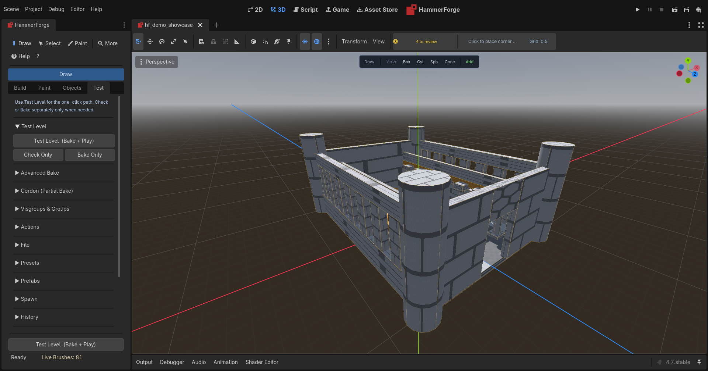

- **Test Level**: **Test Level (Bake + Play)** is the one-click default. **Check Only** validates without baking and **Bake Only** produces geometry without launching. **Play from Camera** and **Play Selected Area** remain available for focused testing.
- **Advanced Bake**: Bake Selected/Changed, dry run, mesh, LOD, lightmap, navmesh, face material, preview, collision, chunking, occluder, and connector controls are collapsed until needed.
- **Actions**: Create Starter, Create Empty/Create Floor, Apply/Clear/Commit/Restore Cuts, and Clear Brushes.
- **Spawn**: Validate Spawn (bakes, then runs physics-based checks and shows debug overlay), Create Default Spawn (auto-places a `player_start` over the middle of the level, on the top of the floor there, at the height Validate Spawn checks for: 0.1 for the feet plus the `height_offset` default of one metre. Under a ceiling too low for that, such as a standard 3 metre room, it takes the most height offset that still leaves the player room, written into its own **Height Offset**, rather than going out onto the roof), Preview Spawn Debug (bakes, then shows persistent capsule/ray overlay toggle).
- **File**: Save/Load .hflevel, Import/Export .map (Classic Quake / Valve 220), Export .glb, and **Export Plan...**, which writes a top down plan of the level as an `.svg` and a `.png` beside it: solid brushes filled, cut brushes hatched, entities by kind, I/O wires, cordons dashed, a scale bar and an arrow to -Z, drawn from the brushes so it needs no window ([#1705](https://github.com/saworbit/hammerforge/issues/1705)). For one floor of several, or for CI, `godot --headless -s res://tools/export_plan.gd --path . -- level.hflevel plans/upper --y-min=3 --y-max=6` writes the same plan for a height band.
- **Presets**: Save/rename presets grid. Presets are saved in `res://hammerforge_presets/`, so replacing the addon folder on an upgrade keeps them.
- **History**: Undo history browser with thumbnails, color-coded action icons, double-click navigation, undo/redo buttons.
- **Settings**: Show HUD, Size at cursor, Draw hover preview, Show agent changes, Show selection size, Show Grid, Grid follows cursor, Debug Logs, Autosave path/toggle, Settings Export/Import, Reset Tool Settings. Cursor following slides along the current drawing plane and keeps an aligned height exact. **Show selection size** (also **Alt+D** and the command palette, off by default) labels the width, depth and height of the selection's world bounds in the viewport, coloured by axis: width along the bottom front edge, depth along the bottom side edge, height up the corner between them. A face selection labels the bounds of its faces. The labels follow a nudge, a resize handle or gizmo drag as it goes, a vertex drag, an Extrude and an undo; they are view state and never saved. Both switches are kept with your preferences, not in the level. Under the **Colours** heading at the end of Settings, a colour button sets each overlay colour: Selected brush (the outline of a selected brush or entity, drawn faintly round the rest), Selected face (the tint on faces picked in Face Select), Hover (the outline of the brush under the cursor, and a hovered vertex or edge), Vertex handle and Selected vertex (edges draw the handle colour at half strength), Additive brush and Subtractive brush (the see-through look of a solid or a cut with no material, and a cut's outline), Cordon wireframe (fainter for a cordon switched off), Extrude up and Extrude down (the hovered face and the ghost while extruding), Draw preview (the solid being drawn), Pending cut (a cut waiting for Apply, and a cut being drawn) ([#1680](https://github.com/saworbit/hammerforge/issues/1680)), the brush entity looks: func_detail, trigger_*, func_wall, func_clip and Other brush entity ([#1760](https://github.com/saworbit/hammerforge/issues/1760)), and Agent change (the outline round what an agent just changed over the bridge, which **Show agent changes** turns off) ([#1653](https://github.com/saworbit/hammerforge/issues/1653)). A change shows in the viewport at once, on what is already drawn. **High Contrast** sets all eighteen to colours that stay apart for the common kinds of colour blindness, with solids and cuts told apart by brightness as well as hue and no brush entity drawn blue under the blue selection, and **Reset** puts the defaults back. The colours are kept with your preferences, not in the level, and never reach a bake.
- **Performance**: Health summary (green Healthy, yellow Edits Slowing above 100 brushes and entities, red Edits Pause above 1,000; the pause after an edit is what grows with the count, [#1622](https://github.com/saworbit/hammerforge/issues/1622)), brush count ProgressBar, entity count, vertex estimate, paint memory, chunk count, last bake time from pressing Bake to the result, waits included ([#1623](https://github.com/saworbit/hammerforge/issues/1623)), recommended chunk size.
- **Visgroups & Groups**: Visgroup list with [V]/[H] toggle, New/Add Sel/Rem Sel/Rename/Delete, Cast Shadows for the highlighted visgroup, Group Sel/Ungroup.
- **Cordon**: Enable checkbox, cordon list with Remove, a Bake checkbox and a name for the chosen cordon, min/max spinboxes for it, Set from Selection, Add from Selection.
- **Prefabs**: Save/search/filter/delete prefabs. Browse with tag filtering and variant indicators. Drag-from the library to instantiate. Save Linked for live propagation. Right-click for variant/tag editing.
- **Agent Bridge**: Allow agent connections (MCP), a lamp, what the bridge is doing, and what the agent last did. See [Agent Bridge (MCP)](HammerForge_Agent_Bridge.md).

### Test Level and Spawn Validation
**Test Level (Bake + Play)** bakes the level and launches it with a first-person controller. It lights the level as Export Playtest Build does: when nothing in the scene sets an environment it adds the flat grey one, and when nothing lights it, a fallback sun. Before every test:

1. **Spawn lookup**: finds the active `player_start` entity (primary-flagged first, then first found).
2. **Auto-create**: if no `player_start` exists, a default is created over the middle of the level, standing on the top of the floor under it, at the height the validation below checks for. When something stands at the middle, such as a pillar or a crate, the spawn moves out a grid step at a time to the nearest place over a floor with room for the player. In a room cut out of a block, the floor is the bottom of the cut, not the block's roof.
3. **Validation**: physics-based checks (floor raycast, capsule collision, headroom, below-map), and a check that the spawn is not inside a brush, read from the brushes' own faces and the cutters that carve them. The floor is the higher of what the ray hits and the brush floor under the spawn, so a floor built from brushes counts before the first bake. Issues appear as toasts and optional debug overlays.
4. **Fix dialog**: critical issues (severity ≥ 2: inside geometry, floating in void) show a dialog offering "Fix & Play" or "Cancel". Fix & Play snaps the spawn to the floor under it, or for a spawn inside a brush moves it sideways along its floor to the nearest clear place. With nowhere to move it, the button reads "Play Anyway". Severity 1 warnings toast and proceed.
5. **Launch**: bakes geometry + collision, then runs the scene with the FPS controller spawned at the validated position, facing the spawn's angle. The angle turns with the spawn however it is turned: Rotate, Godot's gizmo or the Inspector (#1285). The running level swaps each entity marker for the node its class names, so a light lights and a `logic_timer` fires.

#### Play from Camera
Click **Play from Camera** in the Test tab to playtest from your current editor camera position:
- The spawn entity is temporarily moved to the camera position; camera yaw is written to `entity_data["angle"]`.
- The level bakes, spawn is validated, and the playtest launches.
- The spawn is put back to its original position and angle before the launch, because Godot saves the scene on the way into a run. The run gets the camera pose from the launch request instead.
- On validation failure (severity ≥ 2), the spawn is restored before showing the fix dialog. There, Fix & Play starts the run at the clear spot the check found beside the camera, and Play Anyway starts it at the camera. Neither moves the spawn.
- The temporary move is not recorded in undo history.

#### Play Selected Area
Click **Play Selected Area** to bake and playtest only the region around your current brush selection:
- The current cordon state (enabled, every cordon with its name and Bake switch) is saved.
- A temporary cordon is set from the AABB of the selected brushes and switched on. Any other cordons are set aside, so the bake takes the selection alone.
- The level bakes within that cordon, spawn is validated, and the playtest launches.
- The original cordon state is restored (enabled/disabled, every original cordon with its name and switch) before the launch, so the saved scene keeps it. The run bakes the selected area from the launch request.
- On validation failure (severity ≥ 2), the cordon is restored before showing the fix dialog. Fix & Play and Play Anyway still play the selected area alone.

#### Export Game Scene
Click **Export Game Scene** in **Test → Advanced Bake** to write the level as a scene a game loads. It bakes the whole level, with any cordon set aside for that bake and back on afterwards, then saves a `.tscn` beside the level's own scene, named after it. The contents are the same geometry, the starter's floor when the level has one, and the same real entity nodes as a playtest export — a `light_point` as an `OmniLight3D`, a `logic_timer` as a `Timer` — with no playtest player, no fallback sun and no debug environment. That is the difference between the two buttons, and the player is the one that matters: two character controllers in one scene is a bug in the game.

A sky, fog or ambient light you set up with a `WorldEnvironment` in the level stays out of the game scene, because a game usually owns its environment. Tick **Include Level Environment** under the button to take it along.

The **Export with** list under the button picks the bake profile the export bakes on. It starts on **Shipping**; **Level's own options** bakes on whatever the level is set to. Afterwards the level's own options come back, with no undo step, so editing carries on as it was. While it bakes, the Profile list and the options a profile sets do not change; change them when the export finishes. An option you set from the Inspector while it bakes is kept rather than put back, and the toast names it. When it is done, the toast names the profile the scene was baked with. On **Editing** it is a warning, because unmerged meshes and no LODs are right while a level changes and wrong in a game: pick **Shipping** under Export with and export again.

See [Shipping a Level](HammerForge_Shipping_A_Level.md) for the bake options a shipped level wants and how to get lighting baked into it.

#### Export Playtest Build
Click **Export Playtest Build** in **Test → Advanced Bake** to create a standalone playable scene:
- If no spawn exists, auto-creates a default (fully undoable with state capture).
- Bakes the level in Full mode.
- Validates the spawn on the baked level, as Test Level does: severity ≥ 2 shows the fix dialog, where Fix & Play or Play Anyway goes on to export and launch, and severity 1 warns and carries on.
- Packs baked geometry, brush entities, point entities, DefaultSun and the starter's TempFloor (if present), and fallback lighting (a DirectionalLight3D if no light exists) into a temporary scene at `user://hammerforge_playtest.tscn`. The environment is the level's own `WorldEnvironment` when you added one to the level, and a flat grey one when you did not.
- Adds the playtest player controller at the active spawn and applies the spawn's yaw. It walks on **WASD**, jumps on **Space**, and presses a `func_button` with **E** when the reticle is on one within 2.5 units.
- Preserves world transforms while reparenting export content and recursively owns nested geometry/collision so it survives scene packing.
- Injects the entity I/O runtime automatically when the exported content contains connections.
- Initializes only the runtime level core in the exported scene. Grid, drawing, snapping, selection, previews, prefab authoring, validation, undo, and other editor services are not loaded or constructed by export templates.
- Launches the scene via `EditorInterface.play_custom_scene()`.
- A toast confirms "Playtest launched" on success.

### Incremental Bake
For iteration on large levels. Both can end up rebuilding the whole level, as below; [Performance and Limits](HammerForge_Performance.md#baking) has measured bake times by brush count.
- **Bake Selected**: bakes only the currently selected brushes and merges the output into the existing baked container. Geometry baked from other brushes is preserved, and an earlier Bake Selected of the same brushes is replaced rather than doubled. A full Bake merges brushes into one mesh that cannot lose one of them, so Bake Selected on a brush the last full Bake holds bakes the whole level instead and says so.
- **Bake Changed**: bakes when brushes or painted ground have been modified (dirty-tagged) since the last successful bake, and says there is nothing to do when none have. When it bakes, it rebuilds the whole level, so it takes as long as **Bake**. With Navmesh on, a `prop_static` moved, added, deleted or given another Scene is a change too, so the navmesh is cut where the prop is now. A paint connector confirmed with Enter, or taken back by Undo, is a change as well. Dirty tags survive failed bakes and accumulate until the next success.

A bake runs over several frames. Switch to another scene tab before it finishes and it stops with a message, keeping its dirty tags; bake again once you are back. Close the tab and it stops quietly (#1290).

### Bake Preview Modes
Use the **Preview Mode** dropdown in **Test → Advanced Bake** to choose how baked geometry renders:
- **Full**: standard material rendering (default).
- **Wireframe**: cyan wireframe overlay using a custom shader — useful for inspecting geometry topology.
- **Proxy**: semi-transparent grey unshaded material — ultra-fast rendering for layout testing.

**Quick Wireframe Preview**: When brushes are selected, the context toolbar shows a **Bake▷** toggle button. Click it to instantly bake with wireframe preview — you can see the final mesh topology before committing to a full bake. Click again to re-bake at full quality. This toggle:
- Is fully **undoable** (Ctrl+Z reverts both the bake and the toggle state).
- Stays **in sync** with the dock's Preview Mode dropdown — if you bake from the dock with Wireframe mode, the toolbar toggle reflects that.
- Is **disabled** while a bake is in progress to prevent overlapping operations.

### Bake Options

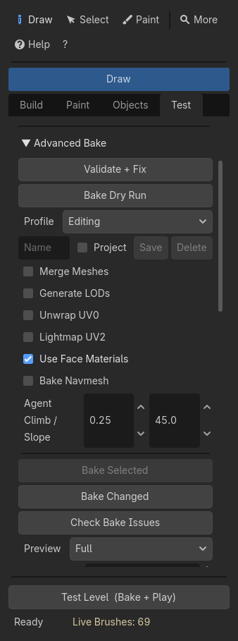
The **Test → Advanced Bake** section exposes additional controls:
- **Profile** (list, with a name box, **Save** and **Delete** under it): sets the bake options below in one step, and says which profile the level is on.
  - **Editing** turns Merge Meshes and Generate LODs off, for a fast bake while you build. **Shipping** turns them on, for a fast frame in the game. Both leave every other option alone: Lightmap UV2, Navmesh, Occluders and Chunk Size depend on the game and the level (see [Shipping a Level](HammerForge_Shipping_A_Level.md)).
  - **Your own.** Type a name and press **Save** to keep every option below under it, Navmesh agent sizes and collision mode included. Saving under a name you already used replaces it. Profiles are kept in your preferences, so every level in the project can use them. Editing, Shipping and Custom cannot be taken as names.
  - **The team's.** Tick **Project** before **Save** to keep the profile in `hammerforge_presets/bake_profiles.json`, beside the brush presets, instead. Commit that file and everyone on the project has the profile after their next pull, marked **(project)** in the list. When the project and your preferences both have a profile of the same name, the project's is the one listed, so Save will not write a copy of a project profile into your preferences. Delete removes a project profile from the file, which is a change to commit like any other. A value in the file this version cannot use is left out with a warning, and left in the file for anyone whose version can. A number past what its setting takes is held to the nearest it can take, with a warning, so the profile stays picked once you pick it. A file that does not read, such as one a merge left conflict markers in, is left alone: Save and Delete say so in the status line and write nothing until it is fixed.
  - **Picking one** sets its options as one undo step, and a toast says how many changed. Picking a saved profile puts its name in the box, so **Save** updates it and **Delete** removes it. Delete asks for a second press, because a deleted profile is not on the undo stack.
  - **Custom** shows when the options match no profile, for example after you change one by hand. The list reads the options each time, so it follows a load, an undo or an Inspector edit. When two profiles match, the one that sets more options is shown.
  - A profile never touches **Bake Visible Only** or the cordons. Those decide what goes into the bake, not how it is built.
- **Cast Shadows** (On, Off, Double Sided, Shadows Only; default On): how every baked mesh casts shadows, painted ground and connectors included, unless a brush in **Selection Tools** or one of its visgroups says otherwise. A brush's own setting beats its visgroups', and the visgroups' beat this one. A bake profile carries it, and the `.hflevel` saves it ([#1444](https://github.com/saworbit/hammerforge/issues/1444)).
- **Chunk Size** (SpinBox, 0-16384, default 0): spatial chunk size for bake grouping. 0 means one mesh, which is what a level wants until it is big enough not to; the Status board offers **Set chunk size N** once it is. The range is the level's own bound, so the Status board's recommended chunk size is a value this control can hold. Chunking applies on both bake paths, including the per-face one that `Use Face Materials` selects by default.
- **Bake Visible Only** (checkbox): skips hidden visgroups and invisible brushes during bake.
- **Material Atlas** (checkbox): packs per-face textures into a single atlas image so all atlased geometry renders in one draw call. Requires **Use Face Materials** to be enabled. Faces with tiling UVs (scale > 1) are automatically excluded and rendered as separate surfaces with their original material so texture repeat works correctly. Best for levels with many small non-tiling textures. HammerForge’s default projection maps world units into UV space, so an ordinary 64-unit face is 0..64 and counts as tiling: on a level built with the defaults this switch usually packs nothing. The bake now says which it did, in the Console Log — `Atlas: packed 4 of 6 material groups into one atlas`, or `Atlas: skipped, 6 of 6 material groups have tiling UVs`. Scale the face UVs into 0..1 on the materials you want atlased. Textures with painted layers or ShaderMaterials are not atlased. The atlas is at most 4096 pixels square, so a level carrying more texture than that holds packs what fits and renders the rest on their own materials, with a warning saying how many.
  - **PBR maps come along.** Normal, roughness, metallic, and emission maps are packed into parallel atlases over the same layout, so materials keep their surface response. A material that supplies no map for a slot contributes a flat tile carrying its own scalar (its roughness value, its metallic value, a flat normal, or black), so mixing mapped and unmapped materials is fine.
  - **Cost.** Each packed slot is a second full-size atlas image, so a level whose materials carry all four maps holds five atlases rather than one. Slots no material supplies are never built.
  - **When a slot is skipped.** The atlas material holds one multiplier and one texture-channel selector per slot, so every material supplying a map has to agree on them. If they disagree — different `roughness_texture_channel` values, different `normal_scale`, a metallic map left at the default `metallic = 0` multiplier — that slot is left out rather than baked wrong. Albedo still atlases. Give the mapped materials matching settings (multiplier 1.0 is the usual fix) to bring the slot back in.
- **Collision Mode** (0/1/2, default 0): controls how baked collision shapes are generated.
  - **0 — Trimesh** (default): one ConcavePolygonShape3D per material surface in each chunk, so a ray hit can name the material it landed on. Simple but worst-case for physics broadphase.
  - **1 — Per-brush convex**: each brush gets a ConvexPolygonShape3D (convex hull), and a brush a cut goes through gets one for each piece left round the cut, so a doorway stays open. A cut that is not convex, such as a torus, leaves the cut mesh's triangles instead, and the bake says so. Much better for physics queries and bot navigation.
  - **2 — Per-visgroup partitioned**: separate StaticBody3D per visgroup, each containing convex hulls for its member brushes. Best for navigation mesh generation and room-based broadphase.
- **Convex Clean** (checkbox, default on): deduplicate vertices before building convex hulls. Disable to keep raw vertex data (degeneracy guard still runs).
- **Convex Simplify** (slider, 0.0–1.0, default 0.0): reduce convex hull complexity by merging nearby vertices into an AABB-proportional grid. Higher values = fewer vertices = simpler collision.
- **Unwrap UV0** (checkbox): applies per-vertex planar UV projection during bake for surfaces that lack explicit UVs.
- **Generate Occluders** (checkbox): automatically generates `OccluderInstance3D` nodes from large flat surfaces during bake. The bake pass walks the entire baked hierarchy (including chunked bakes), groups triangles that are both coplanar and touching into flat surfaces, and emits one occluder per surface that exceeds the minimum area threshold. Touching is the important half: two walls that happen to share a plane but stand in different rooms are two occluders, because Godot gives each occluder a single bounding volume and one that spanned both would never be culled itself. This enables Godot's built-in occlusion culling at runtime without manual occluder placement. Sub-controls:
  - **Min Area** (SpinBox, 0.5–100.0, default 4.0): minimum flat-surface area in m² to emit an occluder. Raise this value to reduce occluder count (fewer culling tests); lower it to increase coverage (more surfaces act as occluders). Surfaces smaller than this threshold are skipped.
- **Auto Connectors** (checkbox): auto-generates ramps or stairs between paint layers at different heights during bake. Requires at least 2 paint layers with filled cells at adjacent grid positions and a height difference ≥ 0.1 world units. Sub-controls:
  - **Mode** dropdown: *Ramp* (smooth slope), *Stairs* (stepped), *Auto* (stairs once the height difference reaches the Stair Threshold, ramp below it).
  - **Step H** (SpinBox, 0.05–2.0): stair step height in metres (only affects Stairs/Auto modes).
  - **Width** (SpinBox, 1–8): connector width in grid cells.
  - **Stair Threshold** (SpinBox, 0.01–256.0, default 2.0): the height difference at which *Auto* picks stairs over a ramp. Saved with the level and used by live ghosts, confirmed connectors, Bake Check and the bake.
  The navmesh runs through a door rather than stopping at it, open or shut, and is cut around the collision of a `prop_static` whose scene has one ([#1196](https://github.com/saworbit/hammerforge/issues/1196), [#1197](https://github.com/saworbit/hammerforge/issues/1197)).
  Connectors are generated before navmesh baking, so the navmesh automatically covers connector surfaces. Auto-connectors are skipped during selection bakes (Bake Selected) to avoid pulling in unrelated geometry.
  **Step H** and the navmesh's **Agent Climb** have to agree. A step taller than the agent can climb bakes a staircase nothing that follows the navmesh can use, and both default to 0.25, so they start exactly on each other. Bake Check works out the connectors the bake would actually build, counts the staircases whose step is over the limit and names the tallest, so it stays quiet in *Ramp* mode, where **Step H** is never read, and it still measures a staircase you placed by hand with the connector tool, which carries its own step and bakes whether or not auto-connectors are on. The playtest player is separate and steps up to its own `max_step_height` (0.4 by default).
  A ramp has the same problem against **Agent Slope**. Its run is one grid cell and its rise is the height difference between the two cells, so with the default cell size and the default 45 degrees, a drop of more than about a metre bakes a ramp no agent will walk. Bake Check measures the connectors the bake would actually build, counts the ones over the limit and names the steepest.

When only specific brushes have been modified since the last bake, the main **Bake** button runs **Bake Changed**, which rebuilds the whole level as **Bake** does. Changing a bake setting counts as a change — the settings the last bake ran with are compared against the ones now set, so a rebake after flipping Bake Visible Only, a collision mode, a navmesh parameter or the cordon rebuilds in full rather than returning the previous result.

### Bake Issue Detection
Click **Check Bake Issues** to scan for potential problems before baking. The findings are listed under the button, one row each. **Select** selects the object a row names. Where the fix is one mechanical edit, **Fix** makes it as one undo step and checks again; a finding whose fix is a judgement call, such as how deep a floating cutter should sink, has no Fix. The list holds:
- **Degenerate brush** (severity 2): near-zero thickness on any axis — blocks play.
- **Oversized brush** (severity 1): very large dimensions — warning only.
- **Floating subtract** (severity 1): a subtractive brush that doesn't intersect any additive brush.
- **Overlapping subtracts** (severity 1): two subtractive brushes with intersecting AABBs.
- **Open edges** (severity 1): edges shared by only one face — geometry is not watertight.
- **Non-manifold edges** (severity 2): edges shared by 3+ faces — may cause bake artifacts.
- **Non-planar faces** (severity 1): faces with 4+ vertices where a vertex drifts off the face plane beyond `planarity_tolerance` (default 0.01 units). Common in imported .map geometry with floating-point drift.
- **Occlusion missing** (severity 1): occluder generation is enabled but no occluders were created (all surfaces below the minimum area threshold).
- **Occlusion coverage** (severity 0, info): reports occluder count and estimated coverage as a percentage of baked AABB surface area. Appears when occluders exist.
- **Micro-gaps** (severity 1): near-coincident but not-exactly-equal vertices across different brushes that would cause seam tearing after bake. Detected within `weld_tolerance` (default 0.001 units). Vertices closer than float rounding (0.00001 units near the origin, more further out) count as touching. The row's **Select** picks both brushes.
- **Stairs above agent climb** (severity 1): one or more connector staircases the bake would build have a step taller than the navmesh agent's max climb, so nothing that pathfinds can use them. Reported once with a count and the tallest. Only when Navmesh is on and the level has stairs to build, which means *Stairs* or *Auto* mode for generated connectors, or a staircase committed with the connector tool.
- **No player spawn** (severity 1): a level with brushes and no `player_start`. **Fix** makes one in the middle of the level, standing clear of anything there.
- **Spawn inside a brush** (severity 2): the line the player's capsule stands on runs through a solid brush, by the brush's own faces, where no cutter has cut it away. A room cut out of a block, a ramp and a trigger volume do not count. **Fix** moves the spawn sideways along the floor it stands on, a grid step at a time, to the nearest place it stands clear. This reads the brushes, so it needs no bake; **Validate Spawn** is the full physics check.
- **Visgroups disagree on Cast Shadows** (severity 1): a brush with no Cast Shadows of its own is in two visgroups that set different ones. The visgroup higher in the visgroup list decides, and the row names the brush, the visgroups and what it bakes with. Give the brush its own Cast Shadows in Selection Tools to settle it.
- **Ramp above agent slope** (severity 1): one or more connector ramps the bake would build are steeper than the navmesh agent's max slope. Reported once with a count and the steepest. Only when Navmesh is on and the level has connectors to build.

**Auto-fix helpers** (also reachable directly on `level_root.validation_system`):
- `weld_brush_vertices(brush)` — snaps near-coincident vertices to their average. Refreshes face normals and bounds automatically.
- `fix_non_planar_faces(brush)` — projects drifting vertices back onto the face plane.

Validate also measures what you build for the player to walk through against the playtest player itself: a flight of three or more steps whose risers are over the 0.4 m it steps up, a doorway (a cut right through a wall, down to its foot) narrower than the player or lower than it even crouched, and a wedge ramp steeper than 45 degrees that leads up onto a floor. A step is read by its top, so the floating slabs of an open flight and the treads of the Spiral Stairs generator count as steps ([#1212](https://github.com/saworbit/hammerforge/issues/1212)), and the playtest player stops at a riser over its step height from any angle ([#1216](https://github.com/saworbit/hammerforge/issues/1216)). A cut that runs out of the top of a low wall leaves nothing over the gap, so only its width is measured ([#1215](https://github.com/saworbit/hammerforge/issues/1215)). A doorway the player has to crouch through is an info, not a warning. Each names both brushes, and **Select** picks the pair. Stairs, walls and ramps turned together to any angle are measured as if square to the world, and box steps each turned their own way, such as a spiral of boxes, are followed step by step from above ([#1095](https://github.com/saworbit/hammerforge/issues/1095)). A flight that turns partway is one flight, reported once ([#1104](https://github.com/saworbit/hammerforge/issues/1104)). A stair whose Collision is Ramp is measured by the ramp the bake lays over it, not its steps ([#1588](https://github.com/saworbit/hammerforge/issues/1588)). A cut through a `func_wall` or a `func_detail` is no doorway, because the bake never opens one, and a cutter tied to an entity class makes none ([#1563](https://github.com/saworbit/hammerforge/issues/1563)). A `func_clip` is left out of the stair, doorway and ramp checks.

**Validate** and **Validate + Fix** list what they find in the same rows as Check Bake Issues, each with **Select** on the brush or entity it names, and still log every line to the Output. Validate + Fix lists what is left after its repairs. Its findings have no Fix button of their own; the repairs it can make are the ones Validate + Fix already makes.

`validate_level(true)` runs both over every brush in the level as part of its geometry pass, so a level imported from another editor can be cleaned up without calling them per brush. That pass also reports a brush whose size or transform is not a number, a brush with no faces (which auto-fix deletes, since there is nothing to repair), and a vertex that is not a number (reported only — there is no nearest position to a NaN).

`validate_level()` checks that every brush is still a convex solid, which is the one property a brush in this lineage has to have and the same test that gates the vertex tools. There is no auto-fix for a brush that is not: it is two solids or a bent one, and guessing which was meant would throw geometry away. Merge will not make one any more, but a `.map` import or a hand edited `.tscn` still can.

It also says when the level has no player spawn, or when the spawn sits outside the level's bounds. A spawn standing on the level's top, as on the ground of an outdoor level, counts as in it. This one is deliberately geometric rather than the physics check behind **Validate Spawn**: that needs collision, and collision comes from the bake, which is why the button bakes first. Validate runs on an unbaked level, so it answers the question it can answer honestly without one.

It reports two brushes in the same place: `2 brushes occupy the same space: crate_1, crate_2`. That is Ctrl+D followed by a drag that did not take — the copy is exactly on the original, so nothing looks wrong in the viewport, and what the level gets is doubled triangles over the whole overlap and z-fighting on every coincident face. The check is deliberately narrow: position, size and shape all matching within an epsilon. Brushes are meant to intersect, so ordinary overlap is not reported. There is no auto-fix, because deleting one of a pair is a guess about which one you want.

It also reports brushes that add nothing to the bake, none of which shows in the viewport ([#1708](https://github.com/saworbit/hammerforge/issues/1708)):

- `Cut brush cuts no solid brush: Cut_7`. A cut left behind when the wall it cut moved, or placed a little off. It removes nothing, and it still sends the whole bake down the CSG path rather than the face material one. The cut is measured against each solid as a convex shape, so a turned cut whose box crosses a wall it misses is still found. A bake that takes the CSG path names these cuts in the Console as well.
- `Solid brush is wholly inside another: crate inside hall`. Every corner of the first is inside the second, to within a millimetre. It adds nothing to the outside surface and leaves faces inside the solid. One poking out by a centimetre is not reported.
- `Brushes are the same to within 1 mm: wall, wall_2`. The check above with a tolerance, for a copy moved by a rounding error rather than not at all. The row is on the later brush, the copy.

Below the rows, each of these kinds gets a row of its own with **Select All**, which selects the brush each finding is about (the cut, the brush inside, the later of each pair), so you can look and press Delete. The near pairs also get **Keep First**, which deletes the later brush of each pair as one undo step and validates again. Nothing is deleted until you press it.

A prefab instance whose `.hfprefab` has been deleted or moved is reported as a missing dependency. The instance goes on working, because its brushes are real brushes, so the only other sign is Cycle Variant doing nothing.

`validate_level()` also resolves every I/O connection's target name against the entities in the level and reports the ones that miss: `I/O connection points at 'door_1', which no entity answers to: button_1.OnPressed`. Wiring is held by name, so renaming a target in the Scene dock or in the Objects tab breaks every wire aimed at it. It is reported only; deleting a mapper's wiring is not something auto-fix does on its own. It also reports a name more than one entity answers to. The brushes of one tie count as one entity, so a door of two leaves tied under one name is fine, while two doors tied apart under one name are reported, because the name makes them one entity without anyone saying so.

Both tolerances (`weld_tolerance`, `planarity_tolerance`) are configurable per-instance for noisy imported geometry.

Issues appear as color-coded toast notifications.

### Non-Blocking Face Bakes
When **Use Face Materials** is enabled, full bakes yield back to the editor every 8 brushes so the UI stays responsive during large bakes. A progress label shows "Collecting faces N/M" as geometry is processed. The bake operates on a snapshot of brush state taken at the start, so editing brushes while a bake is running will not produce mixed results — changes are picked up on the next bake.

### Bake Time Estimate
The Test tab shows an estimated bake time: the last bake's time divided by the brushes that bake took, times the brushes in the level now, or 2 ms a brush before the first bake. A Bake Selected takes only its selection, so after one the estimate is still a whole level's ([#1590](https://github.com/saworbit/hammerforge/issues/1590)). Frame-yield idle time during face bakes is excluded from the estimate so it reflects actual work, not editor frame pacing. If the level has more than 500 brushes, a tip to chunk the bake so the game can cull it appears; chunking does not shorten the bake ([measured](HammerForge_Performance.md#baking)).

**player_start properties** (set in the Entity Properties panel):
- `primary` (bool) -- preferred spawn when multiple exist.
- `angle` (float, degrees) -- initial yaw rotation for the player.
- `height_offset` (float) -- extra height above floor for safety.

**Test tab → Spawn section**:
- **Validate Spawn** -- triggers a bake, then runs validation against real collision geometry and shows debug overlay (green/red capsule, floor ray, ceiling ray) for 10 seconds.
- **Create Default Spawn** -- places a `player_start` over the middle of the level, standing on the floor under it, if none exists. Fully undoable and redoable.
- **Preview Spawn Debug** -- triggers a bake, then shows persistent overlay toggle (stays visible until unchecked).

### Toast Notifications
Transient notifications appear in the dock for important events:
- **Save/load/export** results (success or failure).
- **Bake** completion or errors.
- **Operation errors** with actionable hints (e.g. "Wall thickness 6 is too large — Use a thickness less than 5").
- **Reference cleanup** reports (e.g. "Removed 2 I/O connection(s) targeting deleted brush 'door1'").
- **Autosave failures** (also shown as a persistent red warning label).
- Notifications auto-fade after 4-8 seconds depending on severity (INFO, WARNING, ERROR).

### Context Hints
Each tab shows a contextual hint at the bottom guiding you through the workflow:
- Build tab: start with **Create Starter**, then draw; selection reveals Hollow, Clip, and Extrude actions
- Paint tab: "Draw some brushes first, then paint them here"
- Objects tab: drag an object from the palette into the viewport
- Test tab: use **Test Level** for the one-click path; check or bake separately only when needed

### Object and Face Marquee Selection

In **Select mode**, click a visible surface or begin on empty viewport space and drag. Godot decides the click target, drag threshold, region hits, modifier meaning, transform/property-widget hits, and resulting `EditorSelection`; HammerForge does not approximate those private shapes with a circular dead zone. Brush gizmos register filled triangles from the real brush faces. Entity gizmos combine visible nested preview triangles with restrained local markers for any broken or line-only sibling, including top-level preview children, so one healthy component cannot hide an incomplete one. A truly geometry-less entity gets a one-unit marker at its origin; hidden previews and hidden parents leave no invisible target. Hold **Shift** for Godot's native additive/active-selection behavior. Ctrl/Cmd remain Godot-owned rather than acting as a HammerForge object toggle. Grouped HammerForge brushes are normalized as one unit after Godot finishes.

In **Face Select mode**, the saved object selection and its transform/resize gizmos are hidden, and HammerForge owns face click and marquee selection. Drag at least 6 pixels across one or more brushes. A candidate face must be on a canonical, visible brush and have its screen-projected center inside the rectangle; HammerForge then ray-picks that center and accepts the face only when the same brush/face is the frontmost visible hit. Hidden, back-facing, or occluded faces do not come along merely because their centers overlap the rectangle. Tick **X-ray** beside Face Select Mode, or press **Alt+X**, and the marquee instead takes every face of a visible brush whose center is inside the rectangle and in front of the camera, covered or facing away, so one drag over a room seen from outside takes its inside walls too. While X-ray is on the HUD says so and the rectangle is drawn amber rather than blue. A brush hidden on its own or by a visgroup still gives no faces. Shift adds and Ctrl/Cmd toggles using the modifier state captured at LMB-down. Disable the mode to return to the prior object selection, leave Paint or choose an incompatible tool to close it cleanly, or select an object in the Scene tree to edit that object directly.

### Resize Handles and Widget Protection

Selected non-custom brushes show six yellow face handles; custom face-defined shapes keep their truthful boundary outline without misleading box handles. A handle drag owns its full press/motion/release sequence, so it cannot also click an object, start a marquee, paint, or activate another tool. Godot's move/rotate/scale widget and native property gizmos receive the same protection and remain responsible for their own exact hit-testing.

Resize distances and grid snap are measured in world units, which are metres (see **World scale**). A handle snaps its extent to the grid while Grid (G) is on, and **Ctrl** held turns that the other way; with Vertex (V) on, or **Alt** held, the face stops level with another brush's vertex near the cursor (see **Snap Modes**). If a brush is below a rotated or non-uniformly scaled parent, the grabbed face follows the transformed local axis, the opposite face stays fixed in world space, and the local brush size is adjusted to produce the requested world extent. Sphere handles keep X/Y/Z equal. On cylinders, cones, and capsules, either X or Z handle changes the shared X/Z radius; Y changes height, but a capsule can never become shorter than its diameter. Odd-sided prisms and adjustable pyramids now fill their centered stored bounds, so their visible faces and handle planes agree. Other supported shapes keep independent axes. A collapsed or invalid transform axis is ignored instead of causing a jump. One completed resize creates one undo step; a click with no change, an explicit cancel, or a recovered lost release creates none. During lost-release recovery the original preview is restored and frozen; if Godot never sends its matching release callback, HammerForge releases the local input latch after the recovery turn and ignores a late callback, so the next handle gesture cannot remain blocked.

### Picking Visibility and Depth

Click and hover picking ignores brushes, entities, and preview visuals hidden by a visgroup. Brush bounds are only a fast candidate check: the final hit uses the actual face triangles, so a ray through empty space inside a wedge, cone, pyramid, curved, or custom brush does not select or hide geometry behind it. Entity previews are picked from their visible geometry even when that geometry is stored as an internal editor child. When geometry overlaps in screen space, HammerForge compares brush and entity hits in the same world-space ray and chooses the genuinely nearest visible result, including when either object is scaled.

Surface placement uses the same exact brush-face fallback when editor draft brushes do not yet have physics bodies. Draw placement, entity/prefab drops, and other callers of the shared editor raycast land on the visible non-box surface rather than an AABB wall; when no geometry is hit, the forward ray falls back to **the plane the grid is drawn on** — the one set by Grid Up/Down or Align Grid, or the last completed draw's base when it is not held. An axis lock stands it up on X or Z. Reset Grid releases a held plane and returns it to the LevelRoot origin.

### Selection Filters
Press **Alt+F** or click the **Flt** button on the context toolbar to open the Selection Filter popover. It provides bulk selection tools organized by category:

| Category | Filters | Description |
|----------|---------|-------------|
| **By Normal** | Walls, Floors, Ceilings | Select faces by surface direction. The three partition every direction between them: a face within 17 degrees of vertical is a wall, everything else is a floor or a ceiling by its sign, so ramps and chamfers come out with the floors |
| **By Material** | Same Material | Select all faces matching the selected face's material |
| **Select Similar** | Similar Faces, Similar Brushes | Faces: match material + normal (15°). Brushes: match size (20% tolerance, orientation-agnostic) |
| **Grow / Shrink** | Grow, Shrink, Same plane only, Max angle | The same as **Ctrl+]** and **Ctrl+[**, below, with the options they use |
| **By Visgroup** | *(dynamic)* | One button per visgroup — select all members |
| **By Type** | Detail, Structural | func_detail vs worldspawn brushes |

Filters only ever reach brushes you can see. A brush hidden on its own or by a visgroup is left out, so a material assignment made straight after a filter cannot land on geometry you hid on purpose. A filter that matches nothing leaves the current selection alone and says why ("No detail brushes in this level", "Select a face first, then Same Material").

### Select Similar
Press **Shift+S** to quickly select similar geometry without opening the filter popover:
- When **faces** are selected: selects every face on a visible brush with matching material AND normal direction (within 15°). These are the same faces **Similar Faces** in the popover selects.
- When **brushes** are selected: selects every visible brush with similar dimensions (within 20% tolerance, ignoring orientation/rotation), the same brushes as **Similar Brushes** in the popover.

### Grow and Shrink Selection
Press **Ctrl+]** to grow the selection by one ring and **Ctrl+[** to shrink it by one. Both are also in the command palette and in the **Grow / Shrink** row of Selection Filters.
- When **faces** are selected, Grow adds every face that shares an edge with a selected face: on the same brush, or on another brush whose edge runs along it. Faces that only meet at a corner are not added. Shrink drops every selected face that has an edge on a face Grow would add, so a Grow and then a Shrink gives a patch back.
- **Same plane only** keeps the grow to faces in the plane of the face they border, facing the same way: a floor made of several brushes, without climbing the walls standing on it. **Max angle** (degrees between the two faces' normals, 180 by default) stops the grow at a sharper turn: at 30, a grow goes round a 16-sided cylinder's sides and stops at its caps. Both apply to Shrink too, so shrink a selection of floor tops with Same plane only ticked: without it every top borders its own brush's sides.
- When **brushes** are selected, Grow adds every brush whose solid touches or overlaps a selected one, and Shrink drops every selected brush that touches one that is not selected. Touching is measured on the brushes' real shapes, not their bounding boxes, so a turned brush beside a staircase is not added because its box reaches a step.
- A brush hidden on its own or by a visgroup is never added. A Shrink that would leave nothing selected leaves the selection alone and says so, and one with nothing to add or drop says why. Selecting is not an undo step, so neither is a Grow or a Shrink.

### Invert, and Select With a Brush
**Invert Selection** selects every visible brush and entity that is not selected, and deselects the rest, so "everything except these" is two clicks ([#1717](https://github.com/saworbit/hammerforge/issues/1717)). What a visgroup hides stays out, so hiding the rest and then inverting does what you expect.

To pick a room, draw a throwaway brush around it, keep it selected and run one of these. The brush is deleted as one undo step, so the level is as it was and only the selection changes; Ctrl+Z brings the brush back.

- **Select Inside**: every brush wholly inside it, and every entity standing in it.
- **Select Partly Inside**: the same, and every brush that goes into it at all.
- **Select Touching**: every brush that touches or overlaps it, and every entity on it or in it.
- **Select Column**: as Select Inside, with its footprint running from the bottom of the level to the top, so a small box drawn on the floor in a top view picks what is above and below it on every floor.

The brush is measured as the shape it is, so a turned box picks what is in it and not what is in its bounding box. All five are in the command palette and in the viewport's right-click menu: Invert Selection at the bottom, and the four under **Select With This Brush** with a brush selected. None has a key by default; give one in the shortcut dialog.

### Apply Last Texture
Press **Shift+T** to apply the last texture you sampled with the Texture Picker (T key) to the current selection. Works on both face and brush selections. This enables a fast pick-and-paint workflow: press T to sample a material from any face, then Shift+T to stamp it onto other faces or brushes. Shift+T carries the material only; each face keeps its own projection, scale, offset and rotation. On several brushes it is one undo step, so one Ctrl+Z puts them all back.

### Replace Material
**Replace Material...** swaps one material for another on every face that wears it: the grey prototype wall for the real plaster, in one pass ([#1726](https://github.com/saworbit/hammerforge/issues/1726)). Open it from the command palette, the **Replace...** button under Paint > Material Library, or a thumbnail's right-click menu, which starts **Find** on that material. **Find** lists the materials the level's faces wear, each with how many faces wear it, and **Use Picked** takes the one the Texture Picker (T) last read. **Replace with** is any palette material. **Where** is the whole level, the selected faces and brushes (the default when something is selected), or shown brushes only, which leaves a hidden visgroup alone. The dialog says how many faces on how many brushes will change, and marks them in the viewport while it is open; Cancel puts the selection back. The faces keep their UV scale, offset and rotation unless **Reset UVs** is ticked. Replace is one undo step, and the faces it changed become the face selection, so Fit or Align is one more click. The agent bridge runs the same pass as `replace_material`.

### Apply Picked Look
The Texture Picker also keeps the whole look of the face it samples: its material and how the texture is laid on, the projection, scale, offset and rotation. Press **Alt+T** to give that look to every selected face, as one undo step. Planar and Box UV textures are projected from where a face sits in the level, so two faces in one plane with the same look show one continuous texture: a wall built from several brushes lines up with T on one face and Alt+T on the rest. The same command is the **Apply Picked Look** button in Paint > Face Tools > UV Editor and an entry in the command palette.

- A selected face whose UVs were dragged by hand in the UV editor loses that layout, so the copied settings show. Ctrl+Z brings it back.
- Paint layers and displacement sculpts on the selected faces are left alone.
- A hand-made layout on the picked face does not travel. Only its settings are copied, and the toast says so.
- It works on faces, not brushes: select them with Face Select first.

### Apply Favorite
Press **Alt+1** to **Alt+9** to apply a favorite material: Alt+N applies favorite N, the button numbered N on the context toolbar's strip and the thumbnail numbered N in the Favorites view. Favorites are numbered in palette order. It goes on the selected faces, or on the selected brushes when no face is selected, as one undo step. An empty slot shows a toast naming it and changes nothing. While a draw or extrude is under way the digit is a typed size, so Alt+digit never changes a material mid-gesture. Each one is also an entry in the command palette and can be rebound.

### Smart Contextual Toolbar
A floating mini-toolbar appears in the 3D viewport showing context-sensitive actions based on your current selection and tool state. It eliminates the need to switch dock tabs for common operations:

Each section uses small muted **group labels** (e.g. "Extrude", "Modify", "Select") to visually cluster related tools following Gestalt proximity principles.

- **Brushes selected** → [Extrude] Ext▲/Ext▼ | [Modify] Hollow, Clip, Carve, Merge, Intersect | Duplicate, Delete | [Select] All, ⌂, Similar, Filters | [Preview] Bake▷ toggle. Prefab buttons appear for instances. Shows "N brush(es) selected" count.
- **Faces selected** → Material thumbnails (favorites strip, up to nine, numbered as Alt+1 to Alt+9 apply them; it shows for a brush selection too) | [UV] Fit/Center/L/R/T/B, Giz (Texture Gizmo) toggle | [Apply] All, Last | Select Similar. Shows "N faces on M brush(es)" count.
- **Entities selected** → [Entity] I/O, Properties | Highlight toggle + I/O summary | Duplicate, Delete. Shows "N entities selected" count.
- **Draw mode (idle)** → [Shape] Box/Cyl/Sph/Cone | Add/Subtract toggle | Repeat, showing the last drawn brush's icon and size (disabled before the first Draw). When pending cuts exist: Apply, Commit, Clear buttons + "N pending" badge.
- **Dragging** → Live dimensions display | Axis Lock (X/Y/Z) | Cancel.
- **Vertex mode** → [Mode] Vertex/Edge toggle | [Edit] Merge, Split, Convex, Snap | Exit.

If Godot's visible selection mixes HammerForge objects with ordinary Godot nodes, selection-dependent HammerForge sections are unavailable. Finish the edit on one domain at a time; this prevents a toolbar action from changing only the HammerForge subset.

An **auto-mode hint bar** appears during brush drawing, showing the current operation mode (e.g. "Drawing in Add mode — press Subtract to toggle") with a one-click toggle button.

### Command Palette
Press **Shift+?**, **F1** or **Ctrl+K** to open the command palette: a searchable list of all HammerForge actions with key bindings. Actions that cannot run in the current state are grayed out (e.g. Hollow is disabled when nothing is selected, paint tools are disabled outside paint mode). Type to filter, press **Enter** to execute the first matching action, **Esc** to close.

Selection-dependent managed actions are also grayed out for a mixed HammerForge/Godot selection. If selection changes between opening and invoking the palette, the final dispatcher repeats the same safety check.

### Viewport Context Menu
Press **Space** to open a context-sensitive popup menu at the cursor position in the 3D viewport. The menu adapts to your current selection and tool state:

- **Brush selected** → Place Entity Here, Extrude Up/Down, Hollow, Clip, Carve, Make Brush Entity, Back to World for a brush tied to one, Group, Ungroup for a grouped brush, Add to Visgroup, Duplicate, Delete
- **Face selected** → UV operations (Fit, Center, Left/Right/Top/Bottom justify), texture tools, Show Material in Browser, Run Trim Along Faces, and Re-pick Trim Run while a piece of a trim run was selected on the way into Face Select
- **Entity selected** → Place Entity Here, I/O Connect, Properties, Add to Visgroup, Duplicate, Delete
- **Draw mode (idle)** → Place Entity Here, Shape selector, Draw as Add and Draw as Cut (the current one ticked), Toggle Grid
- **Vertex mode** → Merge, Split, sub-mode toggle

**Place Entity Here** lists the level's point entity classes by category and puts the chosen one on the surface under where the cursor was when the menu opened, standing on it as a drop from the palette does. **Make Brush Entity** lists the brush entity classes and ties the selected brushes to the chosen one, as the Entity panel's Tie does; **Back to World** unties them. **Add to Visgroup** lists the level's visgroups and **New Visgroup**, which makes "Visgroup 1" (or the next free number) holding the selection, to rename in the dock. **Show Material in Browser** brings the Paint tab forward with the picked face's material selected in the browser's palette. Each change is one undo step; a row that does not apply to the selection is left out ([#1724](https://github.com/saworbit/hammerforge/issues/1724)).

**Place <name> Here** appears above the footer while a prefab is selected in the Prefab Library, and places it at the cursor.

**Convert to Brushes** appears at the top while Godot meshes or CSG shapes are selected (see [Convert to Brushes](#convert-to-brushes)).

**Common footer** (in every context): Select All, Deselect All, Grid Snap submenu (0.1/0.25/0.5/1/2/4/8 m), Quick Bake, Undo, Redo.

**Highlight Connected** appears as a check item — it reads the current state and toggles it.

The menu only activates when idle (no active drag, paint, or external tool operation). Its key, Space by default, can be rebound in `user://hammerforge_keymap.json` (see Customizable Keyboard Shortcuts).

With a mixed HammerForge/Godot selection, managed selection commands are unavailable. The final context-menu action handler also checks again before editing, so stale menu state cannot produce a partial change.

### Radial Menu

**Opt-in.** This is one of the power-user overlays, off by default so the core loop stays quiet. Turn on **Power-user overlays** in the Console's **Controls** tab, or in the dock under **Test -> Settings**.

Press **`` ` ``** (backtick) to open an 8-sector pie menu centered on the cursor. Move the mouse to highlight a sector, then left-click to select:

| Sector | Action |
|--------|--------|
| Box | Switch to Box shape |
| Cylinder | Switch to Cylinder shape |
| Select | Switch to Select tool |
| Paint | Switch to Surface Paint |
| Vertex | Enter Vertex Edit mode |
| Tex Pick | Activate Texture Picker |
| Measure | Activate Measure tool |
| Clip | Clip the selected brush across its middle, as Shift+X does |

**Dead zone:** Moving inside the inner ring (center area) deselects all sectors. Moving outside the outer ring also clears the selection — the cursor must be within the ring to select.

**Dismiss:** Press Escape, the Radial Menu key again (backtick by default), or right-click to close without selecting.

While the radial menu is open, it intercepts all viewport input. Its key can be rebound in `user://hammerforge_keymap.json`, and the menu then closes on the new key.

Radial sectors that start a selection-dependent managed action, such as Clip or Vertex Edit, use the same mixed-selection guard as keyboard and contextual UI. General tool switches remain available when they do not mutate the selected subset.

### Quick Property Popups
Double-tap a key, or press Alt+G for Offset, to open a small inline editor for a numeric property:

| Keys | Property | Controls |
|------|----------|----------|
| **G G** | Grid Snap | 1 SpinBox (snap size) |
| **B B** | Brush Size | 3 SpinBoxes (X, Y, Z dimensions) |
| **R R** | Paint Radius | 1 SpinBox (radius) |
| **Alt+G** | Offset | 3 SpinBoxes (X, Y, Z) and World / Local; see [Moving by an Exact Offset](#moving-by-an-exact-offset) |

The popup appears at the cursor position. Type a value and press **Enter** to apply, or **Escape** to cancel. Clicking outside the popup dismisses it (the click is consumed and does not pass through to the scene).

### Viewport Contextual Hints
When you switch tools, a brief instruction hint appears in the viewport overlay:
- **Draw**: "Click to place corner → drag to set size → release for height"
- **Select**: "Click to select; drag empty space for a box; drag widgets to edit"
- **Extrude Up/Down**: "Click a face to start extruding upward/downward"
- **Paint Floor**: "Drag to paint; Alt erases, Shift locks an axis, Ctrl picks material"
- **Paint Surface**: "Click brush faces to apply material"

Hints auto-fade after 4 seconds. Once you dismiss a hint (by switching away), it won't appear again. Hint dismissal persists across sessions. To reset all hints, delete `user://hammerforge_prefs.json` or clear the `hints_dismissed` key.

### Brush Visual Coding

HammerForge keeps operation types recognizable without covering ordinary geometry in triangle topology:

| Operation | Default Appearance |
|-----------|--------------------|
| **Additive** (Union) | Clean green-tinted surface; no always-on wireframe |
| **Subtractive** | Red tint with one red semantic wireframe |
| **Pending cut** | Orange-red tint with a glow until it is applied, then red like any cut. The look follows the brush's own state, so Apply, its undo and a reload all draw it right |
| **func_detail** entity | Bright blue tint |
| **trigger_*** entity | Medium blue tint |
| **func_wall** entity | Muted blue tint |
| **func_clip** entity | Violet tint, whatever material its faces carry |
| **Other** brush entity | Slate blue tint |

Each of these colours can be changed under **Test → Settings → Colours**, and **High Contrast** changes them all.

Hovering or selecting a brush adds one concise semantic outline. A box shows its 12 actual boundary edges, and wedges, pyramids, prisms, and polyhedra keep only true boundaries and creases—not diagonals introduced when faces are triangulated. Cylinder, cone, sphere, ellipsoid, capsule, and torus shapes use sparse profiles that communicate their silhouette without reproducing every render triangle or falling back to a box. Hover and the selected gizmo share this source, and a selected brush does not receive a second overlapping hover outline. Polygon, path, merged, and imported custom brushes follow their real face boundaries and do not show misleading box-resize handles. Full triangle topology remains available deliberately through **Test → Advanced Bake → Preview Mode → Wireframe** and the dedicated geometry-editing modes.

Rapid drawing or resizing should never leave nested outlines or a visual trail. HammerForge reuses its transient semantic overlays and cleans legacy duplicates automatically when affected brushes are rebuilt.

### Grid Size Indicator

The viewport HUD shows the current grid snap value (e.g. "Grid: 0.5") persistently in the top-right panel. When the grid size changes — via the dock SpinBox, quick-property popup (G G), or the `[` / `]` hotkeys — the indicator briefly flashes bright yellow-white and fades back, providing instant feedback without leaving the viewport.

**Grid size hotkeys:**
- **`[`** — halve grid snap (e.g. 0.5 → 0.25), minimum 0.125
- **`]`** — double grid snap (e.g. 0.5 → 1), maximum 512

### Subtract Preview
Enable **Subtract Preview** in Test tab → Settings to see the live CSG cut between overlapping additive and subtractive DraftBrushes. A translucent red mesh shows the volume that will be removed; a wireframe AABB is used only while CSG is catching up or when too many subtractors are active. The preview updates when brushes are added, removed, or moved (0.15s debounce). It does not CSG the entire level. A brush tied to an entity class, such as `func_detail`, `func_wall` or `func_clip`, is never cut by the bake, so the preview shows no cut through it, and a cutter tied to one cuts nothing ([#1563](https://github.com/saworbit/hammerforge/issues/1563)).

### Status bar
- Shows current status ("Ready", "Baking...", errors in red, warnings in yellow).
- Errors auto-clear after 5 seconds, success messages after 3 seconds.
- Displays selection count ("Sel: N brushes" or "Sel: 3 brushes, 5 faces") when brushes/faces are selected, with a **clear (x)** button to deselect.
- Live brush count with color-coded performance warnings.
- Bake progress bar updates during chunked bakes.
- Performance panel shows active brushes, paint memory, bake chunks, and last bake time.
- **Autosave warning**: a red "Autosave failed!" label appears if a threaded save fails. Auto-hides after 30 seconds.
- **Autosave waiting for a pause** shows while a timed autosave is put off until editing pauses, and goes when it runs.

## Snap Modes
HammerForge supports five snap modes that can be combined:

| Mode | Button | Behavior |
|------|--------|----------|
| **Grid** | G | Snap to grid increments (on by default; hold Ctrl in a drag to turn it the other way) |
| **Vertex** | V | Snap to the corners of existing brushes: a box's 8, or a wedge's, a polygon's or any other brush's own |
| **Center** | C | Snap to the center point of existing brushes |
| **Edge** | E | Snap to the midpoint of an existing brush's edge |
| **Perpendicular** | P | Snap to the closest perpendicular projection on a brush's edge |

A brush of more than 64 faces snaps to the corners and edges of its box instead.

Toggle modes independently using the G/V/C/E/P buttons below the Grid Snap row in the Build tab. The toggles are kept with your preferences and every level you open snaps with them. When multiple modes are enabled, the closest candidate wins — a nearby brush corner will beat a farther grid point. The snap threshold (default 0.1 m) determines how close you need to be to a geometry candidate for it to take effect.

**Snapping while you drag.** Grid (G) decides the grid for a draw's corners and height, a resize handle and a vertex or edge drag alike: with it off, none of them snap to the grid. Hold **Ctrl** during any of those drags to turn the grid the other way for as long as it is held: off while G is on, on while G is off. It is read on every mouse motion, so it can be pressed or let go mid drag, and the viewport HUD shows **Snap off** or **Snap on** while it is held. Vertex, Center, Edge and Perpendicular snaps still apply to the draw's corners.

With **Vertex (V)** on, a vertex drag lands the vertex you grabbed on another brush's vertex within 10 pixels of the cursor, and the rest of the selection moves by the same amount; a resize handle moves its face level with that vertex along the handle's axis. Hold **Alt** during either drag for the same thing while V is off. The brush you are editing is never a target, and a cyan marker sits on the target while the snap holds. With an axis lock the vertex goes level with the target along the locked axis. The usual checks still apply: a move that would leave the brush non-convex is refused and the brush put back, and one undo reverts a snapped drag. Both keys are rebindable (`snap_invert_hold`, `snap_vertex_hold`).

**Tip:** Use Vertex for corner alignment, Center for centered placement, Edge for exact midpoints, and Perpendicular for a right-angle projection onto an edge.

## Undo/Redo
- All brush operations (draw, delete, nudge, resize, paint, hollow, clip) support undo/redo.
- **Command collation**: rapid repeated operations (nudging with arrow keys, resizing via gizmo, painting brushes) are merged into a single undo entry within a 1-second window. One undo press reverses the entire sequence.
- Multi-step operations (hollow, clip) use transactions for atomicity.

## Entity Definitions
Brush entity classes (func_detail, func_wall, trigger_once, trigger_multiple) and point entities are data-driven. Definitions are loaded from the plugin's `entities.json` (if present) or fall back to built-in defaults, then overlaid with your project's own file.

To add custom entity types:
1. Create `res://hammerforge_entities.json`. This overlays the plugin file, so your entries survive a plugin upgrade. An entry with the same classname replaces the plugin one.
2. Add entries with `classname`, `description`, `is_brush_entity`, and optional `color` and `properties`. The palette also reads `label`, `preview` and `category` if you set them.
3. The Objects tab entity palette and the brush entity class dropdown both auto-populate from the merged result, so a point entity is placeable and a brush class is assignable with no further setup.

A `LevelRoot` can read from somewhere else instead through its `entity_definitions_path` export. Both pickers follow it.

## Material Library
The material palette can be saved and loaded as a JSON library file. **Save Library** and **Load Library** sit in the Paint tab -> Materials -> Material Library, beside Refresh Prototypes:
- **Save Library**: records the resource path of each palette material. A material made in the editor session has no resource path and cannot be recorded, so its slot is written empty and the status line says how many were left that way. Save the material to disk first if it has to survive the trip.
- **Load Library**: restores the palette from the saved paths. A path the file names but the project cannot find keeps its slot as an empty one rather than shifting the rest, because `FaceData.material_idx` indexes that array; the status line says how many are missing. The load is a single undo step, so Ctrl+Z brings the old palette back.
- **Unused materials**: not tracked. Material assignment is per face, through `FaceData.material_idx`, so "is this palette slot used" is a question about face slots rather than about a resource path.

## Prototype Textures
HammerForge includes 150 built-in SVG prototype textures organized as 15 patterns in 10 color variations. Click **Refresh Prototypes** in the Paint tab → Materials → Material Library to add them all to the palette. **Remove Unused** drops every slot no face is wearing and **Clear** empties the palette outright, both in one pass over the level rather than one pass per slot; a face whose material goes is unset and keeps its geometry. The **Material Browser** displays them as a visual thumbnail grid with search and pattern/color filters — no need to memorize names. Patterns include solid, brick, checker, cross, diamond, dots, hex, stripes (diagonal/horizontal), triangles, zigzag, and directional arrows (up/down/left/right).

For GDScript API usage, see `docs/HammerForge_Prototype_Textures.md`.

## Pending Cuts Workflow

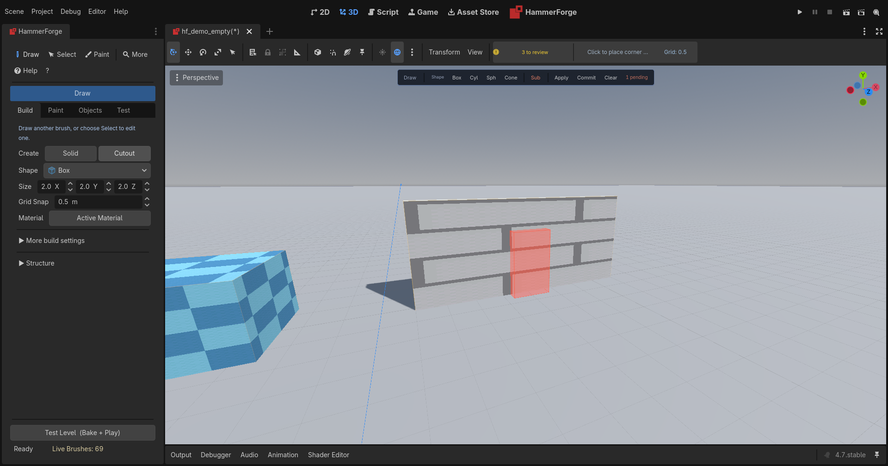


Subtractive brushes are staged as **Pending Cuts** until explicitly applied. This gives you a chance to preview, adjust, and batch your subtract operations before committing.

**Applying cuts** (three methods, all equivalent):
1. **Context toolbar** (recommended): When in Draw mode with pending cuts, the toolbar shows **Apply** / **Commit** / **Clear** buttons with a count badge. This is the fastest path — no tab switching needed.
2. **Test tab → Actions**: The Apply Cuts, Clear Pending Cuts, and Commit Cuts (Bake) buttons are always available.
3. **Viewport context menu**: Space → Apply Cuts (when in subtract context).

Apply Cuts records one **Apply Pending Cuts** undo step, just as applying cuts before a bake does. With nothing pending it leaves the history unchanged.

| Button | Action |
|--------|--------|
| **Apply** | Move pending cuts to draft brushes (keeps them, doesn't bake) |
| **Commit** | Apply + Bake as one undoable transaction |
| **Clear** | Discard all pending cuts without applying |

All cut buttons are disabled during active bakes to prevent race conditions. Commit does not consume a cut until its bake succeeds, and Undo/Redo restores both the editable brushes and the exact baked output, including its Full/Wireframe/Proxy preview mode.

A pending cut stays a cut: its **Operation** is read-only in the Inspector until it is applied. To make it a solid, apply it first, or delete it and draw a solid.

## Design Constraints (Summary)
- DraftBrush previews are lightweight. Final geometry comes from bake.
- Subtractive brushes are staged as Pending Cuts until applied.
- Floor paint is grid-based; heightmaps displace floors only.
- `.map` export/import is for blockouts. Export writes each face's texture name and UV numbers. Import brings both back, from any editor's file. The offset and scale are in texels, as other editors write them, so they are converted through the size of the palette texture with that name, or 64 pixels for a face with no texture. Neither carries the material itself, surface paint or sculpts.
- A `.map` world brush whose every face is named `clip`, `common/clip` or `tools/toolsclip`, in any case, imports as a `func_clip`. A `func_clip` exports into `worldspawn` with every face named clip, as Hammer and TrenchBroom write one, so export then import gives it back unchanged. One with a Physics Layer, a name or another property of its own goes out as a `func_clip` block instead, its faces still named clip, so it comes back with them.

For details, see `docs/HammerForge_Design_Constraints.md`.

## Data Portability
- `.hflevel` is the source of truth for full-fidelity editing.
- `.map` exchange is limited to basic brushes and point entities.
- `.glb` export includes baked geometry only.

For full details, see `docs/HammerForge_Data_Portability.md`.

## Install + Upgrade
For install steps, upgrade guidance, and cache reset help, see `docs/HammerForge_Install_Upgrade.md`.

## Shortcut HUD
A single-row strip in the 3D viewport toolbar, next to the Console lamp. It updates with your current tool and mode, and shows the **primary line** for that context plus the grid size indicator; the full list for the context is on its tooltip. When a contextual hint is active it takes the row for the four seconds of its fade, because the toolbar is one row high.

Toggle it with **Show HUD** — in the Console's Controls tab, or in the dock under Test → Settings.

The contexts and what their full lists cover:

| Context | Shortcuts Shown |
|---------|----------------|
| Draw (idle) | Click+Drag, Shift/Alt modifiers, X/Y/Z axis lock, Ctrl+Scroll size, Ctrl+D, Delete |
| Draw (dragging base) | Shift: Square, Alt+Shift: Cube, Hold Ctrl: Grid Snap Off/On, Click: Height stage, Right-click: Cancel. Live dimensions shown in banner |
| Draw (adjusting height) | Mouse: Change height, Hold Ctrl: Grid Snap Off/On, Click: Confirm, Right-click: Cancel. Live dimensions shown in banner |
| Select | Native click/Shift object selection; Face Select Shift-add/Ctrl-toggle; Escape, Delete, Ctrl+D, Arrow nudge, Ctrl+H Hollow, Shift+X Clip, Ctrl+Shift+F/C Floor/Ceiling |
| Extrude Up/Down (idle) | Click face + drag, U/J tool switch, Right-click cancel |
| Extrude Up/Down (active) | Move mouse to set height, Release to confirm, Right-click cancel |
| Floor Paint | LMB paint, Alt erase, Shift axis lock, Ctrl/Cmd pick, X/Z mirror, Y raise, H room, Enter connector, Esc cancel; live cells/metres and ghosts |
| Surface Paint | Click+Drag paint, Alt+Drag erase, radius/strength info |
| Vertex Edit | Click vertex to select, drag to move, E: edge mode, Ctrl+W: merge, Ctrl+E: split |
| Polygon Tool | Click to place verts, Shift: lock to axis, Enter: close, Escape: remove last |
| Path Tool | Click to place waypoints, Shift: lock to axis, Enter: finalize, Escape: remove last |

The HUD also shows current axis lock state (e.g. "[X Locked]"), and a grid indicator with the snap, plane axis and position (`Grid: 0.5  Y 1.3`). It flashes when the snap changes. Fractional snaps display exactly.

The full list is also available two other ways: the searchable shortcut dialog (**?** button in the dock toolbar) and the command palette (**Ctrl+K**).

## Customizable Keyboard Shortcuts

All keyboard shortcuts are data-driven and can be customized. The default bindings match the shortcuts shown throughout this guide. [Commands](commands.md) lists every command with its default key, what it needs selected and what it does ([#1658](https://github.com/saworbit/hammerforge/issues/1658)).

**Default bindings:**

| Action | Default Key | Description |
|--------|-------------|-------------|
| Draw | D | Switch to Draw mode |
| Select | S | Switch to Select mode |
| Extrude Up | U | Switch to Extrude Up mode (E skipped in paint/vertex modes) |
| Extrude Down | J | Switch to Extrude Down mode (Shift+E skipped in paint/vertex modes) |
| Extrude Up (alt) | E | Extrude Up outside Paint and Vertex modes |
| Extrude Down (alt) | Shift+E | Extrude Down outside Paint and Vertex modes |
| Repeat Last Brush | Shift+D | Arm a stamp of the brush the last Draw made: each click places one |
| Toggle Add / Cut | Q | Switch the drawing operation between Add and Cut |
| Toggle Paint Mode | Shift+P | Turn Paint mode on or off |
| Quick Play | Ctrl+Enter | Bake and test the level |
| Validate Level | Ctrl+Shift+Enter | Check the level for issues |
| Delete | Del | Delete selected brushes and DraftEntities |
| Duplicate | Ctrl+D | Duplicate selected brushes and DraftEntities |
| Copy | Ctrl+C | Put the selection on the clipboard |
| Paste | Ctrl+V | Place what is on the clipboard, where it was copied from |
| Group | Ctrl+G | Group selected brushes |
| Ungroup | Ctrl+U | Ungroup selection |
| Hollow | Ctrl+H | Convert brush to hollow room |
| Hide Selection | Alt+H | Hide the selection without a visgroup, until Show Hidden |
| Show Hidden | Shift+Alt+H | Show what Hide Selection and an isolate hid |
| Clip | Shift+X | Split brush along axis plane |
| Clip to Face Plane | Shift+Alt+X | Clip the selected brushes to the selected face plane |
| Create Structure | Ctrl+Shift+A | Open the structure builder |
| Run Trim Along Faces | Shift+Alt+T | Run a skirting or cornice along the wall faces picked in Face Select |
| Carve | Ctrl+Shift+R | Boolean-subtract from intersecting brushes |
| Merge Brushes | Ctrl+Shift+M | Merge the selected brushes |
| Intersect | Ctrl+Shift+I | Keep only the volume the selected brushes share |
| Save Selection as Prefab | Ctrl+Shift+P | Save the selected brushes and entities as a prefab |
| Cycle Prefab Variant | Ctrl+Shift+V | Switch the selected prefab instance to its next variant |
| Move to Floor | Ctrl+Shift+F | Snap to nearest surface below |
| Move to Ceiling | Ctrl+Shift+C | Snap to nearest surface above |
| Snap to Grid | Ctrl+B | Put each selected brush's bounds corner, or entity's origin, on the grid |
| Rotate CCW | R | Turn the selection counterclockwise |
| Rotate CW | Shift+R | Turn the selection clockwise |
| Flip Selection | Shift+M | Flip the selection |
| Mirror Copy | Alt+M | Keep the selection and add copies mirrored across the ticked axes |
| Reset Rotation | Alt+R | Return the selection to its unrotated orientation |
| Offset | Alt+G | Move the selection, its vertices or its faces by a typed X, Y, Z |
| Pick Pivot | Alt+P | Click a brush vertex, edge or face to turn and flip about |
| Clear Pivot | Shift+Alt+P | Go back to turning about the selection's centre |
| Paint Brush | B | Paint floor cells in Paint mode |
| Erase | E | Erase floor cells in Paint mode |
| Ramp / Rect | R | Paint a rectangular footprint in Paint mode |
| Line | L | Paint a line of floor cells |
| Bucket Fill | K | Fill a connected area of floor cells |
| Blend | N | Paint terrain blend weights |
| Raise Painted Walls | Y | Set wall height for the last Brush or Rect footprint |
| Toggle Paint Mirror X | X | Mirror painting across the grid X origin |
| Toggle Paint Mirror Z | Z | Mirror painting across the grid Z origin |
| Stamp Painted Room | H | Repeat the last Rect as floor and boundary walls |
| Confirm Paint Connector | Enter | Commit the live ramp or stair connector ghost |
| Vertex Edit | V | Enter or leave Vertex Edit mode |
| Edge Mode | E | Toggle vertex/edge sub-mode (in vertex mode) |
| Merge Vertices | Ctrl+W | Merge selected vertices to centroid |
| Split Edge | Ctrl+E | Insert midpoint on selected edge |
| Snap Vertices to Grid | Ctrl+B | Move the selected vertices to their nearest grid points (in vertex mode) |
| Texture Picker | T | Eyedropper: sample a face's material and its whole look, for Shift+T and Alt+T |
| Apply Last Texture | Shift+T | Apply last picked texture to selection |
| Apply Picked Look | Alt+T | Give the selected faces the last picked face's material and alignment |
| Apply Favorite 1 | Alt+1 | Apply favorite 1 of the context toolbar strip to the selected faces or brushes |
| Apply Favorite 2 | Alt+2 | Apply favorite 2 of the context toolbar strip to the selected faces or brushes |
| Apply Favorite 3 | Alt+3 | Apply favorite 3 of the context toolbar strip to the selected faces or brushes |
| Apply Favorite 4 | Alt+4 | Apply favorite 4 of the context toolbar strip to the selected faces or brushes |
| Apply Favorite 5 | Alt+5 | Apply favorite 5 of the context toolbar strip to the selected faces or brushes |
| Apply Favorite 6 | Alt+6 | Apply favorite 6 of the context toolbar strip to the selected faces or brushes |
| Apply Favorite 7 | Alt+7 | Apply favorite 7 of the context toolbar strip to the selected faces or brushes |
| Apply Favorite 8 | Alt+8 | Apply favorite 8 of the context toolbar strip to the selected faces or brushes |
| Apply Favorite 9 | Alt+9 | Apply favorite 9 of the context toolbar strip to the selected faces or brushes |
| Select All | A | Select all brushes and entities (clears face selection) |
| Deselect All | Shift+A | Deselect everything (brushes, entities, faces) |
| Select Similar | Shift+S | Select faces/brushes similar to current selection |
| Selection Filters | Alt+F | Open selection filter popover |
| Grow Selection | Ctrl+] | Add the faces next to the selected faces, or the brushes touching the selected brushes |
| Shrink Selection | Ctrl+[ | Drop the selected faces or brushes on the edge of the selection |
| Toggle Face X-ray | Alt+X | Let the face marquee take covered and back faces |
| Show Selection Size | Alt+D | Label the width, depth and height of the selection in the viewport |
| Lock X | X | Constrain the drawing to X |
| Lock Y | Y | Constrain the drawing to Y |
| Lock Z | Z | Constrain the drawing to Z |
| Draw on Face | L | Build a draw on the plane of the face it starts on (L is the Line tool while Paint is on) |
| Grid Increase | ] | Double grid snap (max 512) |
| Grid Decrease | [ | Halve grid snap (min 0.125) |
| Grid Up | Alt+PgUp | Raise the drawing plane one snap step |
| Grid Down | Alt+PgDn | Lower the drawing plane one snap step |
| Reset Grid | Alt+Home | Return the drawing plane to the level origin |
| Align Grid to Selection | Alt+End | Use the selected face, vertices or brush top |
| Context Menu | Space | Open the context menu at the cursor while idle |
| Radial Menu | &#96; | Open the radial menu when Power-user overlays are on |
| Operation Replay Timeline | Ctrl+Shift+T | Show or hide the operation replay timeline when Power-user overlays are on |
| Invert Grid Snap (hold) | Ctrl | Held in a draw, vertex or resize handle drag: no grid snap with Grid on, grid snap with it off |
| Snap to Vertices (hold) | Alt | Held in a vertex or resize handle drag: land on another brush's vertex, as Vertex snap does |
| Measure | M | Multi-ruler tool (persistent rulers, angles, snap ref) |
| Decal | N | Place decal on surface with live preview. Decals live under the LevelRoot's `Decals` node, save with the level and undo like any other placement |
| Polygon | P | Draw a polygon, extrude to brushes (a concave one splits into convex brushes) |
| Path | ; | Place waypoints, extrude corridor brushes |
| Command palette | Shift+? / F1 / Ctrl+K | Searchable action palette with fuzzy search |

**Rebinding:** Press the **?** button on the toolbar to open the shortcut dialog, select a command and press **Set Key**, then the new chord ([#1733](https://github.com/saworbit/hammerforge/issues/1733)). Every command the palette runs is listed and can take a key, not only those that ship with one; a command with no key shows "none". **Set Second Key** gives a command a second chord, and either one fires it; the surfaces that name a key show the first. A chord another command already uses is said before it is kept, with that command's name, and you swap the keys, take it off the other command, or cancel. A chord the editor or the palette takes ahead of every binding, such as Ctrl+S, can only be cancelled. **Clear** takes a command's keys off, **Reset** puts one back to its default and **Reset All** puts every key back. A change works at once, with no restart, and is written to `user://hammerforge_keymap.json`, the keys you changed and nothing else, so an action you left alone keeps picking up later changes to its default. **Export...** and **Import...** share that file with a team. The file can still be edited by hand: each entry maps an action name to `{"keycode": "F", "ctrl": bool, "shift": bool, "alt": bool}`, with an optional `"second"` chord in the same shape, or `{"none": true}` for no key, for example `{"selection_filter": {"keycode": "G", "alt": true}}`. `keycode` is a key name as Godot spells it (`"F"`, `"Delete"`, `"PageDown"`, `"BracketLeft"`) or Godot's integer keycode; modifiers go in their own fields, not in the name. Restart the plugin after editing the file by hand. Every surface that names a chord — the viewport HUD, the coach marks, the dock tooltips, the hotkey palette and the shortcut list — reads the binding rather than repeating it, so a rebind shows up everywhere at once.

Extrude has two bindings each way. `Extrude Up` is U and `Extrude Up (alt)` is E; `Extrude Down` is J and `Extrude Down (alt)` is Shift+E. They are listed under their own names so you can tell which row you are changing.

An entry that is not a binding, one with no usable `keycode`, or a key that is not a HammerForge action is reported once on load, naming the file and the key, and the default is used for it.

Two actions that can fire in the same mode on the same chord are reported on load as well, naming both, because the input router tests actions one at a time and stops on the first hit -- so one of the two never fires. The shortcut dialog marks such a binding in amber and its tooltip says what else uses it. Sharing a chord across modes is fine and the defaults do it seven times: `E` is Extrude, Erase and Edge Mode, `R` is Rotate and Ramp, `L` is Draw on Face and Line, `X` and `Z` are axis locks and paint mirrors, `Y` is an axis lock and Raise Painted Walls, and `Ctrl+B` is Snap to Grid and Snap Vertices to Grid. The paint family only fires while paint mode is on and the vertex family only while vertex mode is on, and each is asked before the other actions while its mode is on, so those pairs never both answer. Eight actions answer in every mode, ahead of the paint keys: Toggle Add / Cut, Toggle Paint Mode, Quick Play, Validate Level, Show Selection Size, Operation Replay Timeline, Context Menu and Radial Menu, so a paint or vertex key on one of their chords is reported. So is any binding on a key HammerForge takes ahead of every binding and you cannot move: the command palette's `Shift+?`, `F1` and `Ctrl+K` (with any other modifier held as well), `Escape`, and the nudge keys, which are the arrows and `PageUp`/`PageDown` with `Shift`, `Alt` or `Ctrl` held or not, except `Alt+PageUp`/`PageDown` alone, which are Grid Up and Grid Down. And so is a binding on a key Godot's editor answers wherever the focus is, which HammerForge hands to Godot: Undo (`Ctrl+Z`), Redo (`Ctrl+Y` and `Ctrl+Shift+Z`), the scene keys `Ctrl+S`, `Ctrl+N` and `Ctrl+O` with their Shift and Alt forms, Close Scene (`Ctrl+Shift+W`), Quit (`Ctrl+Q` and `Ctrl+Shift+Q`) and the run keys `F5` to `F8` ([#1617](https://github.com/saworbit/hammerforge/issues/1617)). Before, a typo in this file turned every keystroke in the viewport into an error that named `hf_keymap.gd` rather than the file you got wrong.

**Toolbar labels** and **tooltips** update automatically from the keymap, so custom bindings are always reflected in the UI. Press the **?** button on the toolbar to open a searchable shortcut dialog showing all current keybindings grouped by category (Tools, Editing, Selection, Paint, Axis Lock), where a key can be changed as well.

## User Preferences

HammerForge stores cross-session preferences in `user://hammerforge_prefs.json`, separate from per-level settings.

Preferences include:
- Default grid snap size
- Recent file list (up to 10)
- Collapsed section states (which dock sections are expanded/collapsed)
- HUD visibility, Size at cursor, Draw hover preview and Show selection size
- Power-user overlays
- Tutorial wizard visibility and progress step
- Dismissed viewport contextual hints and coach marks
- Favorite materials and the Recent row
- Saved bake profiles
- The UV Editor's Scale link and UV Snap step
- The settings each tool, the Build tab and each structure type were last used with (Test → Settings → Reset Tool Settings clears them)
- Overlay colours (Test → Settings → Colours), each kept as a hex string such as `"#ffd133bf"`; one that is not a colour falls back to its default with a warning

## Clipboard

**Ctrl+C** puts the selected brushes and entities on the clipboard. **Ctrl+V** places them, at the position they were copied from, and selects what it placed so the first drag moves the new piece rather than hunting for it.

The clipboard is a prefab without a name. It is the same capture a prefab gets, so a copied piece arrives with its entity wiring, its brush entity ties, and a record of what each material slot meant; pasting into a level with a different palette resolves those against the destination and appends anything it does not already hold. What a prefab has and the clipboard does not is a name, a place in the library, and a link back to its source: a pasted piece is geometry, not an instance that follows an asset when the asset changes.

Brush ids and brush entity ties are minted fresh on every paste, and each authored name gets one of its own with the pasted wiring following it, so pasting twice gives two pieces the level can tell apart. Group and visgroup membership is deliberately not carried, because a visgroup is a list of names registered per level and pasting into a level that has never heard of "West Wing" would otherwise put brushes in a group with no row in the panel.

The buffer is a file in `user://`, not something the level holds, so it survives closing a level and restarting the editor, and a piece copied in one project can be pasted into another.

**Where the keys work.** In the 3D viewport, both. In the Scene tree, Ctrl+C is claimed when the selection is HammerForge's, because Godot's own node copy would put a `DraftBrush` on its clipboard that a later paste would rebuild outside the brush registry with the id it already had. Ctrl+V is deliberately not claimed there: it needs nothing selected, and taking it away from the Scene tree whenever a level is open would mean you could no longer paste an ordinary node. Paste from the command palette or a menu needs nothing selected either, so it places the clipboard with nothing or the LevelRoot selected ([#1261](https://github.com/saworbit/hammerforge/pull/1261)).

## Prefabs (Reusable Brush Groups)

Prefabs let you save a selection of brushes and entities as a reusable group and place copies anywhere in your level. The system supports variants, tags, live-linked instances, and visual debug overlays.

### Saving a Prefab
1. Select the brushes and/or entities you want to save.
2. Open Test tab → Prefabs section.
3. Enter a name and click **Save** (or **Save Linked** to enable live propagation).
4. The prefab is saved as a `.hfprefab` JSON file in `res://prefabs/`. The name becomes a safe file name there, so a slash or a leading `..` cannot put it anywhere else. If a prefab of that name already exists, you are asked before it is replaced.

**Quick Save**: Press **Ctrl+Shift+P** (rebindable, listed as Save Selection as Prefab in the shortcut dialog) or click **Pfb** in the context toolbar to instantly save the current selection as a prefab with an auto-generated name: a lone brush is named after its shape (`cylinder`), a lone entity after its type (`light_point`), and anything more after its count (`3_brush_group`, `group_2_brushes_1_entities`). It never replaces a file: a second box saved this way becomes `box_2`. Also available via the context toolbar in both brush and entity selected contexts.

### Instantiating a Prefab
- Drag a prefab from the library list into the 3D viewport.
- Or select it in the library, point at the spot in the viewport and press **Space**: the menu offers **Place <name> Here**, which puts it where a drop there would.
- The brushes and entities are placed at the drop position with new unique IDs.
- Every placed entity, brush or point, gets a name of its own in the level and a tie of its own, so two placed doors are two doors. The I/O between them is remapped to the new names; a wire aimed at something outside the prefab still aims at it.
- Each placed instance is tracked in the prefab system for variant cycling and propagation.
- Instance tracking covers brushes in DraftBrushes, PendingCuts, and CommittedCuts, plus point and tied brush entities. Source updates and removal warn when a recorded member is missing instead of silently leaving a partial instance.
- The operation supports undo/redo.

### Prefab Variants
Prefabs can contain multiple variants (e.g., different door styles: wooden, metal, ornate).

- **Adding a variant**: Right-click a prefab in the library → **Add Variant**. Select the replacement geometry and name the variant.
- **Cycling variants**: Select a placed prefab instance and press **Ctrl+Shift+V** (rebindable, listed as Cycle Prefab Variant) or click **Var▶** in the context toolbar. This cycles through all available variants in place. The copy keeps the names of its entities and brushes, so wires aimed at it still reach it.
- **Removing a variant**: Right-click a prefab in the library → **Remove Variant**, then pick the one to drop. The `base` variant is not offered, because a prefab without one is not a prefab.
- **Variant indicator**: The library list shows `[N variants]` next to prefabs that have multiple variants.

### Live-Linked Prefabs
When you save a prefab with **Save Linked**, all placed instances of that prefab maintain a link to the source file. Ctrl+Z straight after unlinks the selection and leaves the `.hfprefab` file as written (#1276).

- **Push to source**: Edit a placed instance, then click **Push** in the context toolbar to update the `.hfprefab` source file with the current state.
- **Propagate to all**: Click **Pull** on any linked instance to propagate the current source file to all linked instances in the level. Each instance keeps its names, as a variant cycle does.
- The context toolbar shows a `[linked]` badge on linked prefab instances. Hover the badge to see how many copies of that prefab the level holds.
- **Copies** (Select Linked Copies in the palette) selects every copy of the selected copy's prefab in the level, and nothing else ([#1734](https://github.com/saworbit/hammerforge/issues/1734)).
- **Unlink** (Unlink Prefab Copy) makes the selected copy ordinary brushes and entities, as one undo step. It keeps its look and names, and no later Pull, Push or variant switch touches it.
- **Keep on this copy.** A copy can differ where it must: a button wired to another door, a light in a darker room. Select a piece of a linked copy and each property in the Entity panel has a **Keep** box. A kept value stays through a Pull and a variant switch, and Push leaves it out of the prefab file, writing the prefab's own value back in its place. **Keep wiring on this copy** does the same for the piece's outputs, and **Clear Kept** keeps nothing again and takes the prefab's values. What a copy keeps is saved with the level, and each change to it is an undo step.
- **Changed copies.** A linked copy that differs from its prefab, outside what it keeps, shows `[changed]` in the badge. Hover it for the list of what changed. **Push** writes the changes into the prefab; **Discard** (Discard Prefab Changes) rebuilds the copy from its prefab as one undo step, keeping what it keeps. Names a copy gives its own entities, and wires between them, are not counted as changes.
- **Duplicate keeps prefab link**, in the Console's Controls and off by default, makes Ctrl+D of a whole linked copy place another linked copy, with what the copy keeps, instead of ordinary geometry. The new copy is made from the prefab, as a Pull would make it.

### Tags and Search
- **Adding tags**: Right-click a prefab in the library → **Edit Tags**. Enter comma-separated tags (e.g., `door, architecture, interior`).
- **Searching**: Use the search bar at the top of the prefab library. Searches match both prefab names and tags.
- **Tag filtering**: Use the Tag dropdown to filter the list to prefabs with a specific tag.

### Visual Debug Overlay
When hovering over a node that belongs to a prefab instance in the 3D viewport with the Select tool, a cyan wireframe bounding box appears around the entire instance.

### What's Captured
- Brush geometry (shape, size, operation, material, transform relative to group centroid)
- Entity data (type, class, properties, I/O connections, transform relative to centroid). Each entity receives a stable unique ID on instantiation — entity membership is tracked by UID, not scene name, so renaming nodes or having duplicate names will not break prefab tracking.
- Brush IDs and group IDs are cleared on capture; new ones are assigned on instantiation.
- Tags (metadata for search/filtering)
- Variants (alternate brush/entity configurations stored alongside the base)

### File Format
`.hfprefab` files are JSON with the same encoding as `.hflevel` (Vector3, Transform3D serialized via `HFLevelIO`). They support optional `tags` (string array) and `variants` (named alternate configurations) fields. They are portable and can be shared between projects.

These persist across editor restarts. Per-level settings (cordon, texture lock, materials) remain in `.hflevel` files.

## Tool Availability (Poll System)

Some actions require specific conditions to run:
- **Hollow, Clip, Move to Floor/Ceiling** require at least one brush selected. When nothing is selected, these buttons are grayed out with an inline hint ("Select a brush to use these tools") visible in the Selection Tools section.
- **Face-dependent controls** (Assign to Selected Faces, UV editing) show "Enable Face Select Mode and click a face to edit" when no face is selected.
- **Extrude** requires a LevelRoot in the scene. In extrude mode, a semi-transparent face highlight (green for up, red for down) previews which face you'll select before clicking.
- **External tools** can define their own requirements via `can_activate()`. The registry asks before activating and reports `get_poll_fail_reason()` rather than making the tool active with nothing for it to do.
- **An active tool's own settings** appear in a **Tool Settings** section on the Build tab, built from the tool's `get_settings_schema()`. The section is hidden while the active tool declares none. Each tool's settings are kept with your preferences under the tool's name, so the Polygon tool's Auto-close Dist and the height it last extruded to, every Path setting and the Decal's texture, size and fade come back as you left them.

HammerForge managed edits are scoped to the visible selection. With only native Godot nodes selected, a keyboard shortcut passes through to Godot. That includes the keys Godot's 3D editor binds as well, such as E (Rotate), Q, T, U and X/Y/Z, while no HammerForge drag is in progress and you are not in paint or vertex mode. With nothing selected they stay HammerForge's. A key HammerForge does handle is consumed, so Godot does not run its own shortcut on the same press. With only HammerForge brushes/entities selected, HammerForge owns it. If the selection mixes both domains, HammerForge stops managed operations such as duplicate, delete, group, hollow, nudge, clip, carve, merge, texture, prefab, and variant actions and shows **“Edit HammerForge and Godot nodes separately”**. The same rule is enforced by the context toolbar, viewport context menu, hotkey palette, and selection-dependent radial actions; their managed commands are hidden or disabled where possible and checked again when invoked. Deselect one domain before retrying. This prevents generic editor commands or stale UI state from bypassing HammerForge IDs, caches, or undo state.

Only one HammerForge editing tool owns mouse input at a time. Activating an external tool such as Polygon, Path, Measure, or Decal cancels an unfinished built-in gesture, exits conflicting vertex/paint state, and gives that tool exclusive HammerForge pointer handling until it is completed, cancelled, or another tool is chosen. A missed surface does not leak the same click into Draw, Select, Paint, or Vertex mode. Native viewport navigation still works whenever the active tool deliberately passes the event through.

The mode indicator banner always shows the current tool and gesture stage. The status bar shows selection count with a clear button.

## Brush Creation (CAD style)
1) Base drag: click and drag to define the base.
2) Height stage: release mouse, move up/down, click to commit.

Modifier keys
- Shift: square base.
- Shift + Alt: cube.
- Alt: height-only.
- Ctrl (held): no grid snap for the corners and the height while Grid (G) is on, grid snap while it is off.
- X/Y/Z: axis locks (shown in HUD as "[X Locked]" etc.).
- Right-click: cancel.

Before you click
- With Draw idle, and with Polygon or Path before their first point, the face under the cursor is tinted by what a draw there starts on: blue for a face level with the grid, green for a flat face at another height, amber for a face that is not flat (the draw still starts flat, at the height you clicked), and violet for a face Draw on Face will build on. Over empty space no face is tinted.
- A small cross marks the snapped point the draw starts from, on a face as on the grid, and the two grid lines through it brighten. The tint and the cross come from the same answer the click uses, so the draw starts where they show.
- The preview goes when you change tool or start a drag. Turn it off with **Draw hover preview** in **Test → Settings** or the Console's Viewport group. It only looks again when the cursor or the view has moved.

Draw on Face (**L**, the **On Face** button beside the Snap row, or the command palette)
- A draw that starts on a brush face lays its base on the face's plane, whichever way the face points, and the height stage pulls along the face's normal. A Solid grows out of the face and a Cutout into it, so a window is a Cutout dragged on the wall and pulled to the wall's depth.
- On a face along the world axes the corners snap to the world grid and stay on the face. On a slanted face they snap in grid steps along the face's own axes, counted from where you clicked.
- The brush is a box turned so its up is the face's normal, and undo and redo keep the turn. A draw on a wall or a slope leaves the drawing grid where it was; one on a floor moves it as an ordinary draw does.
- Over empty space a draw is the ordinary flat one. The axis locks do not apply while drawing on a face.

General keyboard shortcuts
- Delete: remove selected brushes and DraftEntities.
- Ctrl+D: duplicate selected brushes and DraftEntities. A copy of a named entity takes the next free name (`door_1` becomes `door_2`), because the authored name is the address I/O is aimed at and two entities cannot share one. The copy keeps its own outputs, so a duplicated button goes on firing at what the original fired at. Brush entities take a tie of their own as well, so a duplicated door is a second door rather than two more leaves of the first, and the same goes for each copy a Duplicate Array makes.
- Arrow keys: nudge selected brushes and DraftEntities one grid step, along the world axis nearest the arrow's direction in the view you press it in ([#1716](https://github.com/saworbit/hammerforge/issues/1716)). In Top view that is Up for -Z and Right for +X, as it always was. In Front view Up is +Y. In a perspective view Up and Down follow the camera's heading on the ground, snapped to the nearest axis, so facing +X makes Up +X. The shortcut row says where it went, as `+Y 0.25 m`. **Arrows follow the view** in the Console's Controls turns this off and brings back the fixed mapping. An unturned brush with a face on a grid line stays on it however many times it is nudged.
- PageUp/PageDown: nudge selected brushes and DraftEntities (Y axis), in every view.
- Shift+Arrow: duplicate the selection and move the copy one step that way, as one undo step. The copy is the selection after, so pressing it again makes the next copy from that one, and a row of columns is a key a column. Shift used to make no difference to an arrow.
- Alt+Arrow, and Alt+Shift+PageUp/PageDown: nudge by a tenth of the grid step, for fitting the grid cannot reach. A tenth step is not put back on the grid. Alt+Shift+Arrow duplicates and moves a tenth. Alt+PageUp/PageDown alone moves the drawing plane (Grid Up / Grid Down).
- Escape: clear selection.
- Ctrl+Scroll: adjust brush size.
- `[` / `]`: halve / double grid snap size.

Extrude shortcuts
- U: Extrude Up tool.
- J: Extrude Down tool.

Group shortcuts
- Ctrl+G: Group selected brushes/entities.
- Ctrl+U: Ungroup selected brushes/entities.

Paint tool shortcuts (active when Paint Mode is enabled)
- B: Brush tool.
- E: Erase tool.
- R: Rectangle tool.
- L: Line tool.
- K: Bucket fill tool.

## Vertex Editing

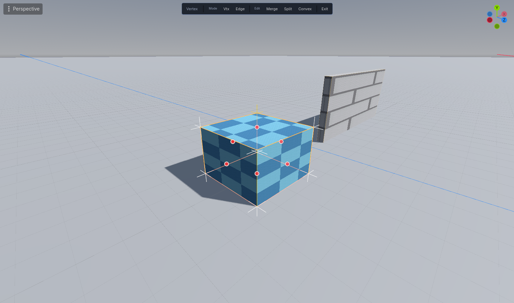


Vertex mode lets you select and move individual brush vertices for precision geometry editing.

### Entering Vertex Mode
Press **V** (keyboard shortcut or the **V** toggle button in the toolbar) to enter vertex mode. Selected brushes show their vertices as crosses and edges as wireframe lines.

### Vertex Sub-Mode
- **Vertex mode** (default): click vertices to select them, drag to move.
- **Edge mode** (press **E** to toggle): click edges to select them. Selected edges highlight orange; hovered edges highlight yellow.

### Dragging Vertices and Edges
An unlocked drag follows a view-facing plane through the vertex or edge midpoint you grabbed. This makes the point track the cursor predictably in perspective and in front, side, and top orthographic views instead of forcing every drag onto world Y. Grid snap is applied to the resulting world-space movement while Grid (G) is on; hold **Ctrl** to turn it the other way for the drag. With Vertex (V) on, or **Alt** held, a vertex drag lands on another brush's vertex near the cursor instead (see **Snap Modes**). An edge drag holds a midpoint, so it takes the grid only.

Use **X**, **Y**, or **Z** to constrain the drag to that world axis. HammerForge chooses a camera-facing projection plane that contains the locked axis. If the camera is looking exactly along that axis and the cursor cannot express a stable movement, the update is ignored rather than making the geometry jump. Losing LMB during a focus change cancels the unfinished drag and restores its captured geometry.

### Edge Operations
- **Split edge** (Ctrl+E): select exactly one edge, then press Ctrl+E to insert a midpoint vertex. The two faces sharing the edge each gain the new vertex. Convexity is mathematically guaranteed.
- **Merge vertices** (Ctrl+W): select 2+ vertices, then press Ctrl+W to merge them to their centroid. Merging is rejected if it would break convexity. Every brush with two or more selected vertices merges, as one undo step; a brush that refuses says why and the rest still merge.
- Merge, Split and Clip to Convex are each one undo step whether you use the key, the vertex toolbar or the command palette.

### Snap Vertices to Grid
Press **Ctrl+B**, or **Snap** in the vertex toolbar, to move each selected vertex to the grid point nearest it in world space. The result is checked as a drag is when you let go: a bent face is cut into flat pieces that fold outward, and a snap that would leave the brush non-convex, or put two of its vertices on one grid point, is refused with the reason and nothing moves. One press is one undo step, and vertices already on the grid add none. Outside vertex mode the same key snaps whole brushes (see Selection Tools).

### Convexity Enforcement
All vertex operations validate that the brush remains convex. If a move or merge would create a concave shape, the operation is rejected and the brush reverts to its previous state. A merge is also rejected if it would leave the brush without a closed solid, which is what merging every vertex of a box would do. A move by an offset that is not a number is refused before any face is touched.

A vertex edit on a box or another primitive makes it Custom. Undo gives it back its shape, its size and its resize handles, as well as its faces.

### Clip to Convex
If a brush has been deformed into a non-convex shape (e.g., by external editing or import), use the **Convex** button in the vertex edit context toolbar to recompute its convex hull. This:
1. Computes the convex hull of all brush vertices.
2. Rebuilds faces from the hull planes.
3. Inherits UV settings (projection, scale, offset, rotation, material) from the closest original face for each new hull face.

This is a fallback repair tool, not a modeling operation — it discards any concave geometry.

### Shortcuts
| Key | Action |
|-----|--------|
| V | Enter vertex mode |
| E | Toggle vertex/edge sub-mode |
| Ctrl+E | Split selected edge |
| Ctrl+W | Merge selected vertices |
| Ctrl+B | Snap selected vertices to the grid |

## Polygon Tool

The polygon tool lets you draw any outline that does not cross itself and extrude it into brushes.

### Workflow
1. Press **P** to activate the Polygon tool.
2. Click in the viewport to place the first vertex on the nearest exact visible surface. If no geometry is hit, placement uses the plane the grid is drawn on. The point passes through the shared Grid, Vertex, Center, Edge, Perpendicular, and reference-line snap pipeline. Until you click, the [draw hover preview](#brush-creation-cad-style) tints the face under the cursor and marks where the vertex will land.
3. Place more vertices. Each cursor ray starts on the horizontal plane established by the first point, then passes through the shared snap pipeline. Hold **Shift** to lock the edge from the last vertex to X or Z, whichever is nearer its direction; the vertex still snaps along that axis.
4. A vertex is taken wherever it lands, concave or not. A click that lands on a vertex already placed is rejected, because two vertices in one spot make a side face with no area.
5. Close the polygon by clicking near the first vertex (within the auto-close threshold) or pressing **Enter** (requires 3+ vertices). A polygon whose points are all on one line encloses nothing, so it is refused with a warning rather than extruded into a brush with no volume. An outline that crosses itself is refused with a toast and keeps its vertices, so you can take one back with Escape or right-click and close it again.
6. Move the mouse up/down to set the extrusion height, then click to confirm.
7. A convex outline makes one brush. A concave one (an L shaped room, a T junction, a notch for stairs) is split into convex brushes, all the same height and grouped so one click selects them all. Each cut runs between two inner corners, or carries on the line of a wall from an inner corner, so an outline drawn along the grid comes apart into rectangles. Either way it is one undo step.

### Preview
During placement, a cyan outline shows the polygon shape. Each edge shows its length at its middle in the Measure tool's label style, with as many decimals as the grid step needs: placed edges in cyan, and the edge to the cursor and the closing edge back to the first vertex in yellow. When the outline is concave, orange lines show where it will be split. During height extrusion, green vertical edges and the top face outline appear, with the split lines across the top as well. The labels go when the brush is built or the polygon cancelled, and none is saved with the scene.

### Settings
| Setting | Default | Description |
|---------|---------|-------------|
| auto_close_threshold | 1.5 | Distance to first vertex that triggers auto-close |

### Shortcuts
| Key | Action |
|-----|--------|
| P | Activate Polygon tool |
| Left-click | Place vertex / confirm height |
| Shift (held) | Lock the edge from the last vertex to X or Z |
| Enter | Close polygon (3+ verts) / confirm height |
| Escape / Right-click | Remove last vertex / cancel |

## Path Tool

The path tool creates corridors by placing waypoints and extruding a rectangular cross-section along the path.

### Workflow
1. Press **;** (semicolon) to activate the Path tool.
2. Click in the viewport to place the first waypoint on the nearest exact visible surface. If no geometry is hit, placement uses the plane the grid is drawn on. The point passes through the shared Grid, Vertex, Center, Edge, Perpendicular, and reference-line snap pipeline. Until you click, the [draw hover preview](#brush-creation-cad-style) tints the face under the cursor and marks where the waypoint will land.
3. Place more waypoints. Each cursor ray starts on the horizontal plane established by the first point, then passes through the shared snap pipeline. Hold **Shift** to lock the segment from the last waypoint to X or Z, whichever is nearer its direction; the waypoint still snaps along that axis.
4. Press **Enter** to finalize the path (requires 2+ waypoints), or, with 3+ placed, click the first waypoint again to close the loop and build it at once. A click closes it when it lands within snap distance of the first point: half a grid step, or the snap distance when that is larger.
5. Each segment becomes one brush. With **Miter Joints** on, its ends are cut on the plane that bisects the corner there, so the two brushes at a corner meet on one plane with no overlap and no extra brush; a closed loop gets this corner at its first point too. A corner sharper than about 29 degrees would send its outside tip out more than four widths, so the tip is cut flat there, square to the bisector. With Miter Joints off, every segment is a box with square ends.
6. All brushes are auto-grouped and created in a single undo action.

A segment too short for the mitres at its two ends, or a path that turns straight back on itself, is refused before anything is built: a toast names the segment (counted from the first point) or the point, and the waypoints stay so you can take one back with **Escape** or right-click, or narrow the path.

### Side
**Side** in Tool Settings places the cross-section relative to the clicked line, looking the way the path runs: **Centre** straddles it, **Left** and **Right** stand wholly to that side, with one face on the line. To wall a room, trace the floor's edge and pick the side away from the room: clockwise seen from above that is Left, and every wall's inside face then lies on the line you clicked, so the room keeps the size it was drawn.

### Curves
Set **Curve** to **Smooth** and the path runs through the clicked points as a curve instead of straight from one to the next: a centripetal Catmull-Rom curve, which never loops or doubles back between two points however unevenly they are spaced. An open path sets off from its first point straight at the second, and arrives at its last coming straight from the one before. **Curve Segments** (2 to 64, default 8) is how many straight pieces each span between two clicked points is cut into, so three points at 8 build 16 pieces.

Hold the left button down when you place a point and drag to pull out a tangent handle: the curve passes through that point heading along the handle, and a longer handle holds that heading further. The handle's end snaps as a point does, and **Shift** keeps it on the X or Z line through the point. A plain click, or a drag no further than the snap distance, keeps the Catmull-Rom tangent. A handle changes the curve's direction at its own point only; the curve still bends on the two spans that meet there, and nowhere else.

Each piece is one convex brush, cut at both ends on the plane that bisects the turn there, so neighbouring pieces meet face to face with no wedge and no overlap; Miter Joints does not apply, since a curve has no corner to leave square. A bend tighter than the path is wide can turn (tighter than half its width, for a path centred on the line) would turn a piece's inner edge inside out: the preview outlines every piece of that span in red, and Enter refuses the path with a toast naming the span ("the curve from point 1 to point 2"), building nothing. Stairs, Railings and Trim follow the curve, cut on the same planes.

### Preview
During placement, a cyan polyline shows the clicked path, or on a smooth path the curve as it will be cut and every pulled-out handle, and the outline of each wall's footprint shows what will be built: to the chosen side, mitred at the corners, and on to the cursor. While the cursor would close the loop it settles on the first point, that point's marker turns green and the closed loop is outlined. When the path as it stands would be refused, what stops it is outlined in red: each segment too short for its mitres, or on a smooth path every piece of a span that bends too tightly. Each segment shows its length at its middle in the Measure tool's label style, with as many decimals as the grid step needs: placed segments in cyan, the segment to the cursor in yellow. The labels go when the path is built or cancelled, and none is saved with the scene.

### Settings
| Setting | Default | Description |
|---------|---------|-------------|
| path_width | 4.0 | Width of the corridor cross-section |
| path_height | 4.0 | Height of the corridor cross-section |
| path_side | Centre | Where the cross-section stands: Centre on the clicked line, or Left or Right of it |
| miter_joints | true | Cut each segment's ends on its corners' bisector planes; off, every segment is a box with square ends |
| path_curve | Off | Off runs straight from point to point; Smooth runs a curve through them |
| curve_segments | 8 | Pieces each span of a smooth path is cut into, 2 to 64 |
| path_extra | None | Auto-generate extras: None, Stairs, Railing, or Trim |
| stair_step_height | 0.25 | Step height for auto-stairs (only when path_extra = Stairs) |
| railing_height | 1.0 | Railing height above path surface |
| railing_thickness | 0.1 | Thickness of railing rails and posts |
| railing_post_spacing | 2.0 | Distance between railing posts |
| trim_width | 0.3 | Width of edge trim strips |
| trim_height | 0.15 | Height of edge trim strips |
| trim_profile | Flat | Shape of the trim's section: Flat, Chamfer, Round, Cove, Ogee or Stepped |
| trim_segments | 4 | Pieces each curve of the profile is cut into, 1 to 16 |
| trim_flip | false | Turn the profile upside down and hang it from the top of the path, for a cornice |
| trim_material_idx | 0 | Material index for trim faces |

Every numeric setting is held to the range in the tool's schema wherever the value comes from, not only in the dock's spinbox: a width below the minimum or above the maximum is clamped to it, and a value that is not a number is refused and the previous one kept.

### Auto-Generated Extras
When `path_extra` is set to a value other than None, additional geometry is auto-generated after the base path segments:

- **Stairs**: Step brushes along sloped path segments. Step count is derived from height difference / step height. Flat segments are skipped.
- **Railings**: Top rail + posts on both sides of the path. Posts are spaced evenly along each segment. Both rails and posts share the group ID with path segments.
- **Trim**: Edge strips run alongside both sides of the path. If `trim_material_idx >= 0`, all faces of trim brushes are assigned that material index.

All three follow Side and run round a closed loop's last segment. Trim is cut on the walls' own corner planes, so it turns each corner with them; a trim strip too short for its mitres refuses the path the same way a wall does. On a straight path, stairs and railings are still square-ended boxes per segment, not mitred. On a smooth path they follow the curve: each rail is swept along it on the walls' planes, posts are spaced evenly along its whole length, and each span that climbs is cut into steps of one rise at equal lengths along the curve, a tread crossing several pieces being one brush on each, cut where it starts and stops.

**Trim Profile** shapes the trim's section, Trim Width out from the path's side by Trim Height up:

- **Flat**: the plain rectangle.
- **Chamfer**: the top outer edge cut off at 45 degrees, by half the smaller of width and height.
- **Round**: a bullnose, the top outer edge rounded as far as the strip allows.
- **Cove**: a quarter ellipse hollowed out of the outer corner, all the way out at the foot and in to the path's side at the top.
- **Ogee**: an S, hollow in the lower half and rounded in the upper.
- **Stepped**: three steps, each in from the one below by a third of the width.

A brush has to be convex, so a profile that is not is cut into horizontal bands, each bounded by the path's side, two levels and one piece of the profile, and each band is its own strip. Flat, Chamfer and Round are one strip a side of each segment; Cove is one a piece of its curve; Ogee's rounded half is one, with a piece of its hollow; Stepped is one a step. **Trim Segments** is the most pieces a curve is cut into: a band never comes out thinner than 1 cm, up or out, so a small trim or a fine setting can give fewer. The HUD shows how many strips Enter will build. **Trim Flip** turns the profile upside down and hangs it from the path's top, its top flush with the path's, for a cornice.

Preview lines during placement: green ticks for stairs, yellow for railings, orange for trim.

### Shortcuts
| Key | Action |
|-----|--------|
| ; | Activate Path tool |
| Left-click | Place waypoint |
| Left-click the first waypoint | Close the loop and build it (3+ waypoints) |
| Left-drag while placing (Curve Smooth) | Pull out the point's tangent handle |
| Shift (held) | Lock the segment from the last waypoint to X or Z |
| Enter | Finalize path (2+ waypoints) |
| Escape / Right-click | Remove last waypoint / cancel |

## Visgroups (Visibility Groups)
Visgroups let you organize your map into logical groups and toggle their visibility.

1. Open the **Test** tab in the dock.
2. Type a name in the Visgroup field and click **New** to create a visgroup. The name is stored trimmed, and a name that is only spaces is refused — a visgroup that renders as a blank row cannot be picked out or described.
3. Select brushes/entities in the viewport, then click **Add Sel** to add them to the visgroup.
4. Click the visgroup name in the list to toggle between **[V]** (visible) and **[H]** (hidden).

Notes:
- A node can belong to multiple visgroups. If ANY visgroup it belongs to is hidden, the node is hidden.
- Nodes not in any visgroup are always visible.
- Use **Rem Sel** to remove selected nodes from the visgroup, or **Delete** to remove the visgroup entirely.
- **Cast Shadows** under the list sets how the highlighted visgroup's brushes cast shadows: Off for a sky shell, say. **Level Default** leaves it to the level. A brush's own Cast Shadows beats its visgroups', and when two of a brush's visgroups disagree, the one higher in the list wins and **Check Bake Issues** names the brush. Hover a visgroup to see its setting. Saved in the `.hflevel` and undone like any other edit ([#1444](https://github.com/saworbit/hammerforge/issues/1444)).
- **Current** makes the highlighted visgroup the one new work joins: a brush you draw, stamp or drop, an entity you place, a structure, and a prefab you place or paste, from the dock or over the bridge. The row says `(current)`, and the viewport's shortcut row names it while you draw, as `Click + Drag: Draw Base  (into Upper floor)`, so nobody fills the wrong one. Untick it for none. It is a setting of the level, saved in the `.hflevel` and the scene, and not an undo step, so undoing an edit never changes where the next brush goes ([#1732](https://github.com/saworbit/hammerforge/issues/1732)).
- **Leave out of bake** keeps the highlighted visgroup in the editor only: guide brushes, a scale figure, a reference copy of a room being rebuilt. Its members stay visible and editable, and every bake skips them, the preview, Bake Changed and a full bake alike. A `.map` export leaves them out too, and a `.map` or `.glb` export says how many it left out. The row says `(not baked)` in a muted colour. Saved in the `.hflevel` and the scene, and undone like any other edit.
- Use **Rename** to change a visgroup's name. Every member moves with it, so you do not have to rebuild the group. A name that is already taken is refused rather than merging the two visgroups, because merging is a different operation and one you should have to ask for by name.
- Visgroups persist in `.hflevel` saves and undo/redo state.

### Isolate, hide and step back

The row of buttons under the visgroup settings changes what is shown without
changing the level ([#1697](https://github.com/saworbit/hammerforge/issues/1697)):

- **Isolate** shows only the highlighted visgroup, or with none highlighted the
  visgroups the selection is in, and hides the rest, including what is in no
  visgroup. **Isolate Sel** shows only the selection. **End Isolate** puts back
  exactly what was shown before, a hidden visgroup still hidden.
- **Hide Sel** (**Alt+H**) hides the selected brushes and entities without making
  a visgroup, and takes them out of the selection. **Show Hidden**
  (**Shift+Alt+H**) brings them back, and ends an isolate too. These hides are
  not saved with the level, and a line under the buttons says how many are
  hidden while any are, so nothing is lost to a hide you forgot. With **Bake
  Visible Only** on, the bake leaves them out as it leaves out a hidden
  visgroup.
- **Previous** steps back to the visibility before the last show, hide, isolate
  or end, up to 20 times. It is kept apart from the undo history, so it never
  undoes an edit, and Ctrl+Z never undoes a visibility change.
- **Save View** keeps which visgroups are shown now under a name, such as "Upper
  floor only" or "Lighting pass". **Views** lists them; **Show** puts one back and
  **Delete** forgets it. Views are saved in the `.hflevel` and the scene, and
  saving or deleting one is an undo step.
- The palette has **Isolate Selection**, **Isolate Visgroups**, **End Isolate**
  and **Previous Visibility** as well.
- **Locked**, beside **Current** and **Leave out of bake**, protects the
  highlighted visgroup's finished work. Its brushes are still drawn, faded a
  little, so new work lines up with them, but nothing selects or changes them:
  a click, a marquee or the Scene dock leaves them out of the selection, Face
  Select and Paint skip them, Replace Material passes them by, a Pull leaves a
  locked prefab copy as it is, and an agent is refused with `locked`. The row
  says `(locked)`. Godot's own lock, the padlock in the Scene dock, does the
  same for one brush or entity. Locking and unlocking are view changes, kept
  with the level and stepped back by **Previous**, not undo steps.

## Grouping
Groups let you persistently link brushes/entities so they select and move together.

1. Select the brushes/entities you want to group.
2. Press **Ctrl+G** (or click **Group Sel** in the Test tab → Visgroups & Groups section).
3. Click any member of the group -- all members are selected automatically.
4. Press **Ctrl+U** (or click **Ungroup**) to dissolve the group.

Notes:
- Each node can belong to one group at a time.
- Groups persist in `.hflevel` saves and undo/redo state.

## Per-Face UV Controls

The Paint tab includes a UV Editor section for fine-tuning per-face UV settings:

### Projection Mode
Select a UV projection mode from the dropdown:
- **Planar X/Y/Z**: projects UVs along the specified axis, from where the face sits in the level. A wall built from several brushes textures as one surface, and Offset X/Y is measured from the world grid rather than from the brush. The axes are the ones Quake family editors use, so a texture stands the right way up on a wall.
- **Box UV**: automatically picks the best axis per face (default for most workflows).
- **Cylindrical**: wraps UVs around a cylinder (best for round shapes). This one is measured about the brush's own axis, so the texture does not turn when the brush moves.
- **Face**: lays the texture in the face's own plane, U level along the face and V down its slope, so a ramp, a roof or a chamfer repeats over the same length a wall does. Box UV takes a slope as the wall or floor it leans towards and stretches the texture along it. A floor or a ceiling reads as Planar Y. It is taken from where the face sits in the level, so coplanar faces on separate brushes line up. A Valve 220 export writes the face's own axes and reads them back as Face; Classic Quake has no axes and writes the world ones.

Click **Re-project UVs** to recompute UVs using the selected projection mode (resets scale/offset/rotation).

A level made before textures stood the right way up keeps the look of every face you had aligned, painted or edited by hand, upside down on a wall as it was then. Faces you never touched turn the right way up. **Re-project UVs** puts an old face on the new axes.

### UV Transform
When a face is selected, adjust its UV parameters with the spinboxes:
- **Scale X/Y**: texture repeat scale (default 1.0).
- **Offset X/Y**: texture offset in UV space.
- **Rotation**: texture rotation in degrees.

Changes are live-previewed and fully undoable. Rapid spinbox changes merge into a single undo step.

The boxes edit the face on show. These buttons edit every face in the face selection, as one undo step:
- **x2** and **/2** beside Scale double or halve U and V. Each axis keeps its sign, so a mirrored face stays mirrored, and the offset stays where it is, so faces that lined up still line up. /2 stops at 0.01 and x2 at 100, the range of the boxes.
- **Link** between the two Scale boxes: while it is on, typing one box sets the other to the same size, each keeping its sign. It is kept in `user://hammerforge_prefs.json`.
- **Flip U**, **Flip V** and **Rotate 90** under Rotate mirror the texture or turn it a quarter about the middle of the face, so it does not jump. Two flips, or four quarter turns, put the face back.
- **Fit U** and **Fit V** in the Justify grid fit one repeat across the face's width or height and scale the other axis by the same amount, so the texture keeps its aspect: Fit V on a wall four times as long as it is high gives one repeat top to bottom and four along.
- **Align to Face** and **Align to World**, under the Justify grid, put every selected face on the Face projection or on Box UV, keeping its scale, offset and rotation.

### Wrap
**Wrap** carries a texture over an edge. Select the face whose texture is placed, press **Wrap**, then click a face that shares an edge with it, on the same brush or a touching one. The clicked face takes the material and the scale, and its offset, rotation and the sign of its scale are worked out so the texture runs on across the edge; it then becomes the face the next click carries from, so clicks walk round a pillar or along a corridor. Each click is one undo step. A face that shares no edge is refused with a toast. On a slope Box UV measures the edge short, so the scale along it is changed to meet the edge and the toast says so. **Esc** or a right click ends it. It has no key; the command palette lists it as Wrap Texture.

### Linked Surfaces
**Link**, beside **Treat as One**, makes the selected faces one surface: they share one mapping, the projection, scale, rotation and offset, and an edit to any of them is an edit to all. Moving, resizing, turning, clipping, hollowing or vertex editing a brush with a linked face keeps the surface's mapping on it instead of Texture Lock's shift, and a surface last justified with Fit, Fit U, Fit V or Tile is fitted again across all its faces. Justify on any linked face justifies the whole surface. Linking a face to a surface, or duplicating a brush with linked faces, extends the surface with no seam. **Unlink** takes the selected faces out, each showing what it showed, and **Select Group** selects every face linked with the selected one. Links are saved in `.hflevel` and scenes and kept by undo.

### Smoothing Groups
**Smoothing**, under Rotate, puts every face in the face selection in a smoothing group, as one undo step. A face in group 0 shades flat, with its own normal. Faces in the same group above 0 that meet at a corner shade with the average of their normals there, across brushes and whatever they are painted with, so a ring of flat faces reads as round. Only the shading changes: the corners stay where they are, so collision, Validate and every tool see the same convex brush.

- A new cylinder or cone puts its sides in group 1 and its caps in 0. A new sphere, ellipsoid, capsule or torus is in group 1 all over. Arch and dome structures put the faces on their curve in group 1, so the segments bake as one curve. A brush made before smoothing groups keeps shading flat until its faces are given a group.
- A face keeps its group through a resize, a sides change, Clip, Carve, Merge and Flip. The face a Clip or a Carve makes is flat, so a cut through a round brush stays a sharp edge. Hollow gives each wall inside the group of the face it lies behind, so a cylinder hollows into a tube that is round inside and out.
- Two brushes in the same group shade into each other where they meet. Put one in another group to keep the edge between them: a cone roof on a round tower, say.
- The face bake, the CSG bake a cut switches to, and Bake Selected shade a brush the same way. A textured brush's preview shows its faces shaded as they bake, within the brush; where it meets another brush, only the bake smooths across the join. An untextured round brush previews as Godot's own round shape.
- The group is saved with the scene and in `.hflevel`. A `.map` has nowhere to put it, so an exported face shades flat in another editor.
- A sculpted face (Displacement) shades with its own normals whatever its group, in the preview as in the bake.
- When a cut moves the bake onto the CSG path, every round brush goes into the cut as its own faces, the segments and the ring it shows, smoothed or not, so a cut does not change a sphere's or a cylinder's shape ([#1596](https://github.com/saworbit/hammerforge/issues/1596)).

### UV Editor canvas
The canvas shows the face's albedo texture under its UV outline, once per repeat and dimmed, and follows Scale, Offset and Rotate. A face with no texture, or with a shader material, keeps a blank canvas.

**UV Snap**, under the canvas, is on by default: a dragged corner lands on the nearest multiple of the step on each axis, chosen from 1/32, 1/16, 1/8, 1/4, 1/2 and 1 UV unit or typed. Hold **Ctrl** (Cmd on macOS) while dragging to place a corner freely. A corner drag is one undo step. A click, or a drag that ends where it began, records nothing, and a right click or Escape during the drag puts the corner back. While snapping is on, grid lines are drawn at the step, stronger at each whole repeat, and lines closer than 4 pixels apart are left out. The step and the checkbox are kept in `user://hammerforge_prefs.json`.

### Material Browser Integration
Right-click a material thumbnail in the Material Browser and choose **Apply + Re-project (Box UV)** to assign the material and reset UV projection in one step.

## Texture Lock
When Texture Lock is enabled, moving or resizing a brush automatically adjusts its face UVs so textures stay aligned.

1. Check **Texture Lock** in the Build tab (enabled by default).
2. Move or resize brushes normally -- UV alignment is preserved.
3. Uncheck to disable (UVs will shift with transforms as before).

Notes:
- Works with PLANAR_X, PLANAR_Y, PLANAR_Z, BOX_UV and FACE projections.
- A linked face keeps its surface's mapping instead. See [Linked Surfaces](#linked-surfaces).
- CYLINDRICAL projection is not compensated (complex; future enhancement).
- Applies to HammerForge move, nudge, floor/ceiling, resize and rotate actions. Godot's native Node3D transform widget leaves the brush's face UV resources unchanged so native undo/redo remains truthful, which means a brush moved with that widget behaves as though Texture Lock were off.
- On a rotation, a face is compensated when the turn keeps its projection plane where it is. A face that turns out from under its own projection is left alone, so its texture travels with the brush rather than tipping.
- Persists in `.hflevel` settings.

## Cordon (Partial Bake)
The cordon restricts bake output to one or more boxes, useful for iterating on part of a large map. The bake takes every brush that touches any cordon, so two rooms at opposite ends of a level bake without the space between them.

1. Open the **Test** tab in the dock.
2. Check **Enable Cordon** to activate.
3. Set the min/max coordinates with the spinboxes, or select brushes and click **Set from Selection**.
4. To cordon another area as well, select its brushes and click **Add from Selection**. The new cordon joins the list and the others stay where they are.
5. Pick a cordon from the list to edit it. The spinboxes and **Set from Selection** work on the cordon you picked. **Remove** takes it out. The last cordon cannot be removed: turn the cordon off instead.
6. Type a name for the picked cordon so the list says which room it is. Uncheck **Bake** to keep a cordon for later without baking it; the list marks it "(off)".
7. A yellow wireframe shows every cordon in the viewport. A cordon that is off is drawn dimmer.
8. Bake. Only brushes that touch a cordon that is on are included, with the cutters that cut them. A brush whose face lies on a cordon's face touches it.

Notes:
- **Enable Cordon** switches every cordon at once. Disable it to bake the entire map. With every cordon's **Bake** unchecked, the entire map bakes too.
- **Set from Selection** and **Add from Selection** turn the cordon they fit on.
- Every cordon edit in the dock can be undone with Ctrl+Z, Remove included. Dragging a spinbox is one step.
- An agent on the [Agent Bridge](HammerForge_Agent_Bridge.md) lists and sets cordons too (`hf_get_cordons`, `hf_set_cordon`, `hf_remove_cordon`). Each of its edits is one `MCP: ...` step, and the list follows it. Its `hf_bake` with `cordons: true` bakes only what the cordons switched on take, as **Bake** does.
- Every cordon, with its name and its Bake switch, is saved in the scene and in `.hflevel` saves. A build from before multiple cordons reads the first cordon only, and drops the others the next time it saves.

## Extrude (Up / Down)
The Extrude tools let you extend an existing brush by clicking one of its faces and dragging to create a new brush.

1. Press **U** (Extrude Up) or **J** (Extrude Down), or click the toolbar buttons.
2. Move the mouse over brush faces -- a **semi-transparent hover highlight** shows which face you'll select (green for up, red for down).
3. Click on a brush face -- a semi-transparent preview appears.
4. Drag the mouse vertically to set the extrude height (grid-snapped), or type a depth and press **Enter** or **Tab** to place the brush exactly that deep, off the grid if you like. The mode indicator shows "Extruding..." with the number you type, and the preview holds that depth until you Backspace it away. A depth of 0 or past 256 is refused with a toast and the extrude carries on.
5. Release the mouse to commit the new brush.

Notes
- **Extrude Up** shows a green preview; **Extrude Down** shows a red preview.
- The new brush inherits the source brush's material.
- A rectangular face makes a standard DraftBrush (box), as wide and as long as the face, even when the face is narrower than the grid ([#1122](https://github.com/saworbit/hammerforge/issues/1122)). It works with Bake, materials, and undo/redo.
- On a slope or a round side the box is turned to lie on the face, as wide and as long as the face and the height you drag off it ([#1107](https://github.com/saworbit/hammerforge/issues/1107)).
- Any other face, such as a round cap or a triangle, makes a prism of its own outline, the way Hammer and TrenchBroom extrude ([#1123](https://github.com/saworbit/hammerforge/issues/1123)).
- Right-click cancels the extrude in progress.

## Floor Paint

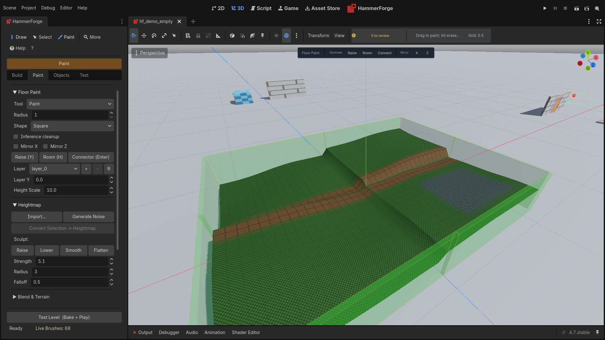

1. Press **Shift+P** to enable Paint mode.
2. Press **R** and LMB-drag a rectangle in the viewport for a first walkable room. No dock interaction is required.
3. Continue with **B** Brush, **E** Erase, **L** Line, **K** Bucket, or **N** Blend. Open the **Paint** tab only when you need shape, radius, layer, heightmap, or terrain settings.
4. After a Brush or Rect stroke, press **Y**, move vertically, and click to set wall height for that footprint. Press **H** to stamp another room using the last Rect dimensions.

Notes
- **Alt+LMB** temporarily erases without changing the selected tool.
- **Shift+LMB-drag** locks the stroke to its first dominant grid axis.
- **Ctrl/Cmd+LMB** samples the cell material for Blend without creating an undo entry.
- **Esc** restores a cancelled stroke. Plain **RMB** remains Godot camera navigation.
- **X/Z** toggle grid-origin mirror axes. They are off by default; mirrored copies and the source are one undo entry.
- The Y height gesture is a clearly chained second undo after the paint stroke. Esc restores its prior heights.
- Painting next to a different-Y layer shows a connector ghost. **Enter** commits it in one undo; Esc dismisses it. Confirmed connectors persist and bake even with automatic detection off.
- **Inference cleanup** is off by default. When enabled, it only removes isolated one-cell noise, fills one-cell cardinal holes/gaps, and widens inferred one-cell corridors inside the stroke-local dirty scope. Erase strokes are untouched, and a stroke of a single cell is left alone - one click is a deliberate cell, not noise.
- The viewport banner shows the hovered cell and footprint, then live unique-cell count and metres while a stroke is active.
- Footprint, raise, and connector ghosts are transient and disappear on completion or Esc without rebuilding an entire layer.
- Each changed stroke is one **Paint Floor** undo entry; a no-op or material pick is not.
- **Brush Shape**: Square fills a full box of cells; Circle clips corners using Euclidean distance.
- Live preview updates while dragging.
- Bucket fills a contiguous region (click filled to erase).
- Generated geometry appears under `LevelRoot/Generated`.
- Generated flat floors/walls are DraftBrush nodes and are included in Bake.

### Region Streaming (Large Worlds)
Region streaming keeps large paint grids responsive by loading only nearby regions.
1. Enable **Streaming** in the Paint tab → Regions section.
2. Set **Region Size** (cells, 64 to 4096) and **Stream Radius** (regions, 0 to 8). Region Size is the divisor that turns a cell index into a region coordinate, so a region as large as the world defeats streaming: the neighbourhood the streamer keeps resident is then a handful of enormous regions, and the memory budget cannot be met because there is nothing smaller than one region to evict. The memory budget is held between 32 MB and 8192 MB for the same reason.
3. Toggle **Show Region Grid** to visualize loaded regions.
4. Paint normally; regions auto-load around the cursor.

Notes
- Streaming a region out writes it to disk first, so a level that has never been saved has nowhere to put one and nothing can be reclaimed. The eviction pass says so rather than leaving the budget quietly ignored.
- Region data is saved to `.hfr` files in `<level>.hfregions/`. A save under a new name, or an autosave to a path of its own, copies the files of the regions streamed out at the time into the new folder, so the level it writes opens with all its paint ([#1665](https://github.com/saworbit/hammerforge/issues/1665)).
- Removing a paint layer leaves its paint in the region files that held it, so undoing the removal, or reading a region streamed out at the time, still finds it. Its id is never given to a new layer, so that paint never turns up on another one. Region files therefore keep growing across layer removals ([#1664](https://github.com/saworbit/hammerforge/issues/1664)).
- The `.hflevel` stores a region index and layer settings.

### Heightmap Terrain
Heightmaps add vertical displacement to painted floors:
1. Paint cells on a layer using Brush/Rect/Line/Bucket.
2. Click **Import** to load a PNG/EXR heightmap, or **Generate** for procedural noise.
3. Adjust **Height Scale** to control displacement amplitude. It has a small floor, because a scale of zero multiplies every height by nothing and reads as the terrain having gone.
4. Adjust **Layer Y** to set the base height of the layer. Below the grid origin is fine; both fields take a number and nothing else.

When a layer has a heightmap, its floors are generated as displaced MeshInstance3D nodes (not DraftBrush). These live under `Generated/HeightmapFloors` and are baked directly (bypassing CSG) with trimesh collision shapes.

### Material Blending
The Blend tool paints per-cell material blend weights on filled cells:
1. Fill cells first (Brush/Rect/etc.).
2. Switch to the **Blend** tool.
3. Choose a **Blend Slot** (B/C/D).
4. Adjust **Blend Strength** (0.0-1.0) in the dock.
5. Paint over filled cells to set blend weights.

Blend weights drive a four-slot shader (`hf_blend.gdshader`). Slot A is the implicit base, while slots B/C/D are controlled by the blend map (RGB) sampled on the UV2 channel.

Terrain slots:
- Use **Slot A-D** texture pickers to assign textures for the terrain blend shader.
- **Slot Scale** controls per-slot UV tiling.

## Face Materials and UVs
1. Open the **Paint** tab → **Materials** section.
2. Open **Material Library** and click **Refresh Prototypes** to load all 150 built-in textures, or click `Add` to load a custom material resource (example: `materials/test_mat.tres`).
3. Browse the visual thumbnail grid — use search, pattern dropdown, or color swatches to filter.
4. Click a thumbnail to select a material. Hover to preview it on selected faces.
5. Enable `Face Select Mode`.
6. Use the Select tool and click faces in the viewport. Each picked face is tinted orange and outlined.
7. Click `Assign to Selected Faces`, or right-click the thumbnail → "Apply to Selected Faces".
8. Press **T** to use the **Texture Picker**: click any face to sample its material and its look, then **Shift+T** gives the selection the material and **Alt+T** the whole look.

UV editing:
- Open the **Paint** tab → **Face Tools** → **UV Editor** section after selecting a face.
- Drag UV points to edit.
- Use `Reset Projected UVs` to regenerate UVs from projection.

Notes:
- Face data is stored per DraftBrush face.
- Materials and UVs persist in `.hflevel` saves.

## Surface Paint (3D)
1. Enable Paint Mode.
2. Open the **Paint** tab → **Surface Paint** section and set `Paint Target = Surface` (if needed).
3. Pick a layer and assign a texture.
4. Paint in the viewport.

Notes:
- Hold **Alt** as you press to erase: the stroke takes paint off at the strength it would put it on. Right-click stays Godot's camera look.
- Each stroke, press to release, is one undo step, so Ctrl+Z takes back exactly the stroke you just made.
- Radius is in UV space (0.0 to 1.0).
- Surface paint updates the DraftBrush preview immediately.
- Surface paint is separate from floor paint layers.
- If paint affects the floor, set `Paint Target = Surface` in the Surface Paint section.

## Displacement Surfaces

Displacement surfaces turn a flat quad face into a subdivided terrain grid that you can sculpt interactively, similar to Source Engine displacements.

### Creating a Displacement
1. On the **Paint** tab, turn on **Face Select Mode**.
2. Click a **quad face** (exactly 4 vertices).
3. On the same tab, open **Face Tools** → **Displacement**.
4. Set **Power** (2 = 5x5, 3 = 9x9, 4 = 17x17 vertices).
5. Click **Create**. The face becomes a subdivided grid.

### Painting (Sculpting)
1. On the **Paint** tab, open **Face Tools** → **Displacement**.
2. Turn **Paint** mode on in the toolbar. This closes Face Select; sculpting needs no picked face.
3. Choose a **Paint Mode**: Raise, Lower, Smooth, Noise, or Alpha.
4. Set **Radius** and **Strength**.
5. Click and drag on a displaced face in the viewport to sculpt. The stroke sculpts the face it starts on.

With Displacement or Face Tools closed, a drag in Paint mode paints the floor or surface instead. Paint uses a circular brush with quadratic falloff. Strokes are continuous — the entire stroke commits as a single undo action when you release the mouse button.

### Settings
- **Elevation**: global height scale multiplier for the displacement grid.
- **Power**: subdivision level. Set the spin and click **Apply** to change an existing displacement; the old grid is resampled into the new one by bilinear interpolation, so the sculpt survives. **Create** reads the same spin for a new displacement.
- **Sew Group**: integer group ID. Click **Sew** to snap shared boundary vertices between adjacent displacements in the same sew group.

Sew moves each vertex along its face normal. Where adjacent faces meet at an angle, the seam returns to its unsculpted position so both faces meet exactly. This also applies to shallow creases, where it can remove a sculpt along the seam.

### Destroying a Displacement
Click **Destroy** to revert a displaced face back to a flat quad.

Notes:
- Displacement requires a quad face (4 vertices). Triangles and N-gons are not supported.
- A sculpt is saved with the scene (Ctrl+S) and in `.hflevel` saves. A scene saved
  before October 2026 lost its sculpts. **Load .hflevel** brings them back from a
  `.hflevel` saved after the sculpt was made.
- The baker generates per-vertex normals for displaced faces (smooth shading).
- Flip mirrors the sculpt with its brush. See **Flip** under Rotating and Mirroring.
- Resizing a box or another primitive stretches the sculpt with its face and
  keeps it on the corners it was made against. That includes a box flipped by an
  older build, whose faces can start at a different corner.
- Clip, Carve and Hollow keep a sculpt on every four-cornered piece of its face,
  on the same surface. See **Cutting: Clip and Carve**.

## Bevel and Face Inset

### Edge Bevel (Chamfer)
Replace a sharp edge with a rounded profile:
1. Enter **Vertex mode** (V key) and switch to **Edge sub-mode** (E key).
2. Select one or more edges.
3. Open the **Build** tab → **More build settings** → **Bevel** section.
4. Set **Segments** (1-16) and **Radius** (distance the bevel cuts into the brush). The radius has to be greater than zero; `0` or below is refused rather than treated as a very small bevel.
5. Click **Bevel Edge**.

The selected edges are replaced with bevel strip faces. Higher segment counts produce smoother curves.

### Face Inset
Shrink a face inward and create connecting side faces:
1. On the **Paint** tab, select a face in **Face Select Mode**.
2. On the same tab, open **Face Tools** → **Face Inset**.
3. Set **Inset** (distance to shrink inward) and optional **Height** (extrude along normal). A positive height raises the face into a boss; a negative one pushes it in to make a recessed panel.
4. Click **Inset Face**.

Notes:
- Inset distance has to be greater than zero and cannot exceed the face's corner-to-centroid distance (the operation is rejected with a toast if too large).
- Both bevel and inset operations are fully undoable.
- A sculpted face keeps its sculpt where it was. A bevel trims the sculpt on each
  face that loses a corner, and a flat inset trims it onto the inset and onto each
  face of the ring around it. A raised or sunk inset takes the sculpt with it, and
  its ring of new wall is flat (#870).

## Entities (early)
- Place nodes under `LevelRoot/Entities` or set meta `is_entity = true`.
- Entities are selectable and excluded from bake.
- Entity palette supports drag-and-drop placement.

Entity definitions live in `res://addons/hammerforge/entities.json`, overlaid by `res://hammerforge_entities.json` when present.

Example (billboard preview):

```json
{
  "light_point": {
    "class": "OmniLight3D",
    "preview": {
      "type": "billboard",
      "path": "res://addons/hammerforge/icon.png",
      "color": "#ffff00"
    },
    "outputs": [],
    "inputs": ["TurnOn", "TurnOff", "Toggle"],
    "properties": [
      {"name": "range", "type": "float", "default": 10.0, "maps_to": "omni_range"},
      {"name": "energy", "type": "float", "default": 1.0, "maps_to": "light_energy"},
      {"name": "color", "type": "color", "default": "#ffffff", "maps_to": "light_color"}
    ]
  }
}
```

`class` is the Godot node class the entity stands for. Test Level and both exports build that node in place of the editor's marker, so a `light_point` placed in the level is a real `OmniLight3D` at runtime, and a level that lights itself does not get the fallback `PlaytestSun`. A definition naming a plain `Node3D` still exports the marker, because there is nothing better to build.

`scene` takes precedence over `class` and names a `PackedScene` to instantiate instead — a working door, a trigger volume with a script, a pickup. Its root can be any node, as a `class` can, and a `Node3D` root takes the marker's place in the level. A scene that is missing or does not build warns and exports the marker, so a wrong definition never costs you the level. The viewport only previews a scene whose root is a `Node3D`, and shows the marker for any other.

`maps_to` is optional and names the property on the built node to receive the value, for the cases where the name a level stores and the name the engine uses differ. An `OmniLight3D`'s Range is `omni_range`. Without `maps_to` the declared name is used as it stands. A property the level stores no value for, such as one a class gained after the level was saved, gets its `default`, which is also what the inspector shows. The entity's authored name, its wiring, and every other piece of metadata move onto the built node, so I/O keeps working.
`outputs` and `inputs` are the names an entity class fires and the names it answers to. The quick-wire form offers them in a dropdown beside each free-text box: the source entity's `outputs` in **Out**, and the `inputs` of whatever is chosen in **To** in **In**. The boxes stay free text, because a mapper may wire to a name no definition declares. What changes is that the vocabulary the built-in presets use is discoverable from the entity rather than only from the presets.

`presets` names sets of property values, such as a light's Warm Ceiling. The Entity panel and the palette both offer them, and a value for a property the class does not declare is left out with a warning. A property may also carry a `tooltip`, shown on its label and control in the Entity panel.

Point and spot lights have **Shadows** and **Projector**. A projector is a texture that shapes the light, like a grate or a window frame; three plain ones ship in `addons/hammerforge/projectors/`. A projector only shows through a light that casts shadows, so the export turns shadows on for a light that has one. It works in the Forward+ and Mobile renderers, and the Compatibility renderer ignores it.

Preview `type` is one of `billboard` (with `path` to a texture), `mesh` (with `path` to a mesh), `capsule` (`radius`, `height`) or `box` (`size` as `[x, y, z]`). All of them take `color`, and the shaped ones take `alpha`. `box` is the proxy that needs no asset.

## Custom Tools (Plugin API)

A project's own editor tools go in `res://hammerforge_tools/`, outside the addon. That is deliberate: the upgrade instructions say to replace `addons/hammerforge` with the new version, so anything kept under it is deleted by a documented upgrade. The folder ships with a `README.md` and a complete example under `examples/`.

A tool is a `.gd` file that `extends HFEditorTool` and returns a `tool_id()` of **100 or above** — IDs below 100 are the built-ins (0 = Draw, 1 = Select, 2 = Extrude Up, 3 = Extrude Down), and a tool claiming one is refused with a warning and freed. Tools are scanned once, at editor launch, so restart the editor after adding one. The scan is not recursive, which is why the shipped example sits in `examples/` and does not appear in your toolbar until you copy it up a level.

`res://addons/hammerforge/tools/` is still scanned, but only so an existing install does not lose anything. Do not put new work there.

Override only what you use: `can_activate()` / `get_poll_fail_reason()` to refuse and say why, `activate()` / `deactivate()` to take and give back whatever the tool holds, `handle_input()` / `handle_keyboard()` returning `EditorPlugin.AFTER_GUI_INPUT_STOP` to consume an event, and `get_shortcut_hud_lines()` for the viewport HUD. `snap_point(pos)` lands a point where a draw would, through the level's snap settings. A tool that changes the level has to go through the `undo_redo` the registry hands it, or the change is not undoable.

## Bake Output
Bake creates `BakedGeometry`:
- If chunked baking is enabled, it adds `BakedChunk_x_y_z` nodes.
- Collision shape type depends on **Collision Mode** (Inspector property on LevelRoot):
  - **Mode 0** (default): Each chunk has a MeshInstance3D and StaticBody3D with one ConcavePolygonShape3D (trimesh) per material surface, and the surface names in its `hf_surface_names` metadata.
  - **Mode 1**: Each chunk has a StaticBody3D containing one ConvexPolygonShape3D per brush (convex hulls), or per piece of a brush a cut goes through. Better for physics broadphase and navmesh generation.
  - **Mode 2**: Each visgroup gets its own StaticBody3D with convex hulls for all its member brushes. Ungrouped brushes share a default body. Best for room-based physics partitioning and bot navigation.
- Stairs and Spiral Stairs with **Collision** set to Ramp bake their slope instead of their steps' collision: a `RampCollision` StaticBody3D with one ConvexPolygonShape3D per flight, landing or tread and no mesh, or in Mode 2 the shapes in their visgroup's body ([#1416](https://github.com/saworbit/hammerforge/issues/1416)).

Brushes whose Cast Shadows or Lightmap Scale differ bake into meshes of their own, `BakedMesh_0`, `BakedMesh_1` and on, with one collision body between them as before. On the CSG path each set of brushes is a CSG pass of its own with every cut in it, so a cut carves every one of them; where a brush of one set meets a brush of another, both keep their faces, as on the per-face path ([#1444](https://github.com/saworbit/hammerforge/issues/1444), [#1438](https://github.com/saworbit/hammerforge/issues/1438)).

Generated flat floor paint brushes are included in the CSG bake. Heightmap floor meshes are duplicated directly into the baked output with trimesh collision shapes (they bypass CSG since they are already ArrayMesh). Heightmap collision is appended after visgroup partitioning (mode 2), so heightmap shapes are always preserved.

Use Face Materials (optional):
- Bakes each face with its own material, with no CSG pass, when the level has no effective structural cuts. Which path is faster depends on the level: on separate boxes the CSG path measured faster (593 ms against 848 ms at 3,000 brushes), and on boxes that touch their neighbours the face material path did (648 ms against 899 ms). It hands the editor a frame every 8 brushes, and CSG two frames in all. [Performance](HammerForge_Performance.md#baking) has the tables.
- Pending, applied, or frozen subtract brushes automatically use the CSG-safe path instead, preserving the cut in both rendered geometry and collision.
- Bakes cooperatively (yields every 8 brushes) so the editor stays responsive on large levels.

## Save/Load (.hflevel)
- Save .hflevel stores brushes, entities, settings, materials palette, face data, and paint layers.
- Paint layer data includes per-chunk `material_ids`, `blend_weights` (+ _2/_3), optional `heightmap_b64`, `height_scale`, and terrain slot settings.
- Load .hflevel restores them. Missing heightmap/material fields default to zero (backward-compatible).
- A file whose shape cannot be read leaves the open level exactly as it was and reports why, rather than clearing it first. A single brush or entity in an otherwise good file that cannot be read is skipped, the rest loads, and the count of what was skipped is reported.
- Autosave can write to a configurable path.
- The timed autosave waits for a pause in editing. When its timer comes round during a drag, a resize, an extrude, a vertex or gizmo drag, a marquee, a paint stroke, or a Polygon, Path or other tool with points placed, it waits until that ends and nothing has changed for 2 seconds. It never waits longer than twice the interval, so a session that never pauses is still saved. A level that has not changed since the last autosave is not saved again ([#1736](https://github.com/saworbit/hammerforge/issues/1736)).
- The `.hflevel` records the scene it was saved from, a `.tscn` or a `.scn`. Switch a big level to `.scn` with **Scene > Save Scene As...**: with autosave on, the level autosaves at once so the file names the new scene. With autosave off, press **Save Level** once after ([Data Portability](HammerForge_Data_Portability.md#which-file-opens-the-tscn-wins)).

## When the editor crashes

A crash of the Godot editor takes HammerForge with it, and a plugin cannot stop that. What HammerForge does is keep enough to see what happened. The [autosave](#saveload-hflevel) is what keeps your work.

- **A journal for each session.** While the editor runs, HammerForge writes how far start up got, one line for each undo step (its name, the brush count and the level's autosave file) and one for each agent bridge call (the tool, and its error code when it failed) to `user://hammerforge/journal/<process id>.jsonl`. Each line is written to disk as it happens. It keeps the last 200 lines. A clean close deletes the file.
- **The next start notices.** A journal whose editor is no longer running was left by a session that died. HammerForge turns it into a folder under `user://hammerforge/crashes/`, named for the date and time, and the Console's [Status](#status) tab shows **Did not close cleanly** first, with the last step it saw. The Log tab says where the folder is.
- **What the folder holds.** `report.json`: the HammerForge and Godot versions, the system, the graphics adapter and renderer, where start up got to, and the last step and bridge call. `journal.jsonl`: the journal. `levels/`: a copy of the newest autosave of each level the journal names. A level copy over 20 MB is left out, and `report.json` names it.
- **Godot's own output.** The editor keeps no log file; Godot's file logging covers a running game. What the engine prints as it goes down reaches only the terminal the editor was started from. To keep it, start the editor from one with its output sent to a file, such as `godot --editor --path . > editor.log 2>&1`.
- **The buttons.** **Open Folder** shows the folder. **Copy Report** puts `report.json` and the journal's last 20 lines on the clipboard, ready to paste into an issue. **Dismiss** hides the row and leaves the folder.
- **Repeats.** A crash whose last five journal lines match an earlier report adds one to that report's count instead of making a new folder.
- **Limits.** 10 reports, 50 MB in all, none older than 90 days. The oldest go first.
- **Nothing leaves your machine.** Sending a report is up to you.

In the editor, `user://` is the project's own data folder: on Windows `%APPDATA%\Godot\app_userdata\<project name>`. Two editors open on two projects each keep their own journals, and a journal whose editor is still running is never taken.

To try it, start the editor with the environment variable `HAMMERFORGE_CRASH_TEST` set. The Status tab gains a **Crash test** row whose **End Editor** button stops the editor at once, as a crash would. Start the editor again and the report is there.

## Troubleshooting

Find what you see in the Symptom column, then the row whose cause fits. One symptom can have more than one row. The [Status](#status) board in the HammerForge Console checks several of these causes for you.

### Setup

| Symptom | Cause | Fix |
|---|---|---|
| No HammerForge dock, and no **HammerForge** in the main-screen switcher | The plugin is not enabled. | Enable **HammerForge** in **Project → Project Settings → Plugins**. See [Install HammerForge](HammerForge_Install_Upgrade.md#install-hammerforge). |
| The plugin turns itself off as you enable it, with script errors from `addons/hammerforge` in the Output panel | The editor is older than Godot 4.7, which HammerForge needs. | Open the project in Godot 4.7 or newer. See [Requirements](HammerForge_Install_Upgrade.md#requirements). |
| The same errors, or no dock, just after you copied the plugin in or upgraded it | Godot's editor cache in `.godot/editor` still describes the old files. | Close Godot, delete `.godot/editor`, reopen the project and enable the plugin again. See [Cache Reset](HammerForge_Install_Upgrade.md#cache-reset-recovery). |
| **HammerForge** is in the switcher, but its dock is not on screen | The dock is a tab in the upper-left dock, beside Scene, and another tab is in front of it. A saved editor layout can also have moved it. | Click the **HammerForge** tab. If there is none, the [Cache Reset](HammerForge_Install_Upgrade.md#cache-reset-recovery) deletes the saved layout too, and the dock comes back in its own place. |
| A Draw click selects instead of drawing, and a toast says the scene has no HammerForge level | The scene has nodes in it and no `LevelRoot`. A Draw click makes one only in a new, empty 3D scene. | Click **Create Starter** or **Create Empty** in the dock's banner. See [LevelRoot](#levelroot). |

### Building

| Symptom | Cause | Fix |
|---|---|---|
| A brush outline follows the mouse, but no brush is made | Draw takes two clicks. The drag sets the base, then the brush waits for its height. | Move the mouse to set the height and click again. Right-click cancels. See [Brush Creation](#brush-creation-cad-style). |
| A click on a face selects the whole brush | Face Select Mode is off. | Tick **Face Select Mode** in **Paint → Materials**. See [Face Materials and UVs](#face-materials-and-uvs). |
| Face Select turns itself off, and the picked faces are gone | Leaving the Paint tab, choosing another tool, entering Vertex mode or selecting a node in the Scene tree closes Face Select. Closing it clears the picked faces. | Go back to **Paint** and tick **Face Select Mode** again. See [Viewport Mouse Controls](#viewport-mouse-controls). |
| **Bevel Edge** asks for vertex/edge mode, or for an edge | The brush is not in Vertex mode, or no edge is picked. | Select the brush, press **V**, then **E** for edges, and click an edge. See [Edge Bevel](#edge-bevel-chamfer). |
| **Bevel Edge** says the bevel failed | The edge is not shared by exactly two faces of the brush. | Pick an edge where two faces meet. |
| The bevel is narrower than the **Radius** you set | A radius wider than half the shorter of the two faces is capped to that, with a warning in the Output panel. Any wider and the bevel would eat through those faces. | Nothing is wrong. For a wider bevel, make the brush larger first. |
| **Inset Face** says "Select a face first", or **Create** under Displacement says "Select a quad face first" | No face is picked. Face Select is off, or something closed it, which clears the picked faces. | On the **Paint** tab, tick **Face Select Mode**, click the face, then use **Face Tools** on the same tab. See [Face Inset](#face-inset) and [Creating a Displacement](#creating-a-displacement). |
| **Inset Face** says the inset failed | The **Inset** distance reaches the middle of the face from one of its corners. | Use a smaller **Inset**. See [Face Inset](#face-inset). |
| **Create** under Displacement says it needs a quad face with no displacement on it | The face does not have exactly four corners. Triangles and faces with more corners cannot take a displacement. | Pick a four-cornered face. See [Creating a Displacement](#creating-a-displacement). |
| **Create** under Displacement says it needs a quad face with no displacement on it | The face has a displacement already. Create refuses rather than wipe the sculpt on it. | Use **Destroy** first to start over. Destroy can be undone. |
| Dragging on a displaced face does not sculpt | Paint mode is off. Face Select turns it off. | Turn **Paint** mode on in the toolbar. That closes Face Select, and the stroke sculpts the displaced face it starts on, with no pick needed. |
| Dragging on a displaced face does not sculpt | The **Displacement** section, or **Face Tools** around it on the **Paint** tab, is collapsed. | Expand both. See [Painting (Sculpting)](#painting-sculpting). |
| Dragging on a face does not sculpt | The face has no displacement. | Pick it in Face Select and click **Create** under Displacement first. |

### Paint and materials

| Symptom | Cause | Fix |
|---|---|---|
| Painted cells stay flat, with no heightmap floor | The active layer has no heightmap. | With that layer active, click **Import...** or **Generate Noise** in **Paint → Heightmap**. See [Heightmap Terrain](#heightmap-terrain). |
| A heightmap is imported or generated, but no floor appears | No cells are painted on the layer. A heightmap shapes painted cells only. | Paint the cells with Brush, Rect, Line or Bucket. |
| Blend strokes change nothing on the floor | The layer has no heightmap. Blend weights are drawn by a heightmap floor's blend shader, and a layer without a heightmap is built from plain brushes. | Give the layer a heightmap, as above. See [Material Blending](#material-blending). |
| A heightmap floor shows only Slot A | No blend weights are painted, so its blend map is all zero. The Blend tool skips cells that are not painted. | Paint the cells first, then go over them with the **Blend** tool (**N**) at a **Strength** above 0. |
| The floor shows plain colours, not textures | No texture is set for the slots, so each slot shows its own colour. | Click **Texture...** beside **Slot A** to **Slot D** in **Paint → Blend & Terrain**. |
| Faces bake grey after **Load Library**, and the status line says some materials are missing | The library names a material file the project no longer has. Its palette slot loads empty. | Put the file back at the path the library names and load again, or give those faces another material. See [Material Library](#material-library). |

### Bake and test

| Symptom | Cause | Fix |
|---|---|---|
| A subtract brush cuts nothing in the viewport | The viewport draws each brush as you drew it. Only a bake makes the cut, and a bake from the dock leaves the brushes on screen over it. | Tick **Subtract Preview** in **Test → Settings** to see the cut as you build. **Test Level** bakes and plays with the cut in place. See [Subtract Preview](#subtract-preview). |
| A subtract brush cuts nothing in Test Level | It does not overlap an additive brush. | Move it into the brush it should cut. **Check Bake Issues** in **Test → Advanced Bake** lists it as a floating subtract, and **Select** on its row picks it. See [Bake Issue Detection](#bake-issue-detection). |
| A subtract brush leaves a heightmap floor whole | The bake adds heightmap floors after the brushes are cut, so no brush cuts them. | Erase the cells under the cut, or shape the floor with the Sculpt buttons in **Paint → Heightmap**. See [Bake Output](#bake-output). |
