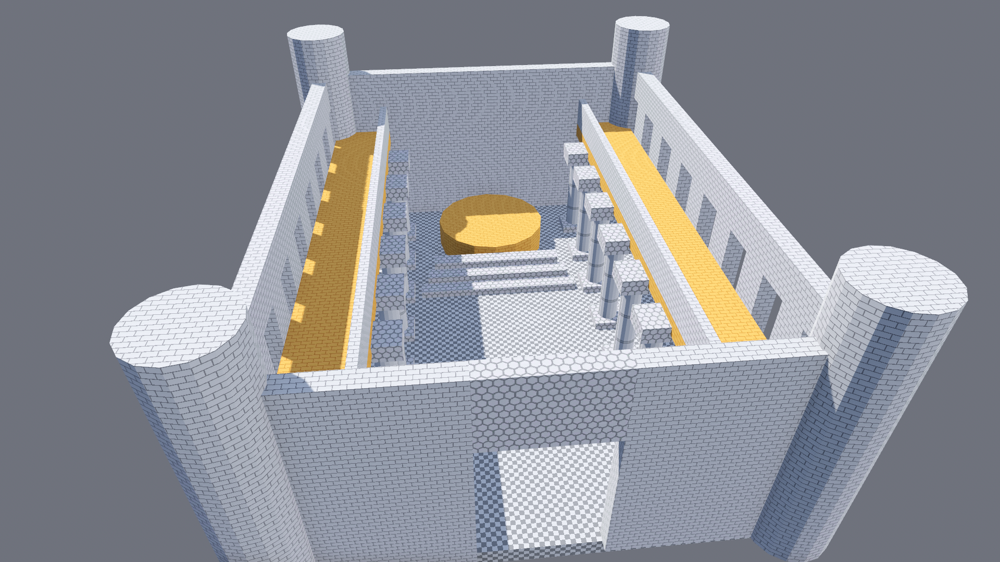
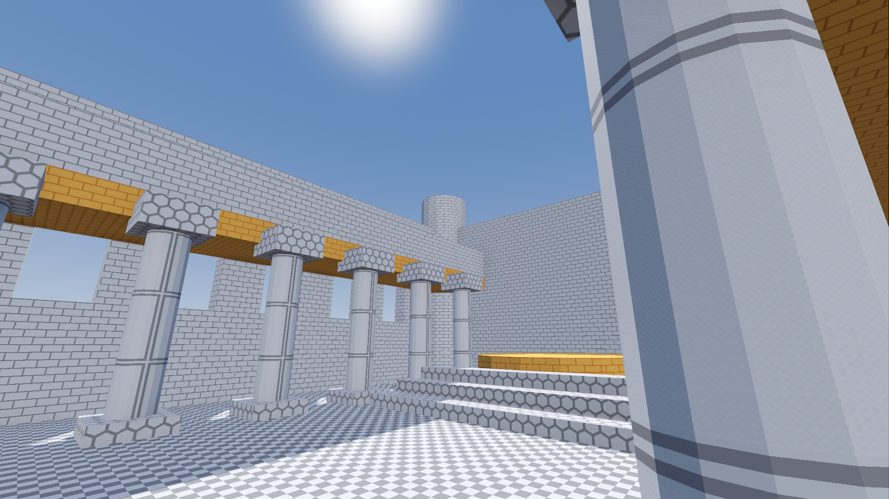

# Features and Reference

The complete feature and reference material for HammerForge. For a quick
overview and installation, see the [home page](index.md).

---

## Core Workflows

### Draw and Shape Brushes



Two-stage CAD drawing: drag base, click height. Brushes support **Add** and **Subtract** operations with pending cut staging, so you can preview subtractions before committing.

- **15 shapes** -- box, cylinder, sphere, cone, wedge, pyramid, prisms, ellipsoid, capsule, torus, and platonic solids, with Sides setting how smooth a round one is
- **Repeat Last Brush** (Shift+D, or Repeat in the context toolbar) -- a stamp of the brush the last Draw made, its shape, size, Sides, Solid or Cutout and material; each click places a copy standing on the face or grid under the cursor, one undo step each, until Esc, a right click or another tool
- **Extrude Up/Down** (E / U or Shift+E / J) -- click any face and drag to extend; a rectangle grows a box, any other face a prism of its own outline, and the new brush takes the face's texture; with **Shift** the drag moves the face itself along its normal on any brush, box or not, with the faces in its plane of the other selected brushes, and stops short of turning a brush inside out (#1712)
- **Hollow** (Ctrl+H) -- shell a brush into walls of a configurable thickness. Any convex brush at any rotation; a cylinder becomes a tube
- **Structure section** (Ctrl+Shift+A) -- pick a type and build it. The shortcut builds whatever the section is showing. Save a type's settings as a named preset, kept in the project so a team shares its house styles
- **Arch** -- a parametric arch, one brush per segment. Radius, wall thickness, depth, arc degrees, segments and start angle
- **Stairs** -- a flight, one brush per step, straight or turning L or U at a landing. Width, tread, rise or a total height, step count, solid-underneath or floating treads, nosing, and ramp collision for a player with no step up
- **Spiral stairs** -- a flight that turns as it climbs, each tread the wedge that radius makes, with an optional newel post and ramp collision
- **Dome** -- a hemisphere in rings, one brush per panel. Adjustable arc and sweep, and a wall that can go all the way to solid
- **Ring** -- a round tube swept round a centre, one convex brush per segment. Radius, tube radius, ring and tube segments, start and sweep, for a pipe bend, a moulding or a handrail
- **Door Frame** -- two posts and a flat or arched head round a clear opening, and the cut for the opening as a Pending Cut. Width, height, wall, frame, proud, head and segments; an Update resizes the cut with the frame
- **Trim Run** (Shift+Alt+T) -- a skirting or cornice along wall faces picked in Face Select, mitred at every corner, inside and out, and stopped square at every doorway a Cutout makes. Edge, offset, and the Path tool's trim profiles; Update keeps the run and Re-pick reads it again from the faces picked now
- **Live structures** -- every structure remembers what made it. Select a piece and the Structure section becomes an editor: change a number and it rebuilds in place, where you moved it to, keeping the materials painted on it and the brush entity its pieces were tied to. It says first if a rebuild would overwrite hand edits. Detach when it should stop being live
- **Clip** (Shift+X) -- split a brush along a plane. Any convex brush, at any rotation; a piece that is still a box stays a box unless it is thinner than 0.1, and every piece keeps its faces' textures, surface paint and sculpts
- **Clip to Face Plane** (Shift+Alt+X) -- cut along the plane of a selected face, which is the cheapest route to an angled wall or a chamfered corner
- **Carve** (Ctrl+Shift+R) -- boolean-subtract one brush from all intersecting brushes, using the carver's real face planes, so the carver can be rotated or a cylinder. A doorway carved through a painted wall leaves the paint on the wall
- **Merge** (Ctrl+Shift+M) -- combine 2+ touching brushes into the one convex solid they make, centred on it, keeping each outer face's material and UVs; an L or a doorway is refused
- **Hull of Selection** -- replace 2+ brushes with one brush, the convex hull of all their corners, touching or not; faces on an old face's plane keep its look, new faces take the Active Material, with a green preview and one undo step
- **Hull Tool** -- click points, double click a face for its corners or Shift drag a face to pull them out, and Enter makes one brush around them; a flat set is refused with the reason
- **Intersect** (Ctrl+Shift+I) -- keep only the volume 2+ brushes share, as one convex brush: the first selected is cut down by the planes of the others, and each face keeps the look of the brush whose plane it lies on. A quarter round column from a box and a cylinder in one step
- **Rotate** (R / Shift+R) -- turn the selection by a configurable step about the locked axis, or Y. Texture Lock carries the texture round with the brush, upright, the same way it carries one you move. Turn it off and the texture keeps its place in the level
- **Flip** (Shift+M) -- mirror the selection across the locked axis, or X. Winding is preserved, so a mirrored brush never bakes inside out, and a sculpted displacement is mirrored with its face
- **Shear** -- lean the whole selection, from a handle on a side of its box or typed in metres per metre or degrees; every corner moves by the one shear, so brushes that met still meet, and point entities move without turning
- **Mirror Copy** (Alt+M) -- keep the selection and add a mirrored copy across each axis ticked in Selection Tools, and each combination of them: X and Z give three. With Selection Edge each copy lands flush beside the original; without it the planes go through the Pivot. One undo step
- **Offset** (Alt+G) -- move the selection by a typed X, Y and Z, along the world's axes or its own: brushes and entities, or in vertex mode the picked vertices, or in Face Select the picked faces by their corners. Exact, one undo step, and a move that would dent a brush is refused with the reason. Alt+G then Enter repeats it
- **Pick Pivot** (Alt+P) -- click a brush vertex, edge midpoint or face centre to turn, flip, ring an array and mirror about it, marked with a cross and saved with the level. Clear Pivot (Shift+Alt+P) goes back to the selection's centre
- **Reset Rotation** (Alt+R) -- clear a rotation and keep the geometry. A quarter turn folds into the brush size losslessly, and any scale set with Godot's own gizmo is left alone, because that is not rotation
- **Apply Rotation and Scale** -- fold a brush's rotation and scale into its shape, so its size reads in metres and nothing moves. A box stays a box and an uneven sphere becomes an ellipsoid; anything else becomes CUSTOM and the toast says so
- **Convert to Brushes** (palette, or the Space menu on a mesh or CSG node) -- a convex mesh or a CSG primitive becomes a brush where it stands, with its material and UVs; one Ctrl+Z brings the node back
- **Arrays** -- Linear, Radial (copies around an axis) and Grid (a 3D lattice) layouts in the Duplicate Array section. Select any piece of one to load it back: Create becomes **Update Array**, with **Detach** beside it, and Update says how many copies it would move back or rebuild over, a stroke painted on one included, before it does
- **Bevel** -- round off sharp edges with configurable segments and radius (vertex/edge mode); a sculpt on a face it trims is trimmed with it
- **Face Inset** -- shrink a face inward and optionally extrude along its normal; a sculpt stays on the surface it was on
- **Numeric input** -- type exact dimensions during any drag or extrude; a base takes width, depth and height as `6,4,3`, with Tab or a comma between them
- **Cancel preview with undo** -- Ctrl+Z cancels an unfinished draw or extrusion and keeps earlier actions in history
- **Drawing plane** -- Grid Up/Down, Reset and Align Grid to Selection place an axis-aligned plane; the HUD shows its axis and position
- **Draw hover preview** -- before the click, the face a draw would start on is tinted for the grid's level, a raised face or one that is not flat, and a cross and two bright grid lines mark the snapped start
- **Draw on Face** (L) -- a draw that starts on a brush face builds on that face's plane and pulls along its normal: a Solid grows out of a wall and a Cutout cuts into it
- **Resize gizmo** with world-space grid snap, opposite-face anchoring under rotated/non-uniformly scaled parents, and shape-aware sizing: spheres stay uniform, cylinder/cone/capsule X/Z handles change one shared radius, and capsules can never be resized shorter than their diameter

### Vertex Editing


Precision vertex-level editing for fine-tuning brush geometry:

- **Vertex mode** (V) -- select and move individual brush vertices with convexity enforcement
- **Edge sub-mode** (E) -- toggle to select, move, split, and merge edges
- **Edge splitting** (Ctrl+E) -- insert midpoint vertex on a selected edge
- **Vertex merging** (Ctrl+W) -- merge selected vertices to their centroid
- **Wireframe overlay** -- color-coded edge display (gray default, orange selected, yellow hovered)
- **Clip to Convex** -- repair non-convex brushes by recomputing the convex hull with UV inheritance
- **Many corners at once** -- a corner several selected brushes share moves as one, a drag on empty space box selects corners, Delete removes them and Alt+Click adds one, and the arrows, R and Scale Vertices move, turn and scale the selected corners (#1713)

### Polygon Tool

Draw any outline that does not cross itself and extrude it into brushes:

- **Polygon tool** (P) -- place the first vertex on an exact visible surface or the forward construction plane, then add vertices from that horizontal placement plane; Enter or auto-close to finish
- **Concave outlines** -- split into convex brushes on close, cut along the line of a wall where possible, grouped and made in one undo step; an outline that crosses itself is refused with a toast
- **Segment lengths** -- each edge shows its length while placing; hold Shift to lock an edge to X or Z
- **Height extrusion** -- drag to set height after closing the polygon
- **Shared snapping** -- placement uses the active Grid, Vertex, Center, Edge, Perpendicular, and reference-line snap modes

### Path Tool

Create corridors and paths by placing waypoints:

- **Path tool** (;) -- place the first waypoint on an exact visible surface or the forward construction plane, then add waypoints from that horizontal placement plane; Enter to finalize
- **Segment lengths** -- each segment shows its length while placing; hold Shift to lock a segment to X or Z
- **Rectangular cross-section** -- configurable width and height per path
- **Mitred corners** -- each segment is one brush cut on its corners' bisector planes, so neighbours meet on one plane with no overlap and no extra brush; a corner sharper than about 29 degrees has its outside tip cut flat
- **Closed loops and Side** -- click the first point to close the path and build it; Side stands the cross-section Left or Right of the clicked line instead of centred on it, so a room's walls can keep the room the size it was drawn
- **Curves** -- Curve Smooth runs the path through the points as a Catmull-Rom curve, cut into Curve Segments convex pieces a span that meet face to face; click and drag to pull out a tangent handle; a bend tighter than the path can turn is outlined red and refused by name
- **Auto-grouping** -- all segment brushes share a group ID
- **Auto-stairs** -- step brushes along sloped segments with configurable step height
- **Auto-railings** -- top rails + posts on both sides with configurable height, thickness, and post spacing
- **Auto-trim strips** -- edge strips alongside path with material auto-assign
- **Trim profiles** -- Flat, Chamfer, Round, Cove, Ogee or Stepped, a concave profile cut into convex horizontal bands; Trim Flip hangs it from the path's top for a cornice

### Snap and Align

Geometry-aware snapping goes beyond a simple grid:

| Mode | Key | What it snaps to |
|------|-----|------------------|
| Grid | G | Regular grid intersections |
| Vertex | V | Corners of existing brushes (8 per box, a wedge's or a polygon's own corners) |
| Center | C | Center points of existing brushes |
| Edge | E | Midpoints of existing brushes' edges |
| Perpendicular | P | Closest point on an existing brush's edge |

Closest candidate within threshold wins. Modes combine freely. A marker on the snapped point says by its shape, and a word beside it, what the point is on, and **Tab** steps to the next kind in reach; **Next Pick: Vertex Only** and its siblings limit one pick to one kind (#1691). A brush of more than 64 faces snaps to its box. **Hold Ctrl** during a draw, a resize handle or a vertex drag to turn grid snap the other way for that drag, and the HUD says Snap off or Snap on. With **V** on, or **Alt** held, a vertex drag lands on the nearest vertex of another brush within 10 pixels, and a resize handle stops level with one, with a marker on the target. **Alt+Arrow** nudges a tenth of the grid step. The Measure tool can set a **custom snap reference line** with Ctrl+Click for alignment along arbitrary axes. **Texture Lock** preserves UV alignment for HammerForge move and resize actions, including nudge and Move to Floor/Ceiling. Godot's native Node3D transform widget leaves the UV settings alone, so a brush moved with it behaves as though Texture Lock were off and the texture keeps its place in the level. **Move to Floor/Ceiling** (Ctrl+Shift+F/C) raycasts to snap brushes vertically. **Snap to Grid** (Ctrl+B) puts each selected brush's bounds corner, or entity's origin, on the nearest grid point, keeping size and rotation; in vertex mode it does the same for the selected vertices. **UV Justify** offers fit/center/left/right/top/bottom/stretch/tile alignment for selected faces, **Align to Edge** turns the texture to run along a face's edge, **Fit Repeats** shows a whole number of repeats, and **Fit Strip** fits one strip of a trim sheet.

### Paint Floors and Terrain


Grid-based paint layers with chunked storage for large worlds:

- **Tools:** Brush (B), Erase (E), Rect (R), Line (L), Bucket (K), Blend (N)
- **Fast viewport loop:** Shift+P enters Paint mode; R then LMB-drag creates a rectangular walkable room without opening the dock
- **Stroke modifiers:** Alt+LMB temporarily erases, Shift+LMB locks the first dominant grid axis, Ctrl/Cmd+LMB samples a cell material, and Esc restores a cancelled stroke
- **Live feedback and undo:** the existing banner shows hovered cell/footprint plus live cells and metres; each changed stroke is one undo entry, including lost-release recovery
- **Paint-then-raise:** Y adjusts wall height for the last Brush/Rect footprint as a clearly chained second undo; unrelated wall runs keep their own height
- **Mirrored paint:** X and Z toggle grid-origin mirroring, off by default and combined with the source stroke in one undo
- **Room stamp:** H repeats the last Rect dimensions as a filled floor with raised boundary walls in one undo
- **Opt-in inference:** default-off one-cell denoise, hole/gap repair, and corridor widening, scoped to the stroke's dirty chunks and local halo
- **Sculpting:** Raise, Lower, Smooth, Flatten brushes for interactive terrain editing with configurable strength, radius, and falloff
- **Shapes:** Square, Circle with adjustable radius
- **Heightmaps:** import PNG/EXR or generate procedural noise -- per-vertex displacement via SurfaceTool
- **Displacement surfaces:** Source-style subdivided face grids (power 2-4) with Raise/Lower/Smooth/Noise paint modes, sew adjacent displacements, elevation scale
- **Convert Selection to Heightmap:** select brushes → rasterize top faces → create sculptable terrain layer
- **Material blending:** four-slot shader with per-cell blend weights painted directly on the grid
- **Live connectors:** touched cross-layer boundaries show ramp/stair ghosts; Enter commits persistent definitions in one undo and Esc dismisses them
- **Auto-connectors:** optional bake-wide ramp/stair detection with mode selection (Ramp/Stairs/Auto), configurable step height and width; confirmed boundaries also bake when automatic detection is off
- **Foliage & Scatter brush:** circle/spline shapes, density preview via MultiMesh (Dots/Wireframe/Full), slope/height filtering, align-to-normal, commit as permanent MultiMeshInstance3D
- **Region streaming:** sparse chunk loading for open worlds

### Materials and Surface Paint



- **Visual material browser** -- thumbnail grid with search, pattern/color filters, and Prototypes/Palette/Favorites views; marks what the level uses with a face count, an In Use view with the most used first, a search that takes every word, Select Faces and Select Brushes Using This, and a thumbnail size slider (#1725)
- **150 built-in prototype textures** (15 patterns x 10 colors) -- click **Refresh Prototypes** for instant greyboxing with visual browsing
- **Texture Picker** (T key) -- eyedropper tool samples material from any face
- **Apply Picked Look** (Alt+T) -- gives the selected faces the picked face's material, projection, scale, offset and rotation in one undo step, so faces on separate brushes line up
- **Hover preview** -- hovering a thumbnail temporarily previews it on selected faces
- **Replace Material** -- swaps one material for another on every face that wears it, across the level, the selection or shown brushes, in one undo step; the faces it changed become the face selection
- **Right-click context menu** -- Apply to Faces, Apply to Whole Brush, Set as Active Material, Replace Material, Toggle Favorite, Copy Name
- **Recent row** -- the last eight materials applied to faces or brushes, newest first, kept per user beside the favorites; a favorite whose file is gone and an empty palette slot show as "!"
- **Apply Favorite** (Alt+1 to Alt+9) -- applies favorite N to the selected faces or brushes in one undo step; the context toolbar strip and the Favorites view show the same numbers
- **Modal Face Select mode** for painting individual faces; entering hides object transform/resize gizmos, manual exit restores the prior object selection, and selecting an object in the Scene tree returns directly to object editing
- **Surface paint** with per-face splat layers, weight images, and live preview; Alt erases and each stroke is one undo step
- **UV editor** with per-vertex drag handles and reset-to-projection, the face's texture drawn under its outline, x2 and /2 with a U and V link, Flip U, Flip V, Rotate 90, Fit U and Fit V, and UV Snap with a grid; a corner drag is one undo step. It sits under **Face Tools** on the Paint tab with Displacement and Face Inset, where faces are picked
- **Face projection** with **Align to Face** and **Align to World** -- lays a texture in the face's own plane, U level and V down the slope, so a ramp repeats as a wall does
- **Wrap** -- carries the selected face's texture over an edge onto each face clicked, one undo step a click, round a pillar or along a corridor
- **Linked surfaces** -- Link, Unlink and Select Group; linked faces share one mapping that a move, resize, cut or vertex edit keeps, and a fitted surface is fitted again
- **Texture Gizmo** (UV Editor, or Giz on the context toolbar) -- drag in the viewport to slide, stretch and turn the texture on the faces picked in Face Select, one undo step a drag
- **Drop a material file** -- drag a `.tres` or `.material` from Godot's FileSystem dock onto a brush face to paint it, or every picked face; a file new to the palette is added in the same undo step
- **Hidden faces** -- mark a face nobody will see, such as the underside of a floor or the back of a wall against another, with the striped Hidden swatch, Alt+T or Hide Faces Against Solids; the bake leaves it out of the mesh, the lightmap and the occluders and keeps its collision, says how many faces and how much area it left out, and a `.map` writes it as `skip`
- **Smoothing groups** -- round brushes and the curved faces of arches and domes shade smooth, the same on every bake path and through cuts; the UV Editor's Smoothing box sets a face's group
- **Material library persistence** -- Save Library and Load Library in the Paint tab write and read the palette as JSON resource paths, reporting the slots they could not record or resolve

### Entities and I/O


- **Entity classes from an FGD** -- point, solid and base classes, typed properties with choices and flags, inputs and outputs, several files in order, and Convert to JSON
- **Data-driven entity types** from `entities.json` plus a per-project `res://hammerforge_entities.json` overlay (point entities, brush entities like func_detail, func_wall, func_clip, trigger volumes)
- **Clip brushes** (`func_clip`) -- collision with no mesh, for a smooth slope over steps or rubble or a barrier along a ledge. A clip draws violet in the editor, bakes as a convex hull on its Layer, cuts the navmesh, and comes in from and goes out to a `.map` as clip faces
- **Source-style I/O connections** -- wire output events to target inputs with parameter, delay, and fire-once options; automatically translated to Godot signals on bake/export via `HFIORuntime` dispatcher (direct method calls, snake_case fallback, generic handler, or user signal emission)
- **Smart auto-routed connection lines** -- quadratic Bezier curves with arrowheads, parallel route offset, color-coded by output type (cyan=OnTrigger, red=OnDamage, yellow=OnUse, etc.) and dimmed by delay
- **I/O wiring panel** -- quick-wire form (output/target/input/param/delay/once), connection summary, and preset picker embedded in the Objects tab. A named brush entity is offered once by its name, and a wire aimed at any brush of a door or a trigger reaches the whole of it in the game
- **Connection presets** -- 4 built-in patterns (Door+Light+Sound, Button→Toggle, Alarm Sequence, Timer Lights) plus user-saved presets with target tag mapping
- **Highlight Connected** -- toggle to pulse-highlight all entities linked to the selected one, with summary counts in the context toolbar
- **Declarative property forms** -- dock auto-generates typed controls (string, int, float, bool, enum, color, vector3) from entity definitions
- **Drag-and-drop placement** from the entity palette, with a button per preset such as a warm ceiling lamp
- **Light presets and projectors**: named property sets per class, and a projector texture that shapes a point or spot light's beam
- **Sound preview**: pick a sound's file and play it in the editor from the Entity panel
- **Clean operation styling** -- solid brushes use an uncluttered green-tinted surface, subtractors retain a clear red semantic outline, and brush entities use an understated blue tint, a clip brush violet. Hover and selection use sparse, shape-specific structural profiles; render-triangle topology is reserved for explicit editing and bake-preview modes

### Organize Your Level

- **View Filters** -- hide a kind in the editor: world, cut or clip brushes, triggers, brush entities and point entities by kind or class, structures, prefab copies, decals, I/O wires or cordons; a rule, so one made later is hidden too, never saved, ignored by the bake, with a footer chip while any is on; **Show Face Direction** draws every face's front blue and back red, so a face pointing into its brush shows from outside
- **Visgroups** -- named visibility groups ("walls", "detail", "lighting") with per-group show/hide. **Current** makes one the group new work joins, **Leave out of bake** keeps one in the editor only, and **Locked** keeps every tool and the agent bridge off its members. **Isolate**, **Hide Sel**, **Previous** and saved **Views** change what is shown without changing the level
- **Grouping** (Ctrl+G / Ctrl+U) -- persistent groups that select and move together
- **Cordon** -- restrict bake to one or more AABB regions with yellow wireframes; skip everything outside them. Two rooms at opposite ends of a level bake without the space between. Each cordon has a name and its own switch, so one can sit out a bake and keep its bounds. A min/max pair entered in either order means the same region, and a cordon with a non-finite corner is refused rather than stored
- **Reference cleanup** -- deleting brushes auto-cleans group/visgroup membership and warns about dangling entity I/O connections
- **Duplicator** -- create N copies of a brush with progressive offset
- **Prefabs** -- save brush + entity groups as `.hfprefab` files with variants, tags, and live-linked propagation. Drag from library to instantiate with new IDs and remapped I/O; each placed copy's entities get names and ties of their own, so two placed doors are two doors, and a variant switch or a Pull keeps the copy's names. Brush and entity ids, group membership and visgroup membership are all left behind on capture, because they only mean something in the level the selection came from. A linked copy can **Keep** chosen properties through a Pull, **Copies** selects every copy of its prefab, and **Unlink** makes one ordinary brushes and entities
- **Measurement** (M key) -- persistent multi-ruler with angle display, Shift+Click chaining, and snap reference alignment
- **Clip tool** (C key) -- cut the selected brushes along a plane placed with two or three points, keeping either piece or both, as one undo step ([#1711](https://github.com/saworbit/hammerforge/issues/1711))
- **Decal placement** (N key) -- raycast decals onto brush surfaces with live preview
- **Real-time cut preview** -- toggle overlays of the cut between additive and cut brushes, only where the bake cuts: a brush tied to an entity class is never cut, and a cutter tied to one cuts nothing
- **Geometry previews before commit** -- carve and intersect (green), clip (cyan + orange plane), and hollow (yellow) show wireframe overlay of resulting pieces with confirmation dialog before executing, which says when a sculpt cannot follow the cut

### Bake and Export

| Option | What it does |
|--------|--------------|
| **Bake** | CSG assembly to merged meshes + collision (trimesh, per-brush convex, or per-visgroup partitioned) |
| **Bake profiles** | Editing and Shipping set the bake options in one undoable step; save your own to keep every option under a name, on your machine or in the project for the team |
| **Chunked bake** | Split output by spatial chunks |
| **Cordon bake** | Restrict to one or more AABB regions |
| **Face materials** | Bake per-face materials without CSG |
| **Heightmap floors** | Bypass CSG, bake displaced meshes directly with collision |
| **LODs** | Auto-generate level-of-detail meshes, including brush entities that keep their own nodes |
| **Lightmap UV2** | Unwrap static geometry, including named brush entities; warn with the path of static meshes missing UV2 |
| **Navmesh** | Bake navigation mesh; it runs through doors and around `prop_static` collision |
| **Dry run** | Preview bake counts without building. Counts through the cordon and Bake Visible Only, so the number matches what the bake takes |
| **Bake Selected** | Bake only selected brushes (merged into existing output, in place of their earlier selection bake; a brush the last full Bake holds bakes the whole level) |
| **Bake Changed** | Rebuild the level when brushes or painted ground were dirty-tagged since the last successful bake, and nothing when none were; with Navmesh on, a prop moved, added or deleted counts too, and so does a paint connector confirmed or undone |
| **Preview modes** | Full / Wireframe / Proxy toggle for ultra-fast iteration |
| **Material Atlas** | Pack albedo textures into a single atlas to reduce draw calls (face materials mode) |
| **Collision Mode** | Trimesh (legacy), per-brush convex hulls, or per-visgroup partitioned convex bodies |
| **Bake Visible Only** | Skip hidden visgroups and invisible brushes |
| **Unwrap UV0** | Per-vertex planar UV projection for surfaces without UVs |
| **Check Issues** | Flag degenerate, floating, overlapping, non-manifold, open-edge, non-planar, and micro-gap brushes, and faces pointing into their brush. Auto-fix: vertex weld + planarity correction, and inward faces turned back on a convex brush |
| **Bake estimate** | Time estimate scaled from the brushes the last bake took, with a tip to chunk a large level so the game can cull it |
| **Validate** | Check level integrity before bake, including brush stairs, doorways and ramps measured against the playtest player, and brushes that add nothing to the bake: a cut that cuts nothing, a solid wholly inside another, two the same to within a millimetre; findings are listed with Select on the object each names, can be accepted with a note so they stop coming back, and follow an edit within a second; Checks chooses which kinds run for the project (#1731) |
| **.map export** | Classic Quake or Valve 220 format |
| **.glb export** | glTF binary for external tools |
| **Compare With** | What changed since another `.hflevel`, in the viewport and the Console; `tools/compare_levels.gd` prints the same list for CI or a pull request |
| **Test Level** | Check, bake, validate spawn (including a spawn inside a brush, with Fix & Play to move it clear), and run with the FPS controller |
| **Play from Camera** | Test from the editor camera position and yaw |
| **Play Selected Area** | Auto-cordon to selection, bake + play that region only |
| **Export Playtest** | Bake + pack a playable scene with player, spawn pose, nested geometry/collision, lighting, and auto-wired I/O; exported levels initialize only the runtime core, not editor tools |
| **Export Game Scene** | Bake + write the `.tscn` a game loads, beside the level scene, on the profile picked under **Export with** (Shipping to start); the Profile list and its options hold while it bakes, and the level's own options come back afterwards |
| **Wire I/O** | Auto-translate entity I/O connections to Godot signals in baked output |
| **Cast Shadows** | On, Off, Double Sided or Shadows Only for the level, for a visgroup, or for a brush in Selection Tools; a brush's own beats its visgroups', which beat the level's |
| **Lightmap Scale** | Per brush, 0.125 to 8, so a floor the player looks at gets more lightmap texels than a ceiling nobody does |
| **Ramp collision** | Stairs and Spiral Stairs set to Ramp bake a smooth slope in place of their steps' collision, with the steps still drawn; a stair the ramp cannot fit keeps its steps and the Console says why |

Moving doors use Dynamic GI, so static lightmaps leave them out. Named brush entities retain their brush material override.

---

---

## Core Loop

The default editor is the five-step greybox path. Extra overlays stay off until you opt in.

1. **Draw** brushes (Add / Subtract)
2. **Assign materials** from the Paint tab
3. **Place entities** and wire I/O
4. **Bake**
5. **Test Level**

Turn on **Power-user overlays** for the radial menu, coach marks, and operation replay timeline — in the Console's **Controls** tab, or in the dock under **Test → Settings**. Command palette, context toolbar, tutorial, Space context menu, and HUD stay available either way.

---

## Editor UX

### The HammerForge Console


Open it from **HammerForge** in the main-screen switcher at the top of the
editor, beside 2D, 3D and Script, wearing the HammerForge mark. It is the
addon's front door, with six tabs:

- **Status**: a red / amber / green board of eight checks, each one saying what
  was measured, what the threshold is, and offering the single button that
  resolves it: *Create Starter Level*, *Bake Now*, *Check + Fix*, *Load Palette*,
  *Add Spawn Point*, *Set chunk size 64*. Green is "nothing to do", amber is
  "works, but will cost you later", red is "will not do what you expect", and
  grey is "not measured yet" — never a fault. Every lamp carries a shape as well
  as a colour, so the board reads the same with a red/green deficiency. A legend
  sits under the board, and **Needs attention only** hides what is already fine.
  After an editor session that did not close cleanly, a **Did not close cleanly**
  row comes first, with the report folder the next start made from that
  session's journal ([When the editor crashes](HammerForge_UserGuide.md#when-the-editor-crashes)).
  When a newer HammerForge is on the Asset Library, a grey line at the top says
  so, with **What's New**, **Skip This Version** and **Later**; it never
  downloads anything ([#1656](https://github.com/saworbit/hammerforge/issues/1656)).
- **Controls**: every HammerForge switch on one screen, grouped into *Viewport*,
  *Bake* and *Safety net*, each captioned with what it actually does. Search by
  name or by description ("pathfinding" finds *Bake navmesh*). Switches with
  nowhere to write are disabled rather than shown at a made-up default. The
  Console writes through the dock's own controls, so both surfaces always agree.
- **Log**: HammerForge's own messages, out of the Output panel's shared stream.
  Level counts double as the filter, repeats collapse to `(x4)`, a text filter
  narrows further, and **Copy** / **Save…** take what is on screen.
- **Entities**: every entity class in the level with how many there are, most
  first, counted in the active cordons or one visgroup if you choose. Click a
  class to select every one of it. **Export Entities...** writes them to a CSV
  with every property ([#1709](https://github.com/saworbit/hammerforge/issues/1709)).
- **Notes**: a Note entity is text left in the level: a note, a to do or a
  playtest finding, with its title in the viewport and its body on hover. The
  tab lists them by kind, and they never bake or export
  ([#1700](https://github.com/saworbit/hammerforge/issues/1700)).
- **Compare**: what changed between the open level and another `.hflevel`, an
  older save, an autosave or a file out of git, picked with **Compare With...**
  in the dock: a summary, then each change, such as "brush 'stair_03': moved
  0.5 m up". Clicking one selects what it names, and the viewport outlines what
  was added, changed and removed, each with its own line as well as its own
  colour. The open level is only looked at; **End Compare** takes it all off
  ([#1701](https://github.com/saworbit/hammerforge/issues/1701)).

**Report a Problem** in the header opens the bug form in the browser filled in
with the versions, the level's stats, the last undo steps and log lines, and a
crash report when there is one; nothing is sent until you submit it
([#1655](https://github.com/saworbit/hammerforge/issues/1655)).

The header carries the overall lamp, the live scope line
(`Arena · 74 brushes · 9 entities · ~3120 verts · 256 KiB paint`) and when the
board was last checked. Counts refresh once a second while the panel is open;
the two reads that walk the whole level go on a slower beat, or on **Re-check**.

Because the Console is a screen of its own, the same lamp also sits in the **3D
viewport toolbar** with the one-line summary beside it — so the answer to "is
anything wrong" is visible while you are building, and clicking it opens the
board that explains why.

### The dock

HammerForge's dock is designed to stay out of your way while keeping everything reachable:

- **4-tab dock** (**Build, Paint, Objects, Test**) with **collapsible sections** -- persisted state, separators, indented content, context-hidden panels (entity I/O sections appear only when an object is selected)
- **Dark/light theme sync** -- all custom panels adapt to Godot's theme setting automatically
- **Overlay colours** -- Test → Settings → Colours sets the selection, hover, brush, cordon, vertex and extrude colours, with a High Contrast set and Reset; kept with your preferences, never in a bake
- **Tool settings kept** -- each tool, the Build tab's controls and each structure type come back as you left them next session; Test → Settings → Reset Tool Settings puts the defaults back
- **Mode indicator banner** -- color-coded strip shows current tool, gesture stage ("Step 1/2: Draw base -- 64 x 32"), and numeric input buffer
- **Toast notifications** -- transient messages for save/load/bake/error results
- **Focused first-run guide** -- two-step **Draw → Test Level** walkthrough with signal-driven auto-advance and persistent progress
- **Dynamic contextual hints** -- viewport overlay hints that appear when switching tools (e.g. "Click to place corner → drag to set size → release for height"), auto-dismiss after 4s with per-hint persistence
- **Searchable shortcut dialog** -- "?" button opens a filterable, categorized shortcut reference (replaces static popup)
- **Smart contextual toolbar** -- floating mini-toolbar in the 3D viewport shows context-sensitive actions (brush ops when brushes selected, UV tools when faces selected, shape picker in draw mode, axis locks while dragging)
- **Command palette** (Shift+? or F1 or Ctrl+K) -- searchable action palette with fuzzy search, other words for commands ("shell" finds Hollow, plus your own in `hammerforge_presets/aliases.txt`), "Did you mean" suggestions, Repeat Last Command and recent commands at the top, and live gray-out for unavailable actions
- **Viewport context menu** (Space) -- context-sensitive right-click-style menu with grid snap presets, UV operations, draw shapes, and toggle items; sections adapt to current selection, and **Place <name> Here** puts the prefab selected in the library at the cursor
- **Predictable camera navigation** -- plain RMB always controls Godot's 3D camera while HammerForge is idle, regardless of selection or persistent tool mode; while held, native WASD flight and mixed mouse input cannot trigger HammerForge actions. Only an active gesture or modal interaction may consume the initial press
- **Radial menu** (`` ` ``, opt-in) -- 8-sector pie menu for quick tool switching (Box, Cylinder, Select, Paint, Vertex, Tex Pick, Measure, Clip). Enable **Power-user overlays** in the Console's Controls tab or Test → Settings
- **Quick property popups** (double-tap G G / B B / R R) -- inline numeric entry for grid snap, brush size, and paint radius without leaving the viewport
- **Grid size indicator** -- persistent "Grid: N" display in viewport HUD with flash-on-change feedback; `[` / `]` keys halve/double grid snap instantly
- **Coach marks** (opt-in) -- first-use step-by-step guides for advanced tools (Polygon, Path, Carve, Vertex, Extrude, etc.) with "Don't show again" persistence
- **Undo history browser** -- thumbnail-equipped history panel (Test tab) with double-click navigation to any undo point
- **Operation replay timeline** (Ctrl+Shift+T, opt-in) -- visual timeline of recent operations with undo/redo replay to any recorded point
- **Example library** -- 5 built-in demo levels (Test tab) with difficulty ratings, annotations, and one-click loading for learning
- **Auto-mode hints** -- "Drawing in Add mode" bar appears during drag with one-click Add/Subtract toggle
- **Tool poll system** -- buttons gray out with inline hints when an action can't run ("Select a brush to use these tools")
- **Native Object Select** -- Godot owns ordinary object clicks, empty-space box selection, modifiers, and transform/property widgets. A widget claim wins the complete mouse and keyboard gesture before HammerForge can start a marquee or nudge; buttonless motion and focus recovery clear stale ownership. Shift keeps Godot's native additive/active-selection behavior; Ctrl/Cmd remain available to Godot instead of becoming a HammerForge toggle. Filled face-triangle gizmo targets make brush and visible entity surfaces easy to select; geometry-less or visibly broken preview assets receive a restrained local pick marker, while hidden previews leave no invisible target
- **Focused Face Select** -- face click/marquee is a separate modal state that switches to Select, turns Paint off, and temporarily hides object transform/resize gizmos. Shift adds faces and Ctrl/Cmd toggles them; leaving Paint or choosing an incompatible tool exits cleanly
- **X-ray face box** (Alt+X) -- the checkbox beside Face Select Mode makes the face marquee take every face of a visible brush inside the box, covered or facing away: the inside walls of a room from outside it in one drag. The HUD says X-ray and the box turns amber
- **Grow / Shrink Selection** (Ctrl+] / Ctrl+[) -- add every face sharing an edge with the selected faces, on the same brush or the brush beside it, or every brush whose solid touches the selected ones; Shrink takes the edge back off. Same plane only and Max angle in Selection Filters keep a grow on a floor or round a curved wall
- **Exact non-box picking** -- hover, face tools, and surface-placement fallbacks hit the real cone, wedge, pyramid, curved, or custom mesh instead of empty space inside its AABB
- **Managed brush/entity editing** -- Delete, Duplicate, and keyboard nudge operate consistently on both brushes and `DraftEntity` nodes through HammerForge undo/state handling
- **Mixed-selection action safety** -- selection-dependent HammerForge edits pass through for native-only selections and stop with a clear warning for mixed HammerForge + Godot selections across keyboard, context toolbar, viewport menu, command palette, and radial entry points
- **Select All / Deselect All** (A / Shift+A) -- Blender-convention quick selection; clears face selection and transitions to object context
- **Performance monitor** -- health summary, brush/entity/vertex counts, chunk recommendations, color-coded ProgressBar; amber above 100 brushes and entities, red above 1,000, from the numbers on [Performance and Limits](HammerForge_Performance.md)
- **Contextual selection tools** -- hollow, clip, move, tie, and duplicator appear in Build only when brushes are selected
- **Live dimensions** -- real-time W x H x D display during drag gestures
- **Size at cursor** -- a size label beside the pointer through both stages of a Draw, and the depth during an Extrude; Test → Settings turns it off
- **Show Selection Size** (Alt+D) -- width, depth and height labels on the selection's bounds in the viewport, coloured by axis, following a nudge, a drag and an undo
- **Texture on many faces** -- a typed UV box goes to every selected face and only that box, a box the faces disagree on shows mixed, and in Face Select the arrows slide each face's texture the way they point on screen by the grid step, Alt a tenth, with Shift turning it 15, 1 or 90 degrees
- **Selection Info** -- a Build tab section with one brush's centre and size, one vertex's X, Y and Z to type into, one edge's length or one face's normal and area, in World or Local; a mixed selection lists its kinds with counts, and a click keeps one kind
- **Select Similar by choice** (Shift+S) -- tick what must match in Selection Filters: material, shape, add or cut, size, visgroup, group, structure or entity class for brushes, material, UV scale or normal for faces, class or a named property for entities; the ticks are kept
- **Quick Select** -- select brushes or entities by a typed rule such as `class is light_point and energy > 2`, to replace, add to or take from the selection, over the level or within the selection; the same tests the MCP bridge filters by
- **Active Material** -- new brushes, Polygon and Path pieces and structures take the Build tab's Active Material, saved with the scene; Clear empties it, and a Cutout never takes it
- **Operation feedback** -- actionable error toasts with fix hints ("Wall thickness 6 is too large -- Use a thickness less than 5")
- **Instant sync** -- paint, material, and surface paint changes reflected immediately via signals (no polling)
- **Customizable keymaps** -- rebind any shortcut via JSON; toolbar labels auto-update. A binding on a key HammerForge takes ahead of the keymap, the command palette's F1, Shift+? and Ctrl+K, Escape and the nudge keys, is reported as a clash
- **User preferences** -- grid defaults, recent files, UI state persist across sessions

### Agent Bridge (MCP)

An agent that speaks MCP can build in the open level through [hammerforge-mcp](https://github.com/saworbit/hammerforge/tree/main/hammerforge_mcp). The [Agent Bridge guide](HammerForge_Agent_Bridge.md) covers setting it up:

- **Off until you say** -- tick **Allow agent connections (MCP)** under Test → Agent Bridge. It is off again every time the editor starts, and a lamp shows whether it is listening, connected or working
- **Local and checked** -- listens on 127.0.0.1 only, with a new token each time it is turned on, written to `.godot/hammerforge_mcp/`, a folder closed to other users where git and exports do not look
- **One undo step per change** -- each change is a single `MCP: ...` step in the editor's history, and a failed one leaves the level as it was
- **Safe retries** -- a change sent again with the same `operation_id` returns the first answer instead of running twice
- **Aimed at the right level** -- switch scene tabs and the agent's next change is refused until it reattaches with `hf_get_status`
- **Build and change** -- `hf_create_starter`, `hf_place_brush` (with a material, a rotation, sides and a name in the same step), `hf_transform_brush` (absolute position and angle), `hf_resize_brush`, `hf_delete_brush`, `hf_extrude_face` (by index, side or normal), `hf_assign_material`, `hf_set_spawn`, `hf_place_entity` for lights, sounds, props and logic entities, and `hf_transform_entity`, `hf_set_entity_properties`, `hf_delete_entity`, `hf_add_entity_output` and `hf_remove_entity_output` to move, retune, delete, wire and unwire them, and `hf_set_brush_entity` to make a brush a trigger, a door, a button, a wall, a detail or a clip brush
- **Cordons** -- `hf_get_cordons` lists them, `hf_set_cordon` adds one round brushes or at a box, or moves, names or switches one by index, and `hf_remove_cordon` takes one out. Each is one step, a refused or undone batch puts the cordons back with the rest, and the dock's Cordon section follows every edit
- **Look** -- `hf_get_status` (with the playtest player's size, step and eye height), `hf_get_brushes` (faces with world normals and centres, and the structure a brush is a piece of), `hf_get_materials`, `hf_get_entities`, `hf_get_cordons`
- **Its own undo** -- `hf_undo` and `hf_redo` move only the agent's `MCP: ...` steps, and refuse once anything else has touched the level
- **Bake and check** -- `hf_bake` writes `<scene>_mcp.tscn` with the bake id on its root (the whole level, or with `cordons: true` only what the switched-on cordons take, marked `partial`), for a runtime tool such as [gda](https://github.com/aigengame/godot-agent) to load and check; `hf_validate` lists what a bake would warn about, by brush, stairs and doorways the player cannot use among them
- **Measure and plan** -- `hf_measure` gives sizes, gaps and angles in one small answer, and `hf_plan` a top down plan of the level as a PNG or SVG, from a headless editor too
- **What it changed** -- the viewport outlines what the agent's last change made or changed, and **Show agent changes** under Test → Settings turns that off
- **See it** -- `hf_viewport_screenshot` gives the viewport, or a clean picture framed on some brushes from a side the agent picks, or from a camera it places, with brushes or cuts left out or only the last bake drawn, as an image the agent can look at
- **Palette commands** -- `hf_list_commands` lists the palette commands an agent may run, with their params as JSON Schema, and `hf_run_command` runs one on the brushes it names, never on the selection: hollow, clip, clip to a face's plane, carve, merge, intersect, snap to grid, build stairs, arches, spiral stairs, domes, rings or door frames, change or detach one by its `generator_id` (keeping its paint and names), place a prefab from the library by name, turned and linked or not, cycle or propagate a placed one, move to floor or ceiling, reset rotation, and paint floor by cell: a rectangle painted or erased on a layer named by index or name, its walls raised, a room stamped from a corner and a size, a connector between two layers confirmed where their cells meet (#1299). It refuses in the palette's own words and opens no dialog
- **Several at once** -- `hf_batch` runs up to 100 changes as one undo step, all or nothing, and a later change can name a brush or a structure an earlier one made
- **Easy to check** -- `hammerforge-mcp --check` says whether it can reach the editor without displacing a working agent, says when the server is not the one for the editor's HammerForge, and prints the client configuration to paste, and the panel says what the agent last did
- **Starting points** -- three prompts a client can list: block out a room, review the level, bake for a playtest

---

---

## Architecture

HammerForge uses a **coordinator + subsystems** pattern:

`LevelRoot` always initializes the brush, entity, bake, paint, and file core needed to load and run a level. Grid, drawing, snapping, selection, previews, prefab authoring, validation, undo, and the remaining editor services are loaded only by editor builds. Export templates therefore avoid constructing the editor tool graph.

```
plugin.gd            EditorPlugin lifecycle, composition, discovery, and undo wiring
  ├─ plugin_*.gd     Input, numeric entry, selection, commands, HUD, overlays, edits, and drops
  ├─ dock.gd         Four-tab UI coordinator with focused handler modules
  ├─ HFToolRegistry  Plugin-owned external tool loading and dispatch
  └─ level_root.gd   Public level facade; owns containers, exports, and signals
       ├─ HFBrushSystem     Brush CRUD, hollow, clip, tie, move, UV justify, caching
       ├─ HFDragSystem      Two-stage draw lifecycle + preview management
       ├─ HFExtrudeTool     Face extrusion (Up/Down) via FaceSelector
       ├─ HFPaintSystem     Floor paint layers, heightmaps, blend, surface paint
       ├─ HFBakeSystem      CSG assembly, mesh merge, LOD, navmesh, collision, Bake Changed and Bake Selected, preview modes
       ├─ HFEntitySystem    Entity CRUD, I/O connections, definition loading, fire_output()
       ├─ HFIORuntime       Runtime I/O-to-Signal dispatcher (auto-injected on bake/export)
       ├─ HFStateSystem     Undo/redo snapshots, transactions, autosave
       ├─ HFFileSystem      Threaded .hflevel / .map / .glb I/O
       ├─ HFValidationSystem Level integrity checks, bake issue detection
       ├─ HFGridSystem      Grid rendering and follow mode
       ├─ HFVisgroupSystem  Named visibility groups + brush grouping
       ├─ HFCarveSystem     Boolean-subtract carve and intersect (progressive remainder over the other brush's face planes)
       ├─ HFConvexClip      Plane/convex-solid split shared by clip, carve and hollow; winding-safe surfaces
       ├─ HFArchBuilder     Parametric arches: one description, one brush per voussoir
       ├─ HFStairsBuilder   Flights, straight or turning at a landing: solid underneath or floating treads
       ├─ HFSpiralStairsBuilder  Annular treads about an axis, with a newel post
       ├─ HFDomeBuilder     Hemispheres in rings, because a patch of sphere is not planar
       ├─ HFRingBuilder     A tube swept round a centre, one convex brush per segment
       ├─ HFDoorFrameBuilder  Posts and a head round an opening, and the cut that makes it
       ├─ HFTrimRunBuilder  A trim profile swept along picked wall faces
       ├─ HFStructurePresets  Named Structure settings per type, read through the schema
       ├─ HFGeneratorSchema What a generator's settings are, so the dock can build them
       ├─ HFGeneratorSystem Records of what each generator made, so structures stay editable
       ├─ HFTransformSystem Rotate, flip, mirror copy, reset rotation and apply rotation and scale, with winding-safe mirroring and stable pivots
       ├─ HFIOVisualizer    Entity I/O connection lines in viewport (curved, color-coded, highlight pulse)
       ├─ HFIOPresets       Reusable I/O connection presets (built-in + user-saved)
       ├─ HFSnapSystem      Grid / Vertex / Center / Edge / Perpendicular snap + custom reference lines
       ├─ HFSubtractPreview Live CSG cut overlay with wireframe AABB fallback
       ├─ HFVertexSystem    Vertex/edge selection, move, split, merge with convexity validation
       ├─ HFSpawnSystem     Player spawn lookup, validation, auto-fix, debug visualisation
       ├─ HFPrefabSystem    Instance registry, variant cycling, live-linked propagation
       ├─ HFDisplacementSystem  Displacement surface create/destroy/paint/sew/elevation
       └─ HFBevelSystem     Edge bevel (chamfer) and face inset

HFToolRegistry
  ├─ HFMeasureTool   Multi-ruler measurement + snap reference (tool_id=100)
  ├─ HFDecalTool     Decal placement with live preview (tool_id=101)
  ├─ HFPolygonTool   Polygon → extruded brushes, split convex (tool_id=102)
  └─ HFPathTool      Waypoint path → mitred walls, trim, stairs and railings (tool_id=103)
```

Key design choices:

- **No live CSG** -- brushes are Node3D with box metadata; CSG runs only during bake
- **RefCounted subsystems** -- concrete systems receive a LevelRoot reference; editor-only systems use dynamic loading so export templates avoid the authoring graph
- **Signal-driven UI** -- signals on LevelRoot replace polling; batched emission prevents UI thrash
- **Tag-based invalidation** -- exact dirty tags on transform, material, UV, paint, and vertex mutations; an ID-keyed change tracker reconciles Godot-owned Inspector/gizmo commits and native undo/redo, so Bake Changed knows whether anything changed
- **Command collation** -- rapid operations merge into single undo entries within a 1-second window
- **HFOpResult** -- failable operations return structured results with actionable fix hints
- **Explicit state machine** -- `HFInputState` manages IDLE / DRAG_BASE / DRAG_HEIGHT / SURFACE_PAINT / EXTRUDE / VERTEX_EDIT modes
- **Stable public facade** -- editor and dock code use LevelRoot's public operations; focused plugin adapters use deliberate dynamic access where GDScript cannot type the EditorPlugin implementation without creating preload cycles

---

---

## Keyboard Shortcuts

[Commands](commands.md) lists every command with its default key, what it needs selected and what it does.

Shortcuts marked with **\*** are rebindable in the shortcut dialog (**?** on the toolbar), which can also give a key, or a second key, to any command that ships without one; the changes are kept in `user://hammerforge_keymap.json`. The keys that start Clip, Measure, Decal, Polygon and Path are keymap actions like the rest (#1820). Keys a tool takes only while it is active (A in Measure mode and Tab in Clip mode) are the tool's own and are not keymap-backed. The command palette's keys, Escape and the nudge keys are fixed as well: the keymap reports a binding on one of them as a clash.

| Key | Action |
|-----|--------|
| D * | Draw |
| S * | Select |
| U * | Extrude Up |
| J * | Extrude Down |
| E * | Extrude Up (alt) |
| Shift+E * | Extrude Down (alt) |
| Shift+D * | Repeat Last Brush |
| Q * | Toggle Solid / Cut |
| Shift+P * | Toggle Paint Mode |
| Ctrl+Enter * | Quick Play |
| Ctrl+Shift+Enter * | Validate Level |
| Del * | Delete |
| Ctrl+D * | Duplicate |
| Ctrl+C * | Copy |
| Ctrl+V * | Paste |
| Ctrl+Alt+V * | Paste at Cursor |
| Shift+; * | Command Line |
| Ctrl+G * | Group |
| Ctrl+U * | Ungroup |
| Ctrl+H * | Hollow |
| Alt+H * | Hide Selection |
| Shift+Alt+H * | Show Hidden |
| Shift+X * | Clip |
| Shift+Alt+X * | Clip to Face Plane |
| Ctrl+Shift+A * | Create Structure |
| Shift+Alt+T * | Run Trim Along Faces |
| Ctrl+Shift+R * | Carve |
| Ctrl+Shift+M * | Merge Brushes |
| Ctrl+Shift+I * | Intersect |
| Ctrl+Shift+P * | Save Selection as Prefab |
| Ctrl+Shift+V * | Cycle Prefab Variant |
| Ctrl+Shift+F * | Move to Floor |
| Ctrl+Shift+C * | Move to Ceiling |
| Ctrl+B * | Snap to Grid |
| R * | Rotate CCW |
| Shift+R * | Rotate CW |
| Shift+M * | Flip Selection |
| Alt+M * | Mirror Copy |
| Alt+R * | Reset Rotation |
| Alt+G * | Offset |
| Alt+P * | Pick Pivot |
| Shift+Alt+P * | Clear Pivot |
| B * | Paint Brush |
| E * | Erase |
| R * | Ramp / Rect |
| L * | Line |
| K * | Bucket Fill |
| N * | Blend |
| Y * | Raise Painted Walls |
| X * | Toggle Paint Mirror X |
| Z * | Toggle Paint Mirror Z |
| H * | Stamp Painted Room |
| Enter * | Confirm Paint Connector |
| V * | Vertex Edit |
| E * | Edge Mode |
| Ctrl+W * | Merge Vertices |
| Ctrl+E * | Split Edge |
| Ctrl+B * | Snap Vertices to Grid |
| T * | Texture Picker |
| Shift+T * | Apply Last Texture |
| Alt+T * | Apply Picked Look |
| Alt+1 * | Apply Favorite 1 |
| Alt+2 * | Apply Favorite 2 |
| Alt+3 * | Apply Favorite 3 |
| Alt+4 * | Apply Favorite 4 |
| Alt+5 * | Apply Favorite 5 |
| Alt+6 * | Apply Favorite 6 |
| Alt+7 * | Apply Favorite 7 |
| Alt+8 * | Apply Favorite 8 |
| Alt+9 * | Apply Favorite 9 |
| A * | Select All |
| Shift+A * | Deselect All |
| Shift+S * | Select Similar |
| Alt+F * | Selection Filters |
| Ctrl+] * | Grow Selection |
| Ctrl+[ * | Shrink Selection |
| Alt+X * | Toggle Face X-ray |
| Alt+D * | Show Selection Size |
| X * | Lock X |
| Y * | Lock Y |
| Z * | Lock Z |
| L * | Draw on Face |
| ] * | Grid Increase |
| [ * | Grid Decrease |
| Alt+PgUp * | Grid Up |
| Alt+PgDn * | Grid Down |
| Alt+Home * | Reset Grid |
| Alt+End * | Align Grid to Selection |
| Space * | Context Menu |
| &#96; * | Radial Menu |
| Ctrl+Shift+T * | Operation Replay Timeline |
| Ctrl * | Invert Grid Snap (hold) |
| Alt * | Snap to Vertices (hold) |
| Alt+Arrow / Alt+Shift+PgUp/PgDn | Nudge a tenth of the grid step |
| C * | Clip Tool |
| Tab | Keep side in Clip |
| M * | Measure |
| N * | Decal Tool |
| P * | Polygon Tool |
| ; * | Path Tool |
| A | Align mode in Measure |
| Shift+? / F1 / Ctrl+K | Command palette |

Floor Paint mouse modifiers are deliberately not keymap actions: LMB paints,
Alt+LMB temporarily erases, Shift+LMB locks the stroke axis, Ctrl/Cmd+LMB picks
the cell material, and Escape cancels. Plain RMB remains Godot camera navigation.

Paint mode contextually claims **X/Z** for mirror toggles, **Y** for raising the
last footprint, **H** for a room stamp, and **Enter** to confirm a connector.
Outside Paint mode, X/Y/Z retain their normal axis-lock role.

R appears twice on purpose. Paint mode claims it for Rect; everywhere else it
rotates. The viewport dispatches the paint tools first and skips the whole
transform group while paint mode is on, so only one of the two is ever live.

---

---

## Testing

The verified Godot 4.7 suite on October 21, 2026 contains **6,064 tests across 334 scripts**: **6,057 passing tests**, seven intentional no-assert safety tests, and **37,085 assertions**. All checks run on every push and pull request via GitHub Actions.

How to run the suite and the lint jobs on your own machine is in
[CONTRIBUTING.md](https://github.com/saworbit/hammerforge/blob/main/CONTRIBUTING.md#running-checks-locally). It is kept in one
place so it cannot drift from what CI runs.

```bash
# Reset prefs for the editor smoke checklist
godot --headless -s res://tools/prepare_editor_smoke.gd --path .
```

---

---

## Roadmap Highlights

See [ROADMAP.md](https://github.com/saworbit/hammerforge/blob/main/ROADMAP.md) for the full plan.

**Recently shipped:**
- Displacement & Bevel (Source-style displacement surfaces with paint/sew/elevation, edge bevel with slerp arc, face inset)
- Quality-of-Life & Polish (theme sync, undo history browser, multi-ruler measure tool, performance monitor, export playtest)
- Terrain & Organic Enhancements (brush-to-heightmap, foliage scatter, path tool extras)
- Learning & Discovery Aids (coach marks, operation replay timeline, fuzzy command palette, example library)
- I/O-to-Signal runtime bridge (auto-wire entity I/O connections to Godot signals on bake/export)
- I/O Connections & Entity Polish (curved auto-routed lines, connection presets, wiring panel, Highlight Connected)
- Bake & Test Level optimizations (Bake Selected, Bake Changed, preview modes, Play from Camera, Play Selected Area)
- Prefab & Group Enhancements (variants, live-linked, tags/search, quick group-to-prefab)
- Improved selection & multi-select (marquee, selection filters, Select Similar, Apply Last Texture)
- Smart contextual toolbar + command palette with fuzzy search

**Recently shipped (also):**
- Check Bake Issues as a list with Select and one-step fixes for the spawn, and Validate's findings in the same list
- Export Game Scene on a chosen bake profile, with the level's own options put back
- Light presets, projector textures, and a sound picker with in-editor preview
- Bake profiles: Editing and Shipping in one step from Test > Advanced Bake, and profiles of your own or the project's
- Material atlas packing and merge-selected-brushes
- Exact-surface Polygon and Path placement through the shared snap pipeline
- Reliable prefab member tracking across Draft, Pending Cuts, Committed Cuts, and entity containers
- Runtime-only LevelRoot initialization in exported levels
- Snap-to-edge (dock **E**) and snap-to-perpendicular (dock **P**)
- Bake `func_detail` meshes and trigger `Area3D` volumes
- Playtest exports with a spawned FPS player, recursive nested-node ownership, and preserved source transforms

**Current tracked work:**
- Open work is on the issue tracker.

**Later:**
- Bezier patch editing
- Preference packs for one-click workflow presets

---

---

## Troubleshooting

Symptoms, their causes and their fixes are in one table: [Troubleshooting](HammerForge_UserGuide.md#troubleshooting) in the User Guide.

---

<p align="center">
  <strong>MIT License</strong><br>
  <sub>Built for Godot 4.7+ | Last updated October 24, 2026</sub>
</p>
